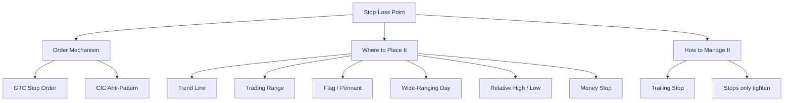

# Chapter 9 — Choosing Stop-Loss Points

> **Core thesis:** Successful chart-based trading depends less on being right
> often than on keeping losses small when wrong. A stop-loss point should be
> defined **before** the trade is entered, not after.

---

## 🧭 Concept Map

---

## 📚 Concepts in this chapter

| # | Concept | Note |
|---|---------|------|
| 1 | Stop-Loss Liquidation Point | [[Stop-Loss Liquidation Point]] |
| 2 | GTC (Good-Till-Canceled) Stop Order | [[GTC Stop Order]] |
| 3 | Trend Line Stop | [[Trend Line Stop]] |
| 4 | Trading Range Stop | [[Trading Range Stop]] |
| 5 | Flag / Pennant Stop | [[Flag and Pennant Stop]] |
| 6 | Wide-Ranging Day Stop | [[Wide-Ranging Day Stop]] |
| 7 | Relative High / Relative Low Stop | [[Relative High Low Stop]] |
| 8 | Money Stop | [[Money Stop]] |
| 9 | Trailing Stop | [[Trailing Stop]] |
| 10 | CIC (Cancel-If-Close) Anti-Pattern | [[CIC Anti-Pattern]] |

---

## 🔗 Cross-Chapter Links

- **Chapter 3 — Trends** → defines uptrend / downtrend lines used by [[Trend Line Stop]]
- **Chapter 4 — Trading Ranges** → defines the boundaries used by [[Trading Range Stop]]
- **Chapter 5 — Chart Patterns** → defines flags, pennants, wide-ranging days, relative highs/lows
- **Chapter 8 — Midtrend Entry & Pyramiding** → entry logic that **requires** a stop be defined before adding units
- **Chapter 10 — Setting Objectives** → companion chapter; objectives + stops together define every trade
- **Chapter 11 — The Most Important Rule** → "exit when the original premise is violated" — generalizes the stop concept
- **Chapter 16 — Planned Trading Approach** → embeds stop-loss placement in the broader risk-control plan (3% rule)
- **Chapter 17 — Trading Rules** → rules #13–#20 are essentially restatements of this chapter

---

## 🎯 The "Stop Hierarchy" decision tree

When choosing **which** technical stop to use, Schwager's order-of-preference reasoning is roughly:

1. Is there a clean **trend line** the position depends on? → [[Trend Line Stop]]
2. Did I enter on a breakout from a **range / flag / pennant / wide-ranging day**? → use the **opposite end** of that pattern
3. Is there a recent **relative high / low** within tolerable risk? → use it
4. Are *all* of the above too far away (risk too large)? → use a [[Money Stop]]
5. Trade going in your favor? → convert to a [[Trailing Stop]]

---

## ⚠️ The Two Cardinal Rules

1. **Decide the stop *before* you enter.**
2. **Stops only ever move in the direction that *reduces* risk.**
   Loosening a stop is the [[CIC Anti-Pattern]].
