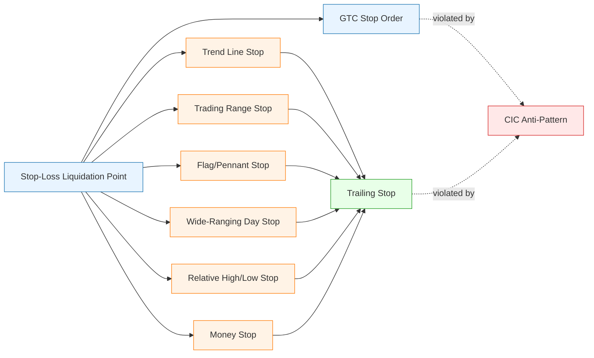

# Chapter 9 — Relationship Map

## 🌐 How the concepts fit together



## 🔑 The three layers

| Layer | Purpose | Concepts |
|-------|---------|----------|
| **Foundation** | The decision and the order that enforces it | [[Stop-Loss Liquidation Point]], [[GTC Stop Order]] |
| **Placement** | *Where* to put the stop | [[Trend Line Stop]], [[Trading Range Stop]], [[Flag and Pennant Stop]], [[Wide-Ranging Day Stop]], [[Relative High Low Stop]], [[Money Stop]] |
| **Management** | What to do *after* the trade goes your way | [[Trailing Stop]] |
| **Anti-pattern** | The behavior that destroys all of the above | [[CIC Anti-Pattern]] |

## 📐 Tightness vs Reliability spectrum

Use this mental ruler when picking which placement technique to use:

```
TIGHTER (less risk, more whipsaws)  ←————————————————→  LOOSER (more risk, fewer whipsaws)

  Trend Line   Wide-Ranging Day   Flag/Pennant   Relative High/Low   Trading Range   Money Stop*
                                                                                       (sized to budget)
```

\* Money Stop is the **fallback** when all of the above are too far away — its tightness is whatever the trader chooses.

## 🎯 Decision tree (in plain English)

1. Is there a clean, repeatedly-touched **trend line** under the position? → use it
2. Did I enter on a **breakout** from a range/flag/pennant/wide-ranging day?
   → use the **opposite end** of that pattern
3. Is there a **recent relative low** (long) within tolerable risk? → use it
4. Are *all* technical levels too far away? → use a **money stop** sized to risk budget
5. Trade going my way? → upgrade to a **trailing stop** that ratchets toward less risk
6. Tempted to cancel a stop because price is near it? → **stop**. That's the [[CIC Anti-Pattern]]. Reduce position size if needed, but never the discipline.

## 🔁 Cross-chapter dependencies

| Chapter 9 concept | Depends on (earlier) | Used by (later) |
|---|---|---|
| Stop-Loss Liquidation Point | Ch 7 (need for risk control) | Ch 10, 11, 16, 17 |
| GTC Stop Order | — | Ch 16 (planned approach) |
| Trend Line Stop | Ch 3 (trend lines) | Ch 17 |
| Trading Range Stop | Ch 4 (ranges) | Ch 8 (re-entry), Ch 12 |
| Flag/Pennant Stop | Ch 5 (continuation patterns) | Ch 8, Ch 12 |
| Wide-Ranging Day Stop | Ch 5, Appendix (true high/low) | Ch 17 (rule 18) |
| Relative High/Low Stop | Ch 3 (relative highs/lows) | Ch 10 (objectives) |
| Money Stop | Ch 16 (max-risk-per-trade rule) | Ch 14 (system design) |
| Trailing Stop | Relative High/Low Stop | Ch 10, 14, 17 |
| CIC Anti-Pattern | All of the above | Ch 11, 17, 18 |

## 🧩 Putting it all together — a single trade's life

```
ENTRY ─► place initial stop (technical or money) + GTC order
   │
   │   (price moves favorably)
   ▼
trade is profitable ─► raise stop to lock in profit (TRAILING stop)
   │
   │   (price approaches the stop)
   ▼
DO NOT CANCEL  ◄── the moment the CIC anti-pattern attacks
   │
   ▼
EXIT (loss capped at planned level, or open profit secured)
```
