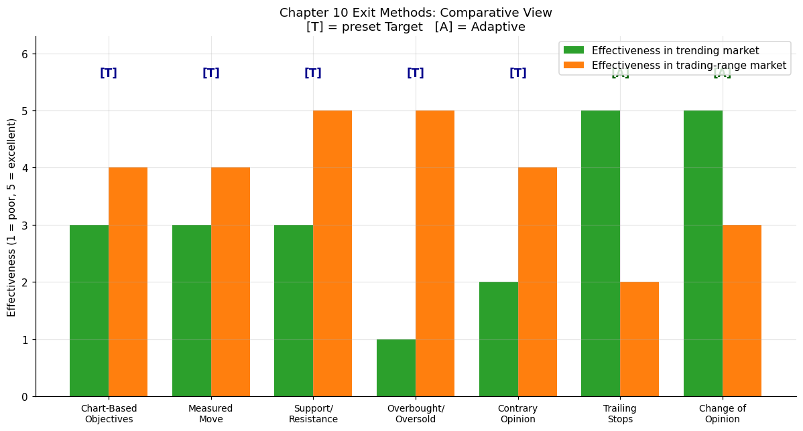
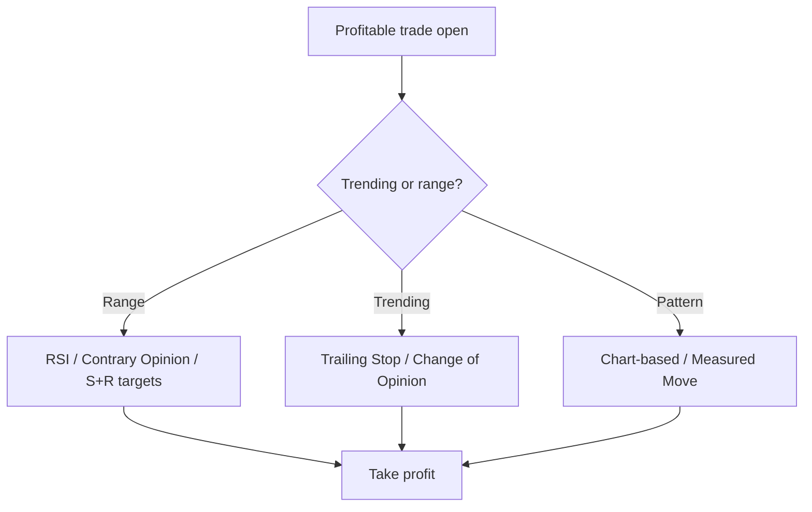

# Chapter 10 — Setting Objectives and Other Position Exit Criteria

> _"It never was my thinking that made the big money for me. It was always my sitting. Got that? My sitting tight! It is no trick at all to be right on the market."_ — Edwin Lefèvre (cited by Schwager)

## Big Picture

A losing trade has a clear exit: the predetermined stop-loss (see [[Chapter 09 - Choosing Stop-Loss Points]]). A **winning** trade is the harder problem: when do you take profits? Chapter 10 surveys seven approaches, splitting them into two families:

1. **Preset-target methods** — you define the exit price *before* the move plays out.
2. **Adaptive methods** — you let the market tell you when it's done.

## Concepts in this chapter

| # | Concept | Family | Best when... |
|---|---------|--------|--------------|
| 1 | [[01 - Chart-Based Objectives]] | Preset target | A clean chart pattern (H&S, triangle, flag) is in play |
| 2 | [[02 - Measured Move]] | Preset target | The market is making roughly equal swings |
| 3 | [[03 - Support and Resistance Objectives]] | Preset target | Strong prior highs/lows are visible above/below |
| 4 | [[04 - Overbought-Oversold Indicators (RSI)]] | Preset target | Market is in a trading range |
| 5 | [[05 - Contrary Opinion]] | Preset target (filter) | You have a sentiment data feed; never sole input |
| 6 | [[06 - Trailing Stops]] | Adaptive | Strong trends; you don't want to cap upside |
| 7 | [[07 - Change of Market Opinion]] | Adaptive | Long-term trend trading |

## How they relate to each other

Schwager's recommendation: don't pick one. **Combine** a preset target (e.g. measured move) for an initial profit-take with a trailing stop for the remainder of the position. Two or more targets that **coincide in the same price area** dramatically increase confidence — that's the central insight of Figures 10.1–10.3 in the book.

## Cross-chapter links

- [[Chapter 05 - Chart Patterns]] — supplies the patterns whose dimensions become Chart-Based Objectives.
- [[Chapter 04 - Trading Ranges and Support and Resistance]] — supplies the levels used in concept #3.
- [[Chapter 06 - Oscillators]] — full treatment of RSI and other oscillators referenced in #4.
- [[Chapter 09 - Choosing Stop-Loss Points]] — trailing stops are introduced there and reused here.
- [[Chapter 11 - The Most Important Rule in Chart Analysis]] — failed signals; useful as the "thesis broken" trigger in #7.
- [[Chapter 16 - The Planned Trading Approach]] — columns 11–12 of the trader's notebook are explicitly for objectives.

## Risk management context

- A target should never override a stop. Stops are non-negotiable; objectives are optional.
- Never widen a stop to give a position room. Stops only move in the risk-reducing direction. (Schwager: "CIC = cancel-if-close" is the anti-pattern.)
- Total open-position risk should not exceed roughly 25–35% of account equity (referenced in Chapter 16).
