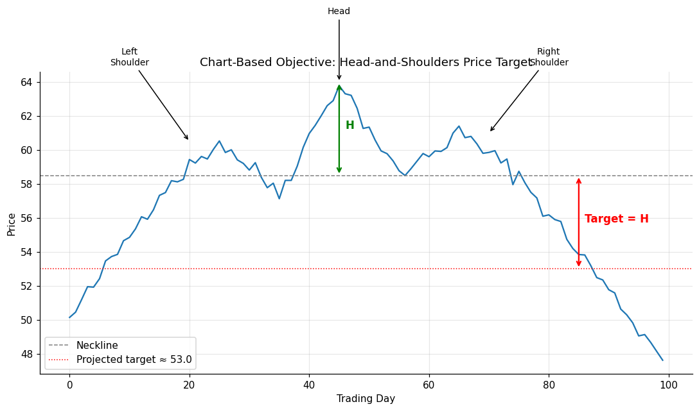

# 01 — Chart-Based Objectives

## Definition

A **chart-based objective** is an exit price for a winning position that is derived from the geometry of a recognized chart pattern. The pattern itself implies how far the move "should" travel once a confirming breakout occurs. Schwager's caution: chart patterns are **considerably more reliable as trade *signals* than as price *objectives*** — treat the projected target as a guideline, not a guarantee.

The classic example is the **head-and-shoulders**: once price closes through the neckline, the projected move from the neckline equals the vertical distance from the head to the neckline.

## Illustration



In this synthetic example:
- Head sits at ~64
- Neckline sits at ~58.5
- Head-to-neckline distance H ≈ 5.5
- Projected downside target after breakdown ≈ 58.5 − 5.5 = **53.0**

## Analogy

Think of a stretched rubber band held above a table. The further you pull it up before letting go (the head's distance above the neckline), the further it bounces *below* the table edge when it snaps. The pattern's height is the energy stored; the breakout is the release.

## Numeric example

A stock forms a head-and-shoulders top:
- Left shoulder: $60
- Head: $64
- Right shoulder: $61
- Neckline: $58

| Step | Calculation | Value |
|------|-------------|-------|
| Pattern height H | 64 − 58 | $6 |
| Neckline break confirms signal | close < $58 | — |
| Downside target | 58 − 6 | **$52** |

If you were short 100 shares from $58, your projected gain at target is $6 × 100 = **$600**.

## Code

See [`01_chart_based_objectives.py`](01_chart_based_objectives.py) — implements `project_head_shoulders_target()` plus `validate_pattern()` to sanity-check shoulder symmetry. Sample run:

```
Validation: OK
Head height above neckline: 6.00
Projected downside target after neckline break: 52.00
```

## Where it works well vs. poorly

| Situation | Effectiveness |
|-----------|---------------|
| Clean, textbook H&S / triangle / flag with strong volume signature | High |
| Choppy markets with overlapping patterns | Low — patterns are ambiguous |
| Strong trend overshooting projections | Mixed — target may underestimate move |
| Failed pattern (target never reached) | Use [[Chapter 11 - The Most Important Rule in Chart Analysis]] — failed signals reverse the bias |

## Relationships

### Within Chapter 10

- Compares closely with **[[02 - Measured Move]]**: both are preset, geometry-based targets. Measured Move uses *swing* sizes, chart-based objectives use *pattern* heights. They often produce coinciding targets — when they do, that target gains weight (this is exactly the "concentration" idea in Schwager's Figure 10.3).
- Often improved by **[[03 - Support and Resistance Objectives]]**: if the projected H&S target sits near a prior major low, that confluence boosts confidence.
- Complementary to **[[06 - Trailing Stops]]**: take partial profits at the chart target, ride the rest with a trailing stop.

### Outside Chapter 10

- The patterns themselves are catalogued in **[[Chapter 05 - Chart Patterns]]** (head-and-shoulders, triangles, flags, double tops/bottoms, rounded bottoms, etc.).
- The reverse case — when the projected target is *not* reached and the breakout fails — is the subject of **[[Chapter 11 - The Most Important Rule in Chart Analysis]]**: a failed signal is more reliable than the original signal.
- Logged in the trader's notebook (column 11–12 in the Chapter 16 template) — see **[[Chapter 16 - The Planned Trading Approach]]**.

## Source

Schwager, *Getting Started in Technical Analysis*, Chapter 10, "Chart-Based Objectives" (pp. 143–144).
