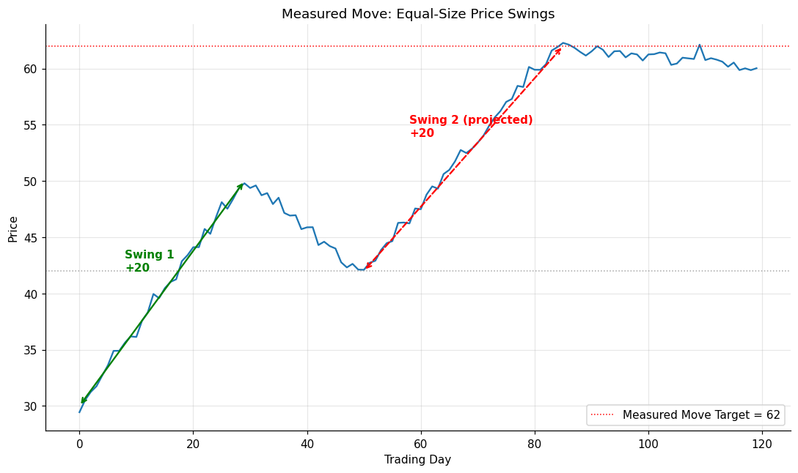

# 02 — Measured Move

## Definition

The **measured move** is the simplest possible price-projection technique: assume that markets tend to move in approximately equal-size price swings. After the market makes an initial swing of magnitude **S**, then retraces partially to a level **R**, the next swing in the original direction is projected to reach **R + S** (in an uptrend) or **R − S** (in a downtrend).

The reliability dramatically improves when **two or more measured-move targets coincide** in the same price area — Schwager calls this a *concentration of measured-move targets* and treats it as a strong target zone.

## Illustration



The first swing rallied from 30 → 50 (+20). After a pullback to 42, the projected next-swing target is 42 + 20 = **62** — which is where the synthetic series tops out.

## Analogy

Think of someone walking up a flight of stairs in groups of, say, three steps at a time, pausing on a landing, then climbing again. If the first push was three steps high, you bet the next push will also be roughly three steps. The landings (retracements) reset your reference; the swing size carries forward.

## Numeric example

| Phase | Price levels | Magnitude |
|-------|--------------|-----------|
| Initial rally | 30.00 → 50.00 | +20.00 |
| Pullback to | 42.00 | −8.00 |
| **MM target** | 42.00 + 20.00 | **62.00** |

If you bought 200 shares at $43 anticipating the second leg, projected profit at target = ($62 − $43) × 200 = **$3,800**.

**Concentration boost**: if a second swing analysis (say the entire decline from 50 to 42 magnified back up from a different reference) projects 62.50, and a third projects 61.80, you have a *cluster* near $62 — much more reliable than a single number.

## Code

See [`02_measured_move.py`](02_measured_move.py). The `cluster_targets()` helper groups multiple MM projections within a tolerance band so you can see at a glance which target zones have multiple confirming projections.

```
MM target clusters (center, count):
  62.17  x3  *** strong
  70.00  x1
```

## Where it works well vs. poorly

| Situation | Effectiveness |
|-----------|---------------|
| Multi-swing trends with consistent rhythm | High |
| Trends accelerating (each swing larger) | Underestimates target |
| Trends decelerating | Overestimates — target rarely reached |
| Single isolated swing — nothing to compare against | Low confidence |

Schwager's note on data: use **continuous futures** rather than nearest futures for measured-move analysis on commodities, because continuous futures preserve the true swing magnitudes across contract rollovers.

## Relationships

### Within Chapter 10

- Closest cousin to **[[01 - Chart-Based Objectives]]**: both project price targets from prior price geometry. Chart-based uses *patterns*, measured move uses *swings*. When both methods point at the same level, that level becomes a high-conviction target.
- Combines naturally with **[[03 - Support and Resistance Objectives]]**: a measured-move target that lands inside a prior resistance zone is two-confirming.
- Trumps **[[04 - Overbought-Oversold Indicators (RSI)]]** in trending markets — the RSI may scream "overbought" long before a measured move target is reached.
- Pairs with **[[06 - Trailing Stops]]**: take partial profit at the MM target, ride the remainder with a trailing stop.

### Outside Chapter 10

- The price swings themselves are defined relative to the **relative highs and relative lows** introduced in **[[Chapter 03 - Trends]]**.
- Used as a discretionary input in many of the worked examples in **[[Chapter 12 - Real-World Chart Analysis]]** (e.g. the British pound trade where the MM1 target marked the exit, Figure 12.4b).
- The cluster idea reappears in **[[03 - Support and Resistance Objectives]]** under the heading "concentrations of relative highs/lows."

## Source

Schwager, *Getting Started in Technical Analysis*, Chapter 10, "Measured Move" (pp. 144–147).
