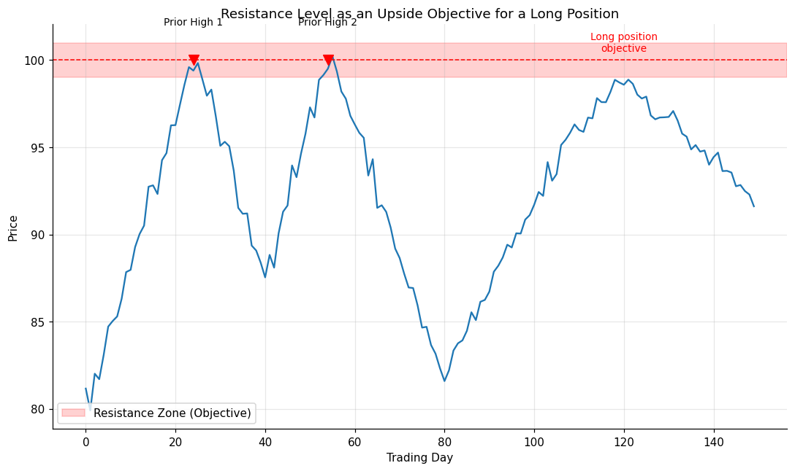

# 03 — Support and Resistance Levels as Objectives

## Definition

Use **prior support** levels as initial objectives for **short** positions; use **prior resistance** levels as initial objectives for **long** positions. The reasoning: traders who got trapped or who took profits at those prior turning points create supply (at resistance) or demand (at support) when price revisits the area, raising the probability that the move will pause or reverse there.

Schwager's important qualifier: support and resistance levels usually represent **temporary rather than major** objectives. So if you exit at one and the trend resumes, plan to **re-enter at a better price** if a reaction develops. Don't treat the exit as a permanent abandonment of the trade thesis.

## Illustration



Two prior highs cluster near $100. A long entered at $82 takes its initial objective just below that resistance zone (~$99.50) — close enough to fill before sellers arrive, far enough that you're not the last buyer in line.

## Analogy

Imagine driving up a hill on a road that has a known speed trap at a particular curve where two previous tickets were issued. Even if your car *could* go faster, sensible behavior is to slow down before that curve. The market does the same thing at prior highs — it's the place where past sellers showed up, so future sellers tend to as well.

## Numeric example

| Step | Value |
|------|-------|
| Long entry | $82.00 |
| Identified prior resistance cluster | $99.80 and $100.10 → average $99.95 |
| Buffer (place objective just inside) | 0.5% |
| **Sell-limit objective** | $99.95 × (1 − 0.005) = **$99.45** |
| Risk per share (stop at $80) | $2.00 |
| Reward per share | $17.45 |
| **Reward/risk ratio** | **8.7 : 1** |

If a pullback develops below $95 after the sell, the trader watches for re-entry signals around the previous breakout point.

## Code

See [`03_support_resistance_objectives.py`](03_support_resistance_objectives.py). The `cluster_levels()` helper groups nearby relative highs/lows so the strongest cluster (most touches) becomes the candidate objective. `set_objective()` then places the order with a small buffer inside the cluster.

```
Current price: 95.82
Objective for long position: 99.71
```

## Where it works well vs. poorly

| Situation | Effectiveness |
|-----------|---------------|
| Range-bound markets bouncing between known levels | Excellent |
| Approach to multi-touched horizontal level | Excellent |
| Strong breakout markets with no overhead supply | Poor — there's no resistance to brake the move |
| First-time visit to a level (no prior touches) | Weaker — fewer trapped traders, less supply |

## Relationships

### Within Chapter 10

- Operates on the same "prior price levels matter" principle as **[[02 - Measured Move]]**, but uses *static* horizontal levels instead of *projected* swing distances. They reinforce each other when targets coincide.
- Mirrors how **[[Chapter 09 - Choosing Stop-Loss Points]]** uses S/R for *stops*: same levels, opposite use — what's an objective for a long is a candidate stop level for a short, and vice versa.
- Often the most visible reference for **[[06 - Trailing Stops]]** placement (e.g. trail the stop just under the most recent support).

### Outside Chapter 10

- The full theory of support and resistance is **[[Chapter 04 - Trading Ranges and Support and Resistance]]** — including the concept of *concentrations* of relative highs/lows and the use of price envelope bands.
- The *failure* of a market to stop at established support/resistance is the foundation of **[[Chapter 11 - The Most Important Rule in Chart Analysis]]** — a level that breaks unexpectedly is the strongest signal in the book.
- Used heavily in worked examples throughout **[[Chapter 12 - Real-World Chart Analysis]]** (e.g. the soybean trade exited at a support zone implied by prior relative lows, Figure 12.17b).

## Source

Schwager, *Getting Started in Technical Analysis*, Chapter 10, "Support and Resistance Levels" (pp. 147–148).
