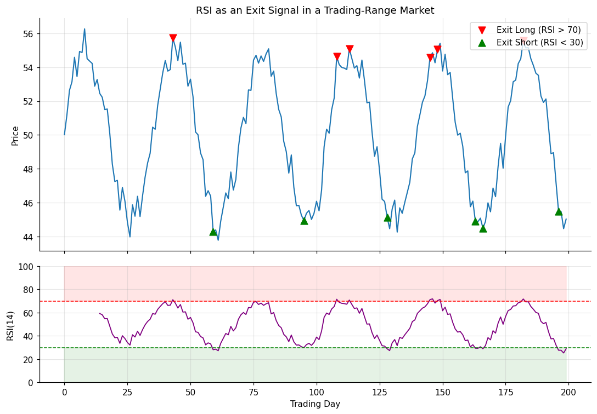

# 04 — Overbought/Oversold Indicators (RSI)

## Definition

**Overbought/oversold indicators** (a subset of oscillators) attempt to identify when prices have moved too far, too fast, and are vulnerable to a reaction. The **Relative Strength Index** (RSI), developed by Welles Wilder, is the canonical example. It is bounded between 0 and 100. Standard interpretation:

- RSI > 70 → overbought → consider exiting **long** positions
- RSI < 30 → oversold  → consider exiting **short** positions

Threshold choice (70/30 vs 80/20 vs 75/25) is a deliberate tradeoff: tighter thresholds (closer to extremes) catch better turning points but signal far less often.

The **critical caveat** Schwager hammers home: this method works well in **trading-range** markets and **fails badly** in **strongly trending** markets, where RSI can sit pinned above 70 (or below 30) for months while the trend keeps going.

## Illustration



In a sinusoidal range-bound market, every red triangle (RSI cross above 70) marked a profitable point to exit a long, and every green triangle (RSI cross below 30) marked a profitable point to exit a short. In a trending market this picture would look very different — repeated false sell signals during the trend.

## Analogy

A car's tachometer redlines when the engine is screaming. In stop-and-go traffic, hitting the redline is a useful warning to ease off. But on a long highway run, the engine can sit comfortably at high RPM for hours without anything being wrong. Same indicator, very different meanings depending on the *terrain* — and that's exactly what range vs. trend is.

## Numeric example

For a 14-day RSI:

| Day | Close | Δ Up | Δ Down |
|----|------:|-----:|-------:|
| 1 | 50.00 | — | — |
| 2 | 50.50 | 0.50 | 0 |
| 3 | 51.20 | 0.70 | 0 |
| ... | ... | ... | ... |

After 14 days, suppose the average up-move is **0.45** and the average down-move is **0.15**.

```
RS  = 0.45 / 0.15 = 3.0
RSI = 100 − 100 / (1 + 3.0) = 100 − 25 = 75
```

RSI is **75 ≥ 70** → overbought → exit long.

## Code

See [`04_rsi_overbought_oversold.py`](04_rsi_overbought_oversold.py). Implements Wilder's smoothing and a `rsi_exit_signals()` helper that fires only on the *cross* of the threshold (not while RSI sits above 70). Sample run on a synthetic range-bound series:

```
Latest RSI(14): 29.95
Latest price:   45.86
7 long-exit signals fired in this series.
  bar 38: price=53.64, RSI=70.15 -> exit_long: RSI crossed above overbought
```

## Where it works well vs. poorly

| Market regime | Effectiveness |
|---------------|--------------|
| Trading range / oscillating market | High |
| Strong trending market | **Poor** — repeated false signals on the wrong side of the trend |
| Choppy with frequent reversals | Mixed — many small wins and small losses |
| Use as a *filter* alongside trend-following entry | Useful supplementary input |

A common refinement is to require RSI to *cross back* through the threshold (e.g. wait for RSI to break back below 70 *after* having been above), which delays the exit but reduces "stop pinned at extreme" failures.

## Relationships

### Within Chapter 10

- Direct opposite of **[[06 - Trailing Stops]]** in temperament: RSI is most useful exactly where trailing stops are least useful (range-bound markets) and vice versa. A robust system uses both, switching emphasis based on a regime detector.
- Pairs with **[[03 - Support and Resistance Objectives]]**: an RSI overbought reading right at known resistance is a stronger exit signal than either alone.
- A close cousin of **[[05 - Contrary Opinion]]** — both measure "stretched-ness," one through price math, the other through trader surveys.

### Outside Chapter 10

- Full mathematics and other oscillators (MACD, Stochastics, Rate of Change, Price Oscillator) are detailed in **[[Chapter 06 - Oscillators]]**.
- RSI is also used as a *countertrend entry* signal in **[[Chapter 14 - Technical Trading Systems]]**, with the same range-vs-trend caveat.
- The exact RSI formula is also given in the **Appendix — Additional Concepts and Formulas**.
- The book's "Eighty-Two Trading Rules" (**[[Chapter 17]]**) explicitly warn against treating overbought/oversold as a primary signal.

## Source

Schwager, *Getting Started in Technical Analysis*, Chapter 10, "Overbought/Oversold Indicators" (pp. 148–150) and Chapter 6 for the underlying oscillator theory.
