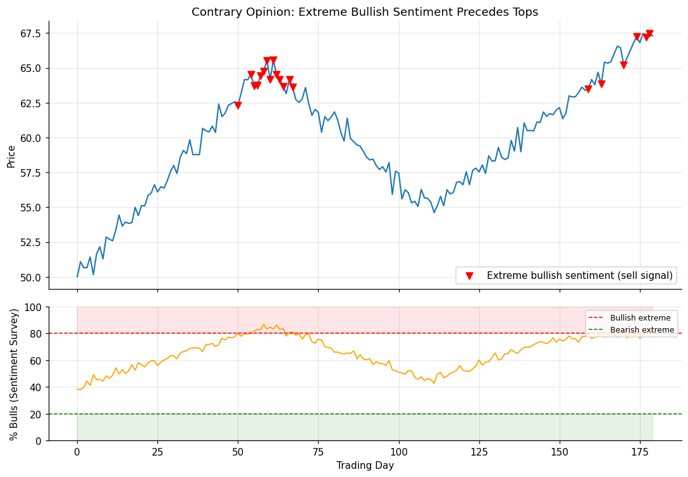

# 05 — Contrary Opinion

## Definition

**Contrary opinion** is the principle that when a large majority of speculators are bullish, those who *want* to be long *already are* — meaning there are few new buyers left to push prices higher, and the market is vulnerable to a downside reaction. The mirror argument applies when sentiment is extremely bearish.

Sentiment is measured indirectly via:
- Surveys of newsletter recommendations (e.g. Investors Intelligence)
- Trader/investor sentiment polls (AAII, Daily Sentiment Index)
- Implied indicators like put/call ratios, fund flows, mutual fund cash levels

Schwager's caveat is critical: the **Achilles' heel** of contrary opinion is that *measuring* market sentiment accurately is hard. Sentiment readings can stay extreme for weeks or months while the trend keeps going. Use it as one input among several — **never as the sole exit trigger**.

## Illustration



The orange line is a hypothetical % bulls reading. When sentiment crossed above 80% during the rally, a contrary-opinion sell signal fired — and was followed by the price top. Note also the symmetric (less common) case at the bear extreme.

## Analogy

Think of a packed elevator. When it's already so full that everyone shouting "I want to get in!" is already inside, the only direction the next person can move is *out*. Markets work similarly: when nearly everyone surveyed is already bullish, the next marginal trader has nowhere to go but the sell side.

A different angle: a popular restaurant. When *everyone* recommends it on social media, the line is around the block, you can't get in, and the experience disappoints. The crowd's enthusiasm is the leading indicator that the value has already been arbitraged away.

## Numeric example

Eight weekly readings of bull sentiment alongside a stock's price:

| Week | Bulls % | Price | Notes |
|-----:|--------:|------:|-------|
| 1 | 55 | 92.0 | Neutral |
| 2 | 62 | 96.0 | Climbing |
| 3 | 70 | 100.0 | — |
| 4 | 78 | 104.0 | Approaching extreme |
| 5 | 85 | 105.5 | Above 80% threshold |
| **6** | **88** | **102.0** | **Extreme + price reversal → exit long** |
| 7 | 80 | 98.0 | Confirmation |
| 8 | 65 | 92.0 | — |

The signal in week 6 combines the extreme sentiment with a 2-week price reversal — the confirmation lets you avoid the "extreme stays extreme" trap.

## Code

See [`05_contrary_opinion.py`](05_contrary_opinion.py). The `contrary_exit_signal()` function requires both:
1. Sentiment crossing the extreme threshold, **and**
2. A short-term price reversal in the appropriate direction

```
Bullish-extreme readings: [29, 36, 43]
Long-exit signal fires on day: 36
```

This dual-condition design is exactly the safety net Schwager recommends — a sentiment extreme alone is not enough.

## Where it works well vs. poorly

| Situation | Effectiveness |
|-----------|--------------|
| Major market tops/bottoms with documented sentiment euphoria/panic | Often excellent |
| Mid-trend, with sentiment merely elevated | Poor — extreme readings can persist |
| Newsletter sentiment used alone (no confirmation) | Risky — easily faked-out |
| Combined with technical confirmation (reversal day, thrust day) | Substantially improved |

Schwager: *"On balance, this method provides useful information as long as it is not used as the sole trading guideline."*

## Relationships

### Within Chapter 10

- Spiritually related to **[[04 - Overbought-Oversold Indicators (RSI)]]**: both measure "stretched-ness." RSI does it from price action; contrary opinion does it from people's stated views. They often confirm each other near major turning points.
- Stronger when paired with **[[01 - Chart-Based Objectives]]** or **[[02 - Measured Move]]**: a chart target that coincides with an extreme sentiment reading is high-conviction.
- Has a similar trending-market weakness as RSI — pair with **[[06 - Trailing Stops]]** to avoid premature exits during runaway trends.

### Outside Chapter 10

- Used as a countertrend entry input in **[[Chapter 14 - Technical Trading Systems]]** — same theory, different application (entry rather than exit).
- Trading rule #75 in **[[Chapter 17 - Eighty-Two Trading Rules]]** captures the asymmetry: extreme sentiment readings can occur without major tops/bottoms, but major tops/bottoms rarely occur without extreme sentiment readings (a useful one-way relationship).
- Discussed indirectly in **[[Chapter 18 - Market Wiz(ar)dom]]** when several of the wizards reference fading the consensus.

## Source

Schwager, *Getting Started in Technical Analysis*, Chapter 10, "Contrary Opinion" (pp. 150).
