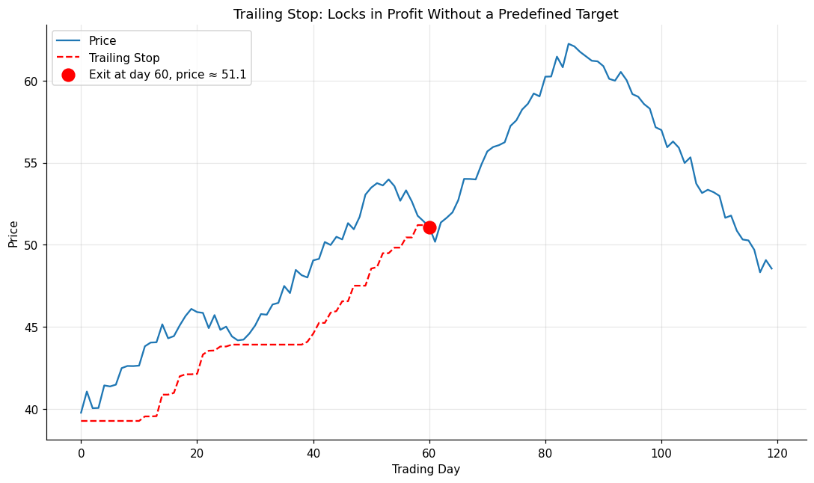

# 06 — Trailing Stops

## Definition

A **trailing stop** is a stop-loss that moves only in the direction of reduced risk: as price moves favorably, the stop ratchets up (for a long) or down (for a short), locking in profit. As Schwager puts it, this may be the least glamorous but **most sensible** method of determining a trade exit. It comes closest to the ideal of *"let your profits run"* because it imposes no preset target — the position rides as long as the trend is intact.

You will never sell the absolute high or buy the absolute low using a trailing stop. That's the price of admission for not capping your upside.

Three common varieties:

1. **Chart-point trailing stop** — e.g., close below the most recent N-day low (revised upward each new high).
2. **Percent or fixed-dollar trailing stop** — e.g., 8% below the highest close since entry.
3. **ATR-based trailing stop** — e.g., 3 × Average True Range below the highest close.

## Illustration



The red dashed line is a chart-point trailing stop. It steps up each time the rolling 10-day low rises. The position is liquidated on the close that breaks below the trailing line — *before* the larger downturn that follows.

## Analogy

Think of a parking brake on a car going up a hill. As the car climbs, you step up to a higher position on the slope and reset the brake. If the car ever rolls back down to where the brake is set, it stops there — you don't lose all the elevation you've gained, but you don't have to predict where the hill ends, either.

## Numeric example

Suppose you go long a stock at **$40** with these closes over five days:

| Day | Close | 10-day low | Trailing stop (= 10-day low − $0.50) |
|----:|------:|-----------:|--------------:|
| 1 | 42 | 40 | 39.50 |
| 2 | 45 | 40 | 39.50 |
| 3 | 48 | 40 | 39.50 |
| 4 | 51 | 42 | 41.50 |
| 5 | 53 | 45 | 44.50 |
| 6 | 50 | 45 | 44.50 |
| 7 | 47 | 45 | 44.50 |
| 8 | **44** | 44 | 44.50 → **stop hit** |

You exit at $44 with a **$4/share profit**. You missed the $9 unrealized peak ($53 − $44), but you also avoided unbounded losses if the stock had crashed.

## Code

See [`06_trailing_stop.py`](06_trailing_stop.py). Implements `chart_point_trailing_stop()` and `percent_trailing_stop()`. Sample run:

```
Entry price: 40.70
[Percent trailing, 8% drawdown]
  Exit at bar 101, price 56.64
  P/L per share: +15.94
```

The two methods deliberately give different exits in noisy data — chart-point is more responsive but more easily whipsawed; percent is smoother but gives back more open profit.

## Where it works well vs. poorly

| Situation | Effectiveness |
|-----------|--------------|
| Strong trending market | Excellent — large gains preserved |
| Range-bound market | Poor — repeated whipsaws |
| News-driven gap moves | Mixed — gap may skip over the stop |
| Small accounts with tight stops | Risky — noise alone trips the stop |

The most common error: **widening** the stop because you don't want to be stopped out at what you suspect is the bottom. Schwager labels the order to do this a "CIC" — *cancel if close*. Don't.

## Relationships

### Within Chapter 10

- Mirror image of **[[04 - Overbought-Oversold Indicators (RSI)]]** in regime preference: trailing stops thrive in trends, RSI thrives in ranges.
- Strong complement to **[[01 - Chart-Based Objectives]]** and **[[02 - Measured Move]]**: a robust setup is to take half the position off at the preset target and trail the rest with a stop.
- Conceptual cousin of **[[07 - Change of Market Opinion]]** — both are adaptive, both have no preset target, but trailing stops use a *price-mechanical* rule while change-of-opinion uses a *thesis-based* rule.
- Anchored to the support/resistance levels of **[[03 - Support and Resistance Objectives]]** — a chart-point trailing stop is typically placed just below the most recent support.

### Outside Chapter 10

- Introduced in detail in **[[Chapter 09 - Choosing Stop-Loss Points]]** along with money stops and the trader's notebook accounting for stops.
- Used in nearly every worked example of **[[Chapter 12 - Real-World Chart Analysis]]** — see for instance the T-bond trade exited on a "raised protective stop" (Figure 12.3b), where the lesson Schwager draws is that bringing stops in *closer than meaningful levels* exits good trades early.
- A key component of trade-exit rules in **[[Chapter 14 - Technical Trading Systems]]**, where they help solve problem #4 ("nonsensitive systems surrender too much profit").

## Source

Schwager, *Getting Started in Technical Analysis*, Chapter 10, "Trailing Stops" (p. 151), with cross-reference to Chapter 9.
