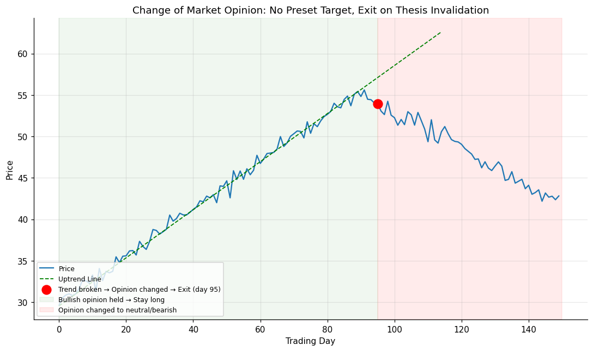

# 07 — Change of Market Opinion

## Definition

The **change of market opinion** approach sets *no predetermined objective at all*. The trader holds the position until the technical thesis that justified entering has changed to **at least neutral**. Schwager describes it as "another approach with very little flash, but lots of common sense."

Mechanically: define your entry thesis as a small set of explicit conditions (e.g., "uptrend line intact AND price above 50-day MA AND no major chart pattern reversal"). When **any** of those core conditions fails, you exit. No negotiation, no second-guessing.

The only thing that triggers the exit is the *invalidation of the reason for being in the trade*.

## Illustration



The position is held throughout the rising trend (green-shaded zone). Only when price decisively breaks the uptrend line does the bullish thesis fail — at that point the position is exited (red-shaded zone). No price target was ever consulted.

## Analogy

Imagine you're at a party because your best friend invited you. You don't have a planned departure time — you'll stay as long as your friend is having a good time. The moment your friend looks bored or says "I think I'm heading out," you leave too. The *reason* for being there is what determines when you go, not the clock.

Similarly: the *reason for being in the trade* is what determines exit, not a price tag.

## Numeric example

Setup: bought stock at **$31** based on two conditions:
1. Price above the 20-day moving average
2. Price above $26 (a wide protective floor at $5 below entry)

Trade evolution (compressed):

| Bar | Price | 20-day MA | Cond 1 | Cond 2 | Action |
|----:|------:|----------:|:------:|:------:|--------|
| 5 | 31.19 | 30.5 | ✓ | ✓ | Entry |
| 30 | 38.50 | 35.0 | ✓ | ✓ | Hold |
| 60 | 47.90 | 42.5 | ✓ | ✓ | Hold |
| 90 | 55.00 | 51.0 | ✓ | ✓ | Hold |
| 97 | **52.99** | 53.5 | ✗ | ✓ | **Exit** |

Exit at $52.99 → P/L = **+$21.80/share**. The exit is triggered by the price falling below the moving average — a clear thesis violation — even though no profit target was ever specified.

## Code

See [`07_change_of_opinion.py`](07_change_of_opinion.py). The `manage_position()` function holds while a list of `ThesisCondition`s remains true, and exits the bar any condition first becomes false. Sample run:

```
Entry  bar 5,   price 31.19
Exit   bar 97, price 52.99
P/L per share: +21.80
Reasons broken: ['Price above 20-day MA']
```

## Where it works well vs. poorly

| Situation | Effectiveness |
|-----------|--------------|
| Strong sustained trends — wants to ride them in full | Excellent |
| Discretionary discretionary trading with clear setup logic | Excellent |
| Very volatile choppy markets where conditions flip frequently | Whipsaw-prone |
| Beginners who can't articulate why they entered | Doesn't work — there's no thesis to invalidate |

The key prerequisite is intellectual honesty about *why* the trade was entered, written down at entry. If you can't list the conditions, you can't manage the trade this way.

## Relationships

### Within Chapter 10

- Sibling to **[[06 - Trailing Stops]]** — both are adaptive, both have no preset target. Trailing stops use a *price-mechanical* rule (e.g. 8% drawdown); change-of-opinion uses a *thesis-based* rule. They can be used together: thesis-break exits immediately; trailing stop catches scenarios where the thesis is technically intact but price action is still deteriorating.
- The opposite of **[[01 - Chart-Based Objectives]]** and **[[02 - Measured Move]]** in philosophy: those methods say "exit at this level"; this method says "exit when the reason is gone."
- Inverts **[[04 - Overbought-Oversold Indicators (RSI)]]** — RSI tries to tell you the trend is exhausted from price math alone; change-of-opinion ignores RSI unless RSI behavior was part of the original thesis.

### Outside Chapter 10

- Operationalized concretely by the **failed signal** doctrine of **[[Chapter 11 - The Most Important Rule in Chart Analysis]]**: when the breakout that justified the trade fails, that's the textbook "thesis broken" event.
- The trader's notebook in **[[Chapter 16 - The Planned Trading Approach]]** is designed for this approach: column 11–12 is for objectives (optional), but the entry reasons recorded at trade open *are* the thesis you're monitoring.
- Frequently illustrated in **[[Chapter 12 - Real-World Chart Analysis]]** — many of the trade-exit comments boil down to "the original premise of the trade was violated" (e.g. Figure 12.1b: "A trade should always be liquidated once the primary premise for the trade is violated").
- Supports trading rule #80 in **[[Chapter 17 - Eighty-Two Trading Rules]]**: maintain a trader's diary including reasons for trade — without the reasons, you cannot know when they're invalidated.

## Source

Schwager, *Getting Started in Technical Analysis*, Chapter 10, "Change of Market Opinion" (p. 151).
