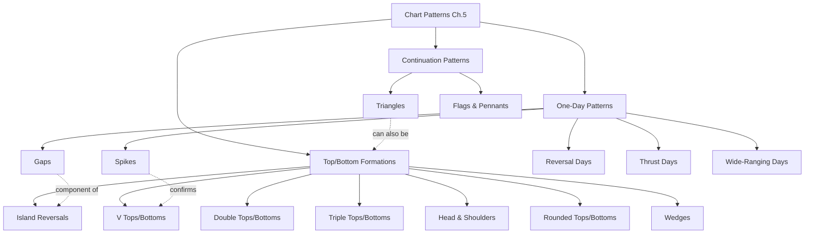

# Chapter 5 — Chart Patterns

> **Source:** Schwager, Jack D. *Getting Started in Technical Analysis* (Wiley, 1998), Ch. 5, pp. 73–109.
> **Theme:** "When people think of technical analysis, they often first think of well-known visual chart patterns…" — Schwager

Chart patterns are recurring shapes formed by price action that suggest probable future behavior. They fall into **three broad families**:

| Family | Purpose | Concepts |
|---|---|---|
| **One-Day Patterns** | Single-bar signals | [[Gaps]], [[Spikes]], [[Reversal Days]], [[Thrust Days]], [[Wide-Ranging Days]] |
| **Continuation Patterns** | Pauses *within* a trend | [[Triangles]], [[Flags and Pennants]] |
| **Top and Bottom Formations** | Major trend reversals | [[V Tops and Bottoms]], [[Double Tops and Bottoms]], [[Triple Tops and Bottoms]], [[Head and Shoulders]], [[Rounded Tops and Bottoms]], [[Wedges]], [[Island Reversals]] |

---

## Concept Map

---

## Cross-Chapter Links

- **[[Chapter 03 - Trends]]** — patterns either *continue* or *reverse* the trend defined here
- **[[Chapter 04 - Trading Ranges and Support and Resistance]]** — many patterns are breakouts from ranges; flags near range tops/bottoms are powerful signals
- **[[Chapter 09 - Choosing Stop-Loss Points]]** — pattern boundaries (other side of flag, neckline) provide natural stops
- **[[Chapter 10 - Setting Objectives]]** — measured-move targets often based on pattern height
- **[[Chapter 11 - The Most Important Rule]]** — *failed* patterns from this chapter are themselves powerful signals (bull/bear traps, filled gaps, penetrated H&S)

---

## Reading Order Recommendation

1. Start with [[Gaps]] (foundational, used inside other patterns)
2. [[Spikes]] → [[Reversal Days]] → [[Thrust Days]] → [[Wide-Ranging Days]] (single-bar family)
3. [[Triangles]] → [[Flags and Pennants]] (mid-trend pauses)
4. [[V Tops and Bottoms]] → [[Double Tops and Bottoms]] → [[Triple Tops and Bottoms]] → [[Head and Shoulders]] → [[Rounded Tops and Bottoms]] → [[Wedges]] → [[Island Reversals]] (reversals, in increasing reliability/complexity)

---

## Key Insight from Schwager

> The **direction of breakout** matters more than the textbook *type* of the pattern. A descending triangle is supposed to break down — but if it breaks up, trade the breakout, not the textbook.

This is the meta-lesson of Chapter 5: patterns are *probabilities*, not prophecies. Pair every pattern with the failure-mode from [[Chapter 11 - The Most Important Rule]].

#technical-analysis #chart-patterns #schwager #chapter-5
