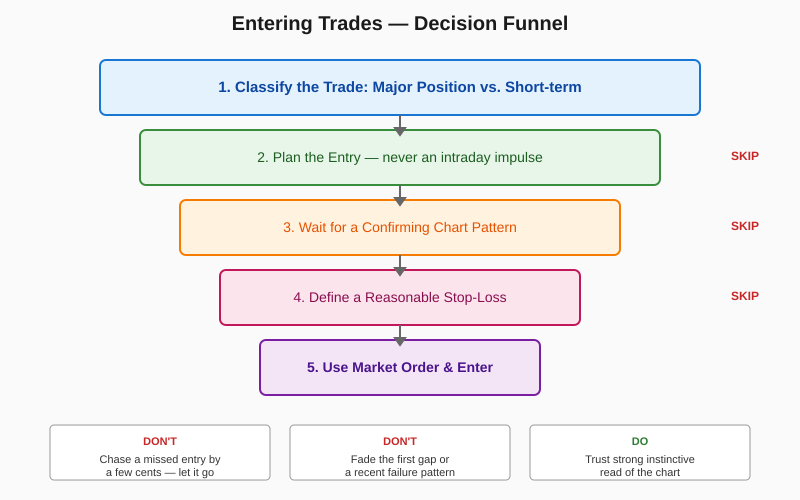

# Entering Trades

> *"The lost profit potential of one missed price move can offset the savings from 50 slightly better execution prices."* — Schwager

## Definition

A disciplined process for opening a position. Entry is treated as a **gated decision**, not a spontaneous reaction. Every entry must satisfy: (1) trade type is classified (major position vs. short-term), (2) the trade was planned in advance, (3) a confirming chart pattern exists, (4) a stop-loss is defined before entry, and (5) the trader is not chasing a missed price, fading a recent failure pattern, or fading the first gap of a move. For important entries, market orders are preferred over limit orders to guarantee fill.

## Illustration



## Analogy

Entering a trade is like merging onto a busy highway. You don't slam your foot down the moment you see daylight — you check your mirrors, signal, match speed, and merge cleanly. People who try to save two seconds by squeezing into a tiny gap (the "better entry price") cause accidents. People who hesitate forever miss the merge entirely and end up stuck on the on-ramp. The disciplined driver merges decisively when the conditions are right, even if the gap isn't perfect.

## Numeric Example

A trader spots a bull flag in **AAPL**:
- Account equity: **$100,000**
- Per-trade risk budget: **1% = $1,000**
- Planned entry: **$100.00** (on flag breakout)
- Stop-loss: **$94.00** (just below flag low)
- Risk per share: **$100 − $94 = $6**
- Position size: **$1,000 ÷ $6 = 166 shares** (round to 100 for clean lot)
- Order type: **market** (avoid missing a major move for $0.10)

If the trader had instead placed a limit at **$99.85** trying to save **$0.15/share**, and the breakout ran straight to $103 without filling, the cost of the missed move would be **$3.00 × 100 = $300** — versus the **$15** they would have saved.

## Code

See [`01_entering_trades.py`](../code/01_entering_trades.py) — implements `EntryChecklist`, `PlannedTrade`, and a "chasing" detector. Demo output:

```
ENTRY APPROVED — LONG 100 AAPL @ ~$100.00 (stop $94.00, risk $600.00) via market order

REJECTED:
  - No confirming chart pattern.
  - Trade is an intraday impulse, not planned.
  - Stop-loss not defined at entry.
```

## Relationships

### Within Chapter 17

| Connects To | How |
|---|---|
| [[02_Exiting_Risk_Control]] | Entry **requires** a stop-loss point — exit logic begins at entry |
| [[03_Money_Management]] | Position size is computed from the entry-to-stop distance |
| [[04_Holding_Winners]] | Differentiating major vs. short-term trades determines whether you'll let it run |
| [[06_Market_Patterns]] | The "confirming chart pattern" requirement is satisfied here |
| [[07_Analysis_Review]] | The reasons for entry must be written down at entry, not reconstructed |

**When does this concept work best?**
- Trending markets where breakouts produce clean continuation moves
- Liquid stocks where market orders don't suffer ruinous slippage
- Traders who have already developed pattern-recognition skills

**When it works poorly:**
- Choppy, range-bound markets — many "confirming patterns" produce whipsaws
- Illiquid securities — market orders cause large fills against you
- News-driven days where chart patterns lose predictive value

### Outside the Chapter

| Connects To | Reference |
|---|---|
| Chart Patterns | Chapter 5 — defines the patterns that count as "confirming" |
| Trends | Chapter 3 — major-position trades require an identified trend |
| Trading Ranges & Support/Resistance | Chapter 4 — stop placement uses these |
| Choosing Stop-Loss Points | Chapter 9 — the stop-loss methodology |
| Midtrend Entry & Pyramiding | Chapter 8 — special cases of entry |
| Real-World Chart Analysis | Chapter 12 — case studies of entry decisions |
| Planned Trading Approach | Chapter 16 — the broader system this entry rule lives in |

## Key Takeaways

- **Plan before you trade, never during.** Intraday impulse is the enemy.
- **A confirming pattern is non-optional.** No setup, no trade.
- **Don't fight your instincts when the chart "looks right."** And don't talk yourself into a setup that doesn't.
- **Don't chase a missed entry.** The next setup is more valuable than this one.
- **Use market orders for important entries.** A few cents of slippage is cheaper than missing the trade.
