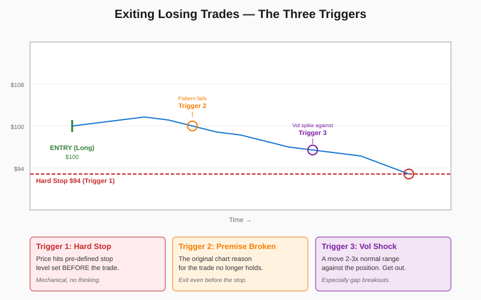

# Exiting Trades and Risk Control (Money Management)

> *"Always sell what shows you a loss and keep what shows you a profit."* — Edwin Lefèvre, quoted by Schwager

## Definition

Exit logic for **losing or troubled** positions, governed by three independent triggers that operate **before** the hard stop is hit. A trade should be liquidated when (1) the protective stop is reached, (2) the **original premise** for the trade is invalidated by new chart action, or (3) a **volatility shock** occurs against the position — particularly a gap breakout in the wrong direction. The principle: stops are the floor, not the ceiling, of when to exit.

## Illustration



## Analogy

Imagine you're hiking up a mountain and you set a rule: "I'll turn back if it gets dark." That's your hard stop. But mid-hike a thunderstorm rolls in, your map blows away, and a forecaster on the radio warns of flash floods. You don't wait for darkness — those are independent reasons to descend immediately. Each warning is a different signal, but they all mean the same thing: **the conditions you planned for no longer exist**. Sticking to your original "darkness rule" while ignoring storms and floods is how hikers die.

## Numeric Example

Long entry on **MSFT** at **$100.00**, hard stop at **$94.00**, normal daily range (ATR) ≈ **$2.00**.

| Day | What Happens | Trigger | Action |
|---:|---|---|---|
| 1 | Closes at **$98** (down $2) | None — within normal range | Hold |
| 2 | Pattern that defined the trade fails (flag broken to downside) | **Premise broken** | Exit @ $97.50 even though stop wasn't hit |
| Alt scenario | Stock opens at **$92** (gap of $6, 3× ATR) | **Gap breakout against** | Exit immediately on open |
| Alt scenario | Drops $5 in one bar (2.5× ATR) without breaking premise | **Vol shock** | Exit immediately |

The vol-shock and premise-broken exits typically save **$2–4 per share** vs. waiting for the hard stop to fire.

## Code

See [`02_exiting_risk_control.py`](../code/02_exiting_risk_control.py) — implements `check_exit()` evaluating all three triggers in priority order, with ATR computation. Demo output:

```
Scenario A (vol shock): trigger = hard_stop
  Exit @ $92.5, P/L = $-750.00

Scenario B (gap against): trigger = hard_stop

Scenario C (premise broken): trigger = premise_broken
```

## Relationships

### Within Chapter 17

| Connects To | How |
|---|---|
| [[01_Entering_Trades]] | A defined stop is **mandatory** at entry — exit planning starts there |
| [[03_Money_Management]] | The dollar risk between entry and stop sets position size |
| [[04_Holding_Winners]] | This concept handles **losers**; concept 4 handles **winners** — they're complementary halves |
| [[05_Trading_Psychology]] | "If your gut feeling says the trade is wrong, reverse it" — emotional courage to exit |
| [[06_Market_Patterns]] | A bull/bear trap forming AGAINST you is an immediate liquidation signal |

**When does this concept work best?**
- Volatile markets where ATR-based vol shocks are common and meaningful
- News-driven environments where premises change rapidly
- Long-term position trades where defending capital matters more than capturing every tick

**When it can hurt you:**
- Quiet, mean-reverting markets — premise-broken exits may fire on noise
- Very short timeframes — vol shocks are statistical artifacts, not signals
- After a long winning streak when overconfidence makes you ignore exit signals

### Outside the Chapter

| Connects To | Reference |
|---|---|
| Choosing Stop-Loss Points | Chapter 9 — *the* canonical methodology |
| Real-World Chart Analysis | Chapter 12 — case studies of exit decisions |
| The Most Important Rule | Chapter 11 — failed signals as exit triggers |
| Setting Objectives | Chapter 10 — counterpart for winning-trade exits |
| Trend-Following Systems | Chapter 14 — exit rules in mechanical systems |

## Key Takeaways

- **Define the stop at entry, before emotion enters the decision.**
- **Three independent exit triggers**: hard stop, premise broken, volatility shock.
- **Gap breakouts against you = liquidate immediately.** No second-guessing.
- **Reverse, don't just exit, when contradictory signals are strong.**
- **Never average down on a loser.** That's how small losses become career-ending.
- After a stop-out, **don't immediately re-enter** — wait for a fresh, fully-justified setup.
