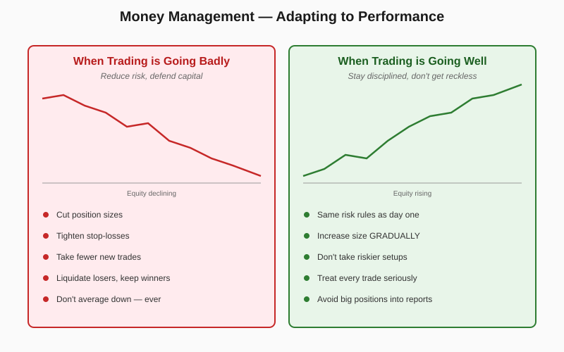

# Money Management — Other Risk-Control Rules

> *"When trading is going badly, reduce risk exposure by liquidating losing trades, not winning trades."* — Schwager

## Definition

A set of rules governing **position sizing and risk allocation that adapts to performance**. The core insight: trading behavior must change with the equity curve. During drawdowns, reduce position sizes, tighten stops, and slow new entries. During winning periods, **maintain discipline** — increase size only gradually, never suddenly, and never relax the rules that earned the gains. Spreads in futures get the same money-management respect as outright positions; small positions get the same respect as large ones.

## Illustration



## Analogy

Money management is like managing a household budget across good months and bad ones. When you get a raise, the worst thing you can do is immediately upgrade your car, your apartment, and your vacation plans — that's how lottery winners go broke. The disciplined approach is to keep living roughly the same way and slowly upgrade as the new income proves stable. Conversely, when you have a bad month, you don't double down on expensive habits hoping things turn around; you trim the discretionary spending until the situation stabilizes. Treating "small" positions casually is like saying "it's only a $20 lottery ticket" — the habit, not the amount, is what matters.

## Numeric Example

Account starts at **$100,000** with a **1% per-trade risk** rule.

**Scenario A — Account at $115,000 (+15%):**
- Gradual scaling: 1.0% × 1.10 = **1.10% per trade**
- Risk budget per trade: **$1,265**
- For a stop $3 below entry: **421 shares**

**Scenario B — Account at $88,000 (12% drawdown from peak of $100k):**
- Drawdown adjustment: 1.0% × 0.5 = **0.50% per trade**
- Risk budget per trade: **$440**
- For the same $3 stop distance: **146 shares** (about ⅓ of normal size)

**Liquidation priority during drawdown:** if four positions are open with P/L of −$2,200, +$1,200, −$800, +$400, the rule cuts the **−$2,200 loser first**, then the **−$800 loser** — never trim the +$1,200 winner unless absolutely necessary.

## Code

See [`03_money_management.py`](../code/03_money_management.py) — implements `RiskPolicy`, `Account`, equity-adaptive `position_size()`, and `liquidate_losers_first_priority()`. Demo:

```
Scenario A — equity +15%:
  shares: 421
  applied_risk_pct: 1.1
  notes: ['Equity +15.0% → gradual size scale x1.10']

Scenario B — drawdown 12%:
  shares: 146
  applied_risk_pct: 0.5
  notes: ['Drawdown 12.0% — risk halved to 0.50%']
```

## Relationships

### Within Chapter 17

| Connects To | How |
|---|---|
| [[01_Entering_Trades]] | Position size is computed from the entry/stop pair set there |
| [[02_Exiting_Risk_Control]] | When forced to reduce exposure, exit losers first |
| [[04_Holding_Winners]] | "Don't suddenly increase size after profits" applies to winning trades being held |
| [[05_Trading_Psychology]] | "Bad habits stay latent" — success is when discipline is most easily abandoned |
| [[07_Analysis_Review]] | Equity charts and segmented-trade analysis identify drawdown periods |

**When does this concept work best?**
- Long trading horizons where compounding matters
- Strategies with realistic win rates (40–60%) where streaks happen naturally
- Multi-position portfolios where correlation amplifies risk

**When it works poorly:**
- Very small accounts where minimum-size rounding makes adaptive sizing impractical
- Strategies with extreme outlier returns (sometimes large bets are correct)
- Single-position trading where there's nothing to liquidate

### Outside the Chapter

| Connects To | Reference |
|---|---|
| Planned Trading Approach | Chapter 16 — establishes the risk-control plan this rule operates within |
| Market Wiz(ar)dom | Chapter 18 — Eckhardt and others on risk control |
| Trend-Following Systems | Chapter 14 — diversification and equity-change adjustments |
| Trading Ranges | Chapter 4 — narrow ranges during reports = avoid large positions |

## Key Takeaways

- **Risk per trade flexes with equity**: cut sizes in drawdowns, scale gradually in expansions.
- **Cap total open risk** at ~25% of equity across all positions combined.
- **Cut losers first** when reducing exposure — keeping winners is mathematically and psychologically correct.
- **No sudden size jumps after a win streak.** Gradual increases only.
- **Treat small positions seriously.** "It's only one contract" is the gateway to bigger violations.
- **Avoid large positions into scheduled news** (earnings, government reports).
- **Spreads aren't safe.** Apply the same money management.
