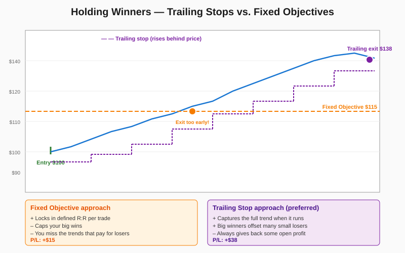

# Holding and Exiting Winning Trades

> *"The failure to adequately profit from correct trades is a key profit-limiting factor."* — Schwager

## Definition

Exit logic for **profitable** positions. Trailing stops (not fixed objectives) are the primary mechanism, because objectives systematically truncate the big winners that fund the entire trading approach. Quick small profits are forbidden in major position trades; if a fast profit is taken, it's because the move was abnormally rapid (e.g., 50–60% of an objective hit in a week) — and even then, only a partial exit is taken with a re-entry plan in mind. The trader avoids the emotional trap of wanting to be 100% right by always keeping a residual position for the duration of the trend.

## Illustration



## Analogy

A trailing stop is like a kite string. As the kite rises, you let out more line, but you never reel it in toward you while the wind is still blowing — that would crash the kite. You only haul the line in once the wind dies and the kite starts to fall. People who set fixed objectives are like kite-flyers who decide on the ground that the kite will go exactly 200 feet up and no further; on a windy day they're cutting the string while the kite still has lift left in it. The trailing-stop approach lets the wind decide how high the kite goes — the trader's job is simply to hold the string and only haul it in when the kite starts coming down on its own.

## Numeric Example

Long entry on **NVDA** at **$100**, with an initial objective of **$115** and a 2.5×ATR trailing stop (ATR ≈ $2, so 5-point trail).

| Day | High | Low | Close | Trail Stop | Notes |
|---:|---:|---:|---:|---:|---|
| 1 | 102 | 100 | 101 | 97.00 | initial trail |
| 4 | 110 | 106 | 109 | 105.00 | progress = 60% in 4 days → **partial exit on half** |
| 7 | 119 | 114 | 118 | 114.00 | trail ratchets up |
| 10 | 130 | 123 | 128 | 125.00 | parabolic — consider scale-up profits |
| 14 | 140 | 134 | 138 | 135.00 | trail near $135 |
| 15 | 138 | 130 | 132 | 135.00 | **stop hit at $135** |

**P/L comparison:**
- Fixed objective at $115 → exit half on day 6 → P/L = +$15/share
- Trailing stop → 50% exited at $109, 50% exited at $135 → blended P/L = **(0.5 × $9) + (0.5 × $35) = $22/share**

The trailing approach earned **47% more** on the same position by capturing the second half of the trend.

## Code

See [`04_holding_winners.py`](../code/04_holding_winners.py) — implements `TrailingStop` (ratchet-only), `WinnerPosition`, and the partial-profit "fast move" detector. Demo output shows:

```
Day  3: H=107 L=103 C=106.5 | trailing stop=102.00
  [partial profit] sold 100 shares of NVDA @ $109.00 (progress 60% in 4 days)
Day  4: H=110 L=106 C=109 | trailing stop=105.00
```

## Relationships

### Within Chapter 17

| Connects To | How |
|---|---|
| [[01_Entering_Trades]] | A short-term trade gets quick profit-taking; a major-position trade gets the trailing-stop treatment |
| [[02_Exiting_Risk_Control]] | This is the **counterpart**: that handles losers, this handles winners |
| [[03_Money_Management]] | Equity surging "too fast" triggers cautious scale-up profits |
| [[05_Trading_Psychology]] | The emotional pull to take profit early is the central enemy here |
| [[06_Market_Patterns]] | A reversal pattern (V-top, wide-range down day) overrides trailing logic |

**When does this concept work best?**
- Strong trending markets — trailing stops capture the full move
- Strategies with low win rates that depend on a few big winners
- Long-timeframe trading where letting positions breathe matters

**When it works poorly:**
- Choppy markets — trailing stops give back too much during retracements
- High-frequency strategies — fixed targets are more efficient
- Range-bound assets — there's no "trend to ride"

### Outside the Chapter

| Connects To | Reference |
|---|---|
| Setting Objectives and Position Exit Criteria | Chapter 10 — broader framework for objectives |
| Trend-Following Systems | Chapter 14 — trade exit and reentry rules |
| Real-World Chart Analysis | Chapter 12 — case studies of letting trends run |
| Midtrend Entry & Pyramiding | Chapter 8 — adding to winners is a special case |
| Market Wiz(ar)dom | Chapter 18 — Druckenmiller, Eckhardt on letting winners run |

## Key Takeaways

- **Don't take fast small profits in major trades.** Especially never on day one.
- **Trailing stops > fixed objectives** for the main exit mechanism.
- **Use objectives only as a "fast move" trigger** for partial profit-taking when 50–60% is hit in a week.
- **If you take partial profits, plan the re-entry.** Don't let the price level you exited at lock you out of a continuing trend.
- **Always keep a partial position** during a strong trend; full exits feel right but cost the most.
- **Patience applies to winners too.** Sitting in a working trade is harder than people admit.
