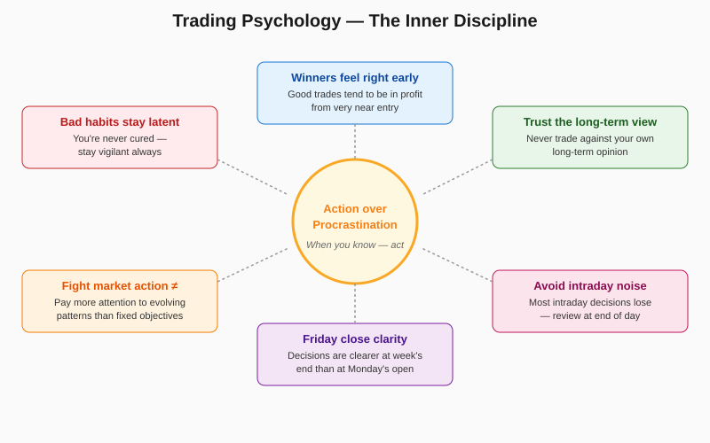

# Trading Psychology and Miscellaneous Principles

> *"You are never immune to bad trading habits — the best you can do is keep them latent."* — Schwager

## Definition

A cluster of behavioral rules that govern **how the trader acts**, independent of any specific setup. Five operating principles emerge: (1) prioritize evolving market action over rigid objectives and support/resistance levels, (2) act decisively when action is warranted — never procrastinate, (3) never trade against your own long-term opinion, (4) winning trades tend to be in profit very early, (5) end-of-week clarity beats Monday-open noise. Intraday decisions are mostly losers — keep the screen off during the day. Bad trading habits never leave; they just go dormant when discipline is high.

## Illustration



## Analogy

Trading psychology is like being on a diet. You're never "cured" of liking junk food — you just build habits that keep the temptation latent. The moment you tell yourself "I've got this under control, one cookie won't hurt," the old habits come roaring back. The other principles work the same way: a person on a diet who weighs themselves only on Friday after a full week of behavior gets cleaner data than someone who steps on the scale ten times a day reacting to bloat. And the dieter who feels strong cravings in the afternoon (intraday) typically caves — the time to plan tomorrow's meals is the night before, not at 3 PM when willpower is depleted.

## Numeric Example

A trader runs a 6-month study on the **Friday-close vs. Monday-open** rule:

| Entry Time | Trade Count | Win Rate | Avg P/L per Trade |
|---|---:|---:|---:|
| Friday near close | 9 | 78% | +$84 |
| Monday open | 8 | 50% | −$8 |

The data confirms the qualitative rule: **end-of-week clarity** translates into measurably better outcomes.

A separate **intraday-decision audit** over a quarter:

| Decision Type | Count | Avg P/L | Win Rate |
|---|---:|---:|---:|
| End-of-day planned | 47 | +$112 | 62% |
| Intraday impulse | 23 | −$48 | 35% |

The numbers vindicate the rule: intraday impulses cost the trader real money — about **$160 of relative P/L per intraday trade**.

## Code

See [`05_trading_psychology.py`](../code/05_trading_psychology.py) — implements `early_assessment()`, `FridayMondayStudy`, and `IntradayDecisionLog` for tracking decision quality. Demo output:

```
Day-1 flag: Trade underwater on day 1. Tighten stop and watch for premise-broken signals.
Fri/Mon study: friday: 78% win rate, +$84 avg | monday: 50% win rate, -$8 avg
Intraday-decision audit: avg_pnl: -$85, intraday-only avg: -$200
```

## Relationships

### Within Chapter 17

| Connects To | How |
|---|---|
| [[01_Entering_Trades]] | "Never an intraday impulse" applies the same rule at entry time |
| [[02_Exiting_Risk_Control]] | "If your gut says the trade is wrong, reverse" — psychological courage |
| [[03_Money_Management]] | "Bad habits stay latent" especially after a winning streak |
| [[04_Holding_Winners]] | "Winners are ahead from the start" — early performance as signal |
| [[07_Analysis_Review]] | Trader's diary captures the patterns these rules describe |

**When does this concept work best?**
- For traders who already have a defined methodology — psychology is the multiplier
- After 6+ months of trade logs that can be reviewed for behavioral patterns
- During emotionally charged markets (parabolic moves, crashes)

**When it doesn't help:**
- For pure-mechanical systems where human decisions don't enter the loop
- Very short timeframes where intraday IS the strategy
- Beginners who don't yet have enough trades to spot behavioral patterns

### Outside the Chapter

| Connects To | Reference |
|---|---|
| Market Wiz(ar)dom | Chapter 18 — full treatment of trading psychology |
| Real-World Chart Analysis | Chapter 12 — actual decisions made under emotional pressure |
| The Most Important Rule | Chapter 11 — discipline to take failed-signal trades |
| Trend-Following Systems | Chapter 14 — mechanical systems exist partly to bypass these biases |

## Key Takeaways

- **Act when action is warranted.** Procrastination is a decision with negative expected value.
- **Never trade against your own long-term view.** "Dancing between the raindrops" gets you wet.
- **Day-1 underwater is a yellow flag.** Tighten the stop; watch for premise breaks.
- **Use Friday's close as your weekly decision point.** The week's full evidence is in.
- **Intraday decisions are usually losers.** Keep the screen off during market hours when possible.
- **Listen to vivid market dreams.** They're often the subconscious naming a pattern the conscious mind suppressed.
- **You're never cured of bad habits.** The day you feel safe is the day they return.
