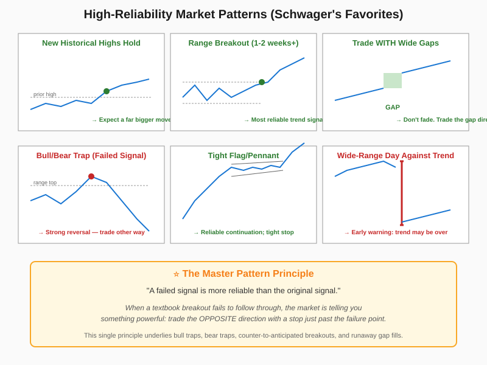

# Market Patterns

> *"A failed signal is more reliable than the original signal."* — Schwager (the master rule)

## Definition

A catalog of high-probability chart patterns and the master principle that organizes them: **failed conventional signals are themselves more powerful signals in the opposite direction**. Specific patterns Schwager flags as particularly reliable include: new historical highs that hold (expect a far bigger move beyond), narrow consolidations near the top of broader trading ranges (bullish), 1-to-2-week+ range breakouts, gaps in the trend direction (trade with them, never fade), bull/bear traps (failed range breakouts), tight flags and pennants as continuation signals, wide-ranging days against the prevailing trend (trend-change warnings), spike reversals, and the failure of a market to follow through on bullish/bearish news.

## Illustration



## Analogy

Market patterns are like crowd behavior in a stadium. When a crowd surges toward an exit (a breakout) and **keeps moving**, that's the trend confirming itself — get out of the way and go with them. But when a crowd surges toward an exit and then suddenly **reverses, panicked, back into the stadium** (a bull/bear trap), something has spooked them — and that something is much bigger than the original reason they started moving. Smart observers don't try to predict where the crowd will go; they watch what the crowd actually does, and they trust failed surges more than confirmed ones, because reversals reveal hidden information that the original move concealed.

## Numeric Example

A stock has been range-bound between **$98 and $102** for **20 days**. Then:

**Scenario A — Confirmed breakout:**
- Day 21 closes at **$104**, above the range high
- Days 22–28: holds above $102, makes new high at **$108**
- Pattern says: trade with it, target the projected continuation
- **Trade**: Long at $104, stop at $101.50, target trailing-stop driven

**Scenario B — Bull trap:**
- Day 21 closes at **$104** (apparent breakout)
- Day 23 closes at **$101** (back into range — initial confirmation: median = $100)
- Day 25 closes at **$98** (strong confirmation: returned to lower bound)
- Pattern says: failed signal — trade the OPPOSITE direction
- **Trade**: Short at $98, stop at $104.50 (the bull-trap high), expect downside follow-through

The trap signal in Scenario B is statistically **more reliable** than Scenario A's confirmation, because the failure reveals that no real demand existed above $102.

## Code

See [`06_market_patterns.py`](../code/06_market_patterns.py) — implements detectors for `is_new_historical_high_holding()`, `is_range_breakout()`, `is_wide_gap()`, `is_bull_trap()`, `is_bear_trap()`, and `failed_signal_check()`. Demo:

```
Range breakout detection: up
Wide gap: up
Failed up-breakout suggests: down
```

## Relationships

### Within Chapter 17

| Connects To | How |
|---|---|
| [[01_Entering_Trades]] | These patterns are the "confirming chart pattern" required for entry |
| [[02_Exiting_Risk_Control]] | Bull/bear trap forming AGAINST your position = liquidate immediately |
| [[04_Holding_Winners]] | Wide-range day against trend = trim or trail tighter |
| [[05_Trading_Psychology]] | Selling at new historical highs is "the amateur's worst mistake" |
| [[07_Analysis_Review]] | Patterns chart book records these in real time and follows up |

**When do these patterns work best?**
- Liquid markets where multiple participants validate the breakout/failure
- Stocks/futures with clear range structure (not noisy chop)
- After confirmation conditions are met (e.g., price retracement past median for traps)

**When they fail:**
- Thin, low-volume markets where false moves are common
- During major news events that bypass normal pattern logic
- When traders force a pattern label on price action that's actually random

### Outside the Chapter

| Connects To | Reference |
|---|---|
| Chart Patterns | Chapter 5 — *the* foundational treatment of these patterns |
| The Most Important Rule | Chapter 11 — failed signals as the most important rule in chart analysis |
| Trading Ranges & Support/Resistance | Chapter 4 — the range structure that makes traps possible |
| Trends | Chapter 3 — provides the directional context |
| Real-World Chart Analysis | Chapter 12 — case studies showing these patterns in action |
| Oscillators | Chapter 6 — extreme sentiment readings that often coincide |

## Key Takeaways

- **The master rule:** failed signals are more reliable than the originals.
- **New highs that hold** signal much bigger moves to come — don't sell into them.
- **1–2 week+ range breakouts** are among the most reliable trend signals.
- **Trade with wide gaps**, never fade them.
- **Tight flags/pennants** allow trend continuation entries with close stops.
- **Wide-range counter-trend days** are early warnings of trend reversal.
- **Failure to follow through on news** signals an imminent reversal.
- **Relative strength** (firm when peers are weak) signals intrinsic strength.
- **Curved consolidations** suggest accelerated moves in the curve's direction.
