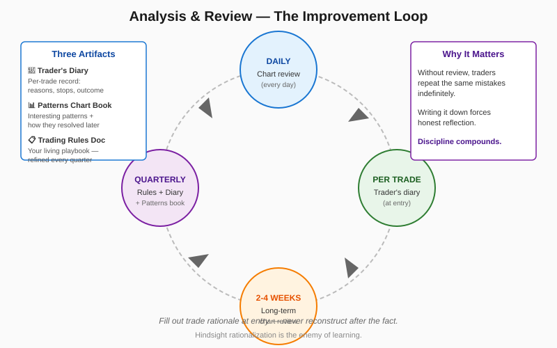

# Analysis and Review

> *"Most traders will repeat a mistake many times before the lesson finally sinks in."* — Schwager

## Definition

A continuous-improvement loop built on three durable artifacts and four review cadences. The artifacts are: (1) a **trader's diary** with one entry per trade containing reasons, intended stop, intended objective, follow-up, and lessons — filled out **at entry** so reasons aren't reconstructed; (2) a **patterns chart book** logging interesting patterns observed in real time, with predicted outcomes followed up later to measure forecasting accuracy; (3) the **trading rules document** itself. The cadences are: charts daily, long-term charts every 2–4 weeks, and a quarterly rotation through the three artifacts (diary, patterns book, rules) — though anything can be reviewed sooner if useful.

## Illustration



## Analogy

A trader's review system is like a pilot's flight log combined with a chef's recipe notebook. The flight log records every decision made during a flight: what the conditions were, what the pilot decided, how it turned out, what they'd do differently. After 500 flights, patterns emerge — "I always misjudge crosswind landings at airport X" — that no single flight could reveal. The recipe notebook captures interesting techniques observed in others' kitchens or invented in your own, with notes on how they actually tasted versus how the cook predicted they would. Both artifacts only work if you write the prediction **before** the result. A pilot writing "I knew it was a bad idea" after a rough landing learns nothing; one who writes "winds are 15kt — I'll come in at 110 IAS" before each landing builds a real model of their own judgment.

## Numeric Example

A trader maintains a patterns book for **6 months**. After follow-ups, the data shows:

| Pattern Type | Observations | Prediction Accuracy |
|---|---:|---:|
| Bull/bear traps | 18 | 78% |
| Range breakouts (>2 weeks) | 12 | 75% |
| Tight flag continuations | 24 | 71% |
| New historical highs holding | 7 | 86% |
| V-tops/V-bottoms (early call) | 9 | 33% |
| Symmetrical triangles | 14 | 50% |

The data tells the trader **where to focus and where to be cautious**: V-reversal calls are coin flips at best — that pattern should be downweighted in the playbook. Triangles aren't predictive enough to trade on their own. New-high holds and traps are the highest-conviction patterns in this trader's hands.

A separate **trader's diary review** of the last quarter's losers reveals that **8 of 11 losses** had the same lesson written on them: *"entered without confirming pattern."* The rules document is updated to make confirming patterns a hard prerequisite — and the next quarter's losing-trade count drops to 4.

## Code

See [`07_analysis_review.py`](../code/07_analysis_review.py) — implements `TradersJournal` with persistent JSON storage, `DiaryEntry`, `PatternEntry`, review-overdue scheduling, and `pattern_accuracy()` statistics. Demo:

```
Overdue reviews:
  - daily_charts
  - long_term_charts
  - rules
  - diary
  - patterns_book

Pattern accuracy: {'reviewed': 1, 'accuracy_pct': 0.0}
```

## Relationships

### Within Chapter 17

| Connects To | How |
|---|---|
| [[01_Entering_Trades]] | "Entry reasons must be written at entry, not reconstructed later" |
| [[02_Exiting_Risk_Control]] | The diary captures whether the right exit trigger fired |
| [[03_Money_Management]] | Equity charts and segmented-trade analysis live in this concept |
| [[04_Holding_Winners]] | The diary catches the recurring "exited too soon" lesson |
| [[05_Trading_Psychology]] | The diary IS where bad-habit patterns become visible |
| [[06_Market_Patterns]] | The patterns chart book is built directly from this concept |

**When does this concept work best?**
- Long trading careers where compounding wisdom matters
- Strategies that depend on subjective pattern recognition (ones that need calibration)
- Periods of poor performance — that's when the diary pays the most

**When the discipline lapses (and how it shows up):**
- During winning streaks, when "I don't need this" feels true
- When the trader is too busy — "review every day, especially when busy" exists for this reason
- During emotionally charged periods (after big losses) when honest review feels painful

### Outside the Chapter

| Connects To | Reference |
|---|---|
| Planned Trading Approach | Chapter 16 — establishes the trader's notebook structure this builds on |
| Real-World Chart Analysis | Chapter 12 — explicitly demonstrates the diary-style approach |
| Testing and Optimizing Trading Systems | Chapter 15 — the systematic counterpart of subjective review |
| Market Wiz(ar)dom | Chapter 18 — successful traders all keep some version of this |

## Key Takeaways

- **Three artifacts, three cadences.** Diary, patterns book, rules — reviewed in rotation.
- **Write reasons AT ENTRY**, never after the outcome is known. Hindsight rationalization kills learning.
- **Daily review beats brilliance.** Especially when you're too busy.
- **Predict, then follow up.** The patterns book only works if predictions precede outcomes.
- **Capital-letters lessons with exclamation points.** Make repeated mistakes painful to read.
- **The system compounds.** Year-one journal is a curiosity; year-five journal is your edge.
- **Bad habits show up in the data first.** That's why this concept matters most when you're winning.
