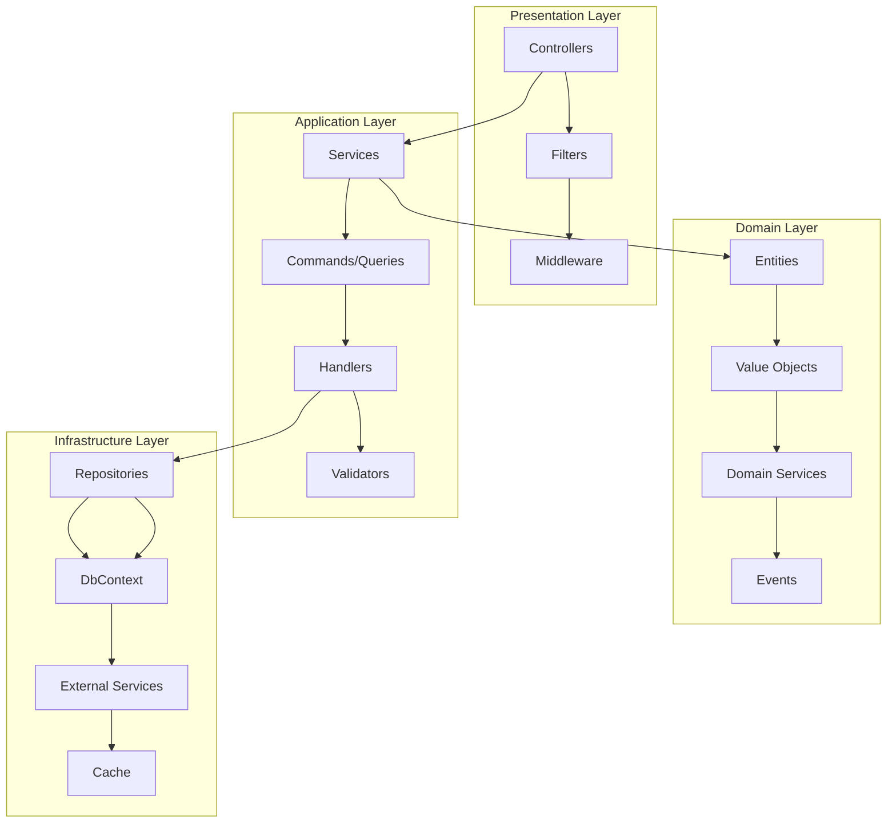
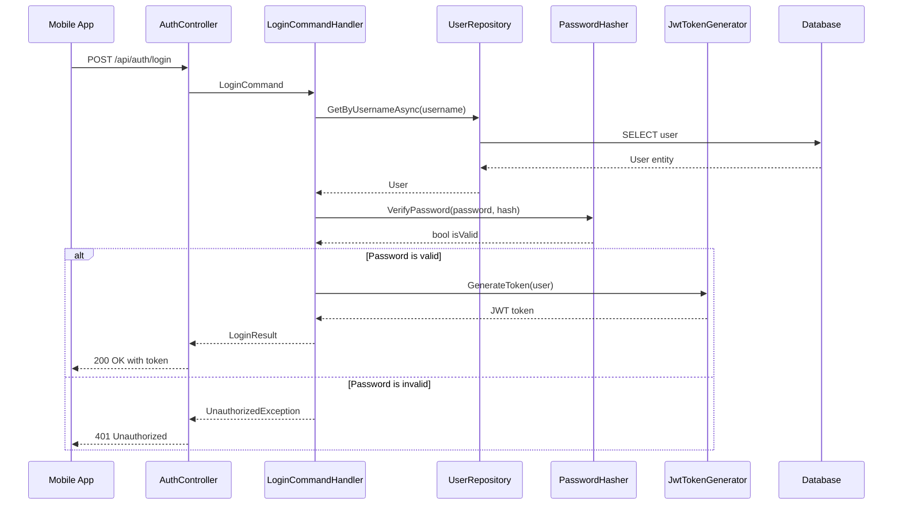
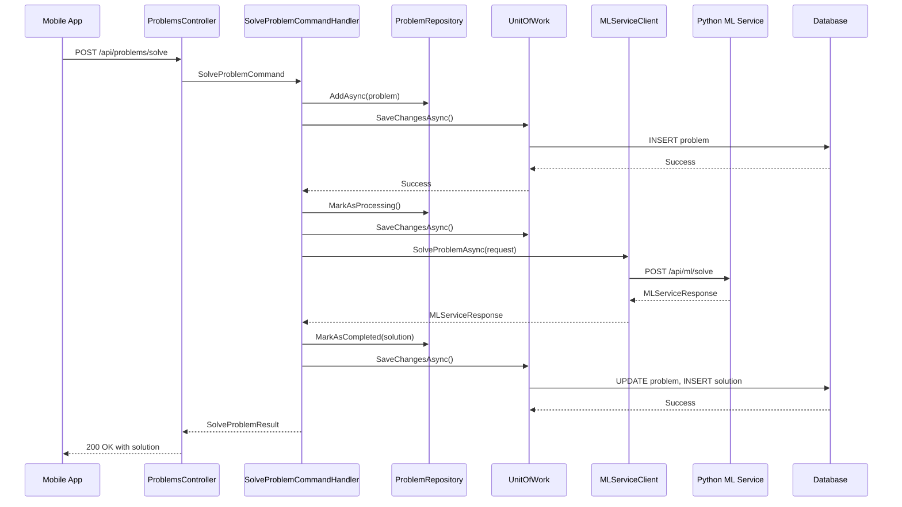

# Backend Design - .NET Core 8.0 Web API Service

## Overview

The backend is a .NET Core 8.0 Web API service that handles authentication, business logic, database operations, and communication with the Python ML service. The design follows Clean Architecture principles with Domain-Driven Design (DDD) patterns, implementing the "Think Big, Start Small" approach.

## Architecture Pattern

The backend follows **Clean Architecture** with **CQRS (Command Query Responsibility Segregation)** and **Repository Pattern** for data access.

### Core Design Patterns

1. **Repository Pattern** - Data access abstraction
2. **Unit of Work Pattern** - Transaction management
3. **Factory Pattern** - Service and handler creation
4. **Strategy Pattern** - Multiple authentication methods
5. **Observer Pattern** - Event handling and notifications
6. **Adapter Pattern** - External service integration
7. **Singleton Pattern** - Configuration and shared services

## System Architecture



## Domain Model (Start Small)

### Core Entities

```csharp
// Domain/Entities/User.cs
public class User : BaseEntity
{
    public string Username { get; private set; }
    public string PasswordHash { get; private set; }
    
    // Private constructor for EF Core
    private User() { }
    
    public User(string username, string passwordHash)
    {
        Username = username ?? throw new ArgumentNullException(nameof(username));
        PasswordHash = passwordHash ?? throw new ArgumentNullException(nameof(passwordHash));
        CreatedAt = DateTime.UtcNow;
    }
    
    public bool ValidatePassword(string password, IPasswordHasher passwordHasher)
    {
        return passwordHasher.VerifyPassword(password, PasswordHash);
    }
    
    public void UpdatePassword(string newPasswordHash)
    {
        PasswordHash = newPasswordHash;
        UpdatedAt = DateTime.UtcNow;
    }
}

// Domain/Entities/Problem.cs
public class Problem : BaseEntity
{
    public Guid UserId { get; private set; }
    public string ImageUrl { get; private set; }
    public string Category { get; private set; }
    public ProblemStatus Status { get; private set; }
    
    // Navigation properties
    public User User { get; private set; }
    public Solution Solution { get; private set; }
    
    private Problem() { }
    
    public Problem(Guid userId, string imageUrl, string category)
    {
        UserId = userId;
        ImageUrl = imageUrl ?? throw new ArgumentNullException(nameof(imageUrl));
        Category = category ?? throw new ArgumentNullException(nameof(category));
        Status = ProblemStatus.Pending;
        CreatedAt = DateTime.UtcNow;
    }
    
    public void MarkAsProcessing()
    {
        Status = ProblemStatus.Processing;
        UpdatedAt = DateTime.UtcNow;
    }
    
    public void MarkAsCompleted(Solution solution)
    {
        Status = ProblemStatus.Completed;
        Solution = solution;
        UpdatedAt = DateTime.UtcNow;
    }
}

// Domain/Entities/Solution.cs
public class Solution : BaseEntity
{
    public Guid ProblemId { get; private set; }
    public List<SolutionStep> Steps { get; private set; }
    public decimal Confidence { get; private set; }
    
    // Navigation property
    public Problem Problem { get; private set; }
    
    private Solution() 
    {
        Steps = new List<SolutionStep>();
    }
    
    public Solution(Guid problemId, List<SolutionStep> steps, decimal confidence)
        : this()
    {
        ProblemId = problemId;
        Steps = steps ?? throw new ArgumentNullException(nameof(steps));
        Confidence = confidence;
        CreatedAt = DateTime.UtcNow;
    }
}

// Domain/ValueObjects/SolutionStep.cs
public class SolutionStep : ValueObject
{
    public int StepNumber { get; private set; }
    public string Description { get; private set; }
    public string Formula { get; private set; }
    public string Explanation { get; private set; }
    
    public SolutionStep(int stepNumber, string description, string explanation, string formula = null)
    {
        StepNumber = stepNumber;
        Description = description ?? throw new ArgumentNullException(nameof(description));
        Explanation = explanation ?? throw new ArgumentNullException(nameof(explanation));
        Formula = formula;
    }
    
    protected override IEnumerable<object> GetEqualityComponents()
    {
        yield return StepNumber;
        yield return Description;
        yield return Formula;
        yield return Explanation;
    }
}

// Domain/Enums/ProblemStatus.cs
public enum ProblemStatus
{
    Pending = 0,
    Processing = 1,
    Completed = 2,
    Failed = 3
}
```

### Base Classes

```csharp
// Domain/Common/BaseEntity.cs
public abstract class BaseEntity
{
    public Guid Id { get; protected set; } = Guid.NewGuid();
    public DateTime CreatedAt { get; protected set; }
    public DateTime? UpdatedAt { get; protected set; }
    
    private readonly List<IDomainEvent> _domainEvents = new();
    public IReadOnlyCollection<IDomainEvent> DomainEvents => _domainEvents.AsReadOnly();
    
    public void AddDomainEvent(IDomainEvent domainEvent)
    {
        _domainEvents.Add(domainEvent);
    }
    
    public void RemoveDomainEvent(IDomainEvent domainEvent)
    {
        _domainEvents.Remove(domainEvent);
    }
    
    public void ClearDomainEvents()
    {
        _domainEvents.Clear();
    }
}

// Domain/Common/ValueObject.cs
public abstract class ValueObject
{
    protected static bool EqualOperator(ValueObject left, ValueObject right)
    {
        if (ReferenceEquals(left, null) ^ ReferenceEquals(right, null))
            return false;
        return ReferenceEquals(left, null) || left.Equals(right);
    }
    
    protected static bool NotEqualOperator(ValueObject left, ValueObject right)
    {
        return !(EqualOperator(left, right));
    }
    
    protected abstract IEnumerable<object> GetEqualityComponents();
    
    public override bool Equals(object obj)
    {
        if (obj == null || obj.GetType() != GetType())
            return false;
            
        var other = (ValueObject)obj;
        return GetEqualityComponents().SequenceEqual(other.GetEqualityComponents());
    }
    
    public override int GetHashCode()
    {
        return GetEqualityComponents()
            .Select(x => x?.GetHashCode() ?? 0)
            .Aggregate((x, y) => x ^ y);
    }
}
```

## Application Layer

### CQRS Implementation

```csharp
// Application/Common/Interfaces/ICommand.cs
public interface ICommand<out TResponse> : IRequest<TResponse> { }

// Application/Common/Interfaces/IQuery.cs
public interface IQuery<out TResponse> : IRequest<TResponse> { }

// Application/Common/Interfaces/ICommandHandler.cs
public interface ICommandHandler<in TCommand, TResponse> : IRequestHandler<TCommand, TResponse>
    where TCommand : ICommand<TResponse> { }

// Application/Common/Interfaces/IQueryHandler.cs
public interface IQueryHandler<in TQuery, TResponse> : IRequestHandler<TQuery, TResponse>
    where TQuery : IQuery<TResponse> { }
```

### Authentication Commands and Queries

```csharp
// Application/Features/Authentication/Commands/LoginCommand.cs
public class LoginCommand : ICommand<LoginResult>
{
    public string Username { get; set; }
    public string Password { get; set; }
}

public class LoginCommandHandler : ICommandHandler<LoginCommand, LoginResult>
{
    private readonly IUserRepository _userRepository;
    private readonly IPasswordHasher _passwordHasher;
    private readonly IJwtTokenGenerator _jwtTokenGenerator;
    private readonly ILogger<LoginCommandHandler> _logger;
    
    public LoginCommandHandler(
        IUserRepository userRepository,
        IPasswordHasher passwordHasher,
        IJwtTokenGenerator jwtTokenGenerator,
        ILogger<LoginCommandHandler> logger)
    {
        _userRepository = userRepository;
        _passwordHasher = passwordHasher;
        _jwtTokenGenerator = jwtTokenGenerator;
        _logger = logger;
    }
    
    public async Task<LoginResult> Handle(LoginCommand request, CancellationToken cancellationToken)
    {
        var user = await _userRepository.GetByUsernameAsync(request.Username, cancellationToken);
        
        if (user == null || !user.ValidatePassword(request.Password, _passwordHasher))
        {
            _logger.LogWarning("Login failed for username: {Username}", request.Username);
            throw new UnauthorizedException("Invalid credentials");
        }
        
        var token = _jwtTokenGenerator.GenerateToken(user);
        
        _logger.LogInformation("User {UserId} logged in successfully", user.Id);
        
        return new LoginResult
        {
            Token = token,
            User = new UserDto
            {
                Id = user.Id,
                Username = user.Username
            }
        };
    }
}

// Application/Features/Authentication/Commands/LoginCommandValidator.cs
public class LoginCommandValidator : AbstractValidator<LoginCommand>
{
    public LoginCommandValidator()
    {
        RuleFor(x => x.Username)
            .NotEmpty()
            .WithMessage("Username is required")
            .MaximumLength(50)
            .WithMessage("Username must not exceed 50 characters");
            
        RuleFor(x => x.Password)
            .NotEmpty()
            .WithMessage("Password is required")
            .MinimumLength(6)
            .WithMessage("Password must be at least 6 characters");
    }
}
```

### Problem Solving Commands

```csharp
// Application/Features/Problems/Commands/SolveProblemCommand.cs
public class SolveProblemCommand : ICommand<SolveProblemResult>
{
    public Guid UserId { get; set; }
    public string ImageUrl { get; set; }
    public string Category { get; set; }
}

public class SolveProblemCommandHandler : ICommandHandler<SolveProblemCommand, SolveProblemResult>
{
    private readonly IProblemRepository _problemRepository;
    private readonly IMLServiceClient _mlServiceClient;
    private readonly IUnitOfWork _unitOfWork;
    private readonly ILogger<SolveProblemCommandHandler> _logger;
    
    public SolveProblemCommandHandler(
        IProblemRepository problemRepository,
        IMLServiceClient mlServiceClient,
        IUnitOfWork unitOfWork,
        ILogger<SolveProblemCommandHandler> logger)
    {
        _problemRepository = problemRepository;
        _mlServiceClient = mlServiceClient;
        _unitOfWork = unitOfWork;
        _logger = logger;
    }
    
    public async Task<SolveProblemResult> Handle(SolveProblemCommand request, CancellationToken cancellationToken)
    {
        // Create problem entity
        var problem = new Problem(request.UserId, request.ImageUrl, request.Category);
        
        // Save to database
        await _problemRepository.AddAsync(problem, cancellationToken);
        await _unitOfWork.SaveChangesAsync(cancellationToken);
        
        try
        {
            // Mark as processing
            problem.MarkAsProcessing();
            await _unitOfWork.SaveChangesAsync(cancellationToken);
            
            // Call ML service
            var mlRequest = new MLServiceRequest
            {
                ImageUrl = request.ImageUrl,
                Category = request.Category
            };
            
            var mlResponse = await _mlServiceClient.SolveProblemAsync(mlRequest, cancellationToken);
            
            // Create solution
            var steps = mlResponse.Steps.Select((step, index) => 
                new SolutionStep(index + 1, step.Description, step.Explanation, step.Formula)).ToList();
                
            var solution = new Solution(problem.Id, steps, mlResponse.Confidence);
            
            // Mark problem as completed
            problem.MarkAsCompleted(solution);
            await _unitOfWork.SaveChangesAsync(cancellationToken);
            
            _logger.LogInformation("Problem {ProblemId} solved successfully", problem.Id);
            
            return new SolveProblemResult
            {
                ProblemId = problem.Id,
                SolutionId = solution.Id,
                Steps = steps.Select(s => new SolutionStepDto
                {
                    StepNumber = s.StepNumber,
                    Description = s.Description,
                    Formula = s.Formula,
                    Explanation = s.Explanation
                }).ToList(),
                Confidence = solution.Confidence
            };
        }
        catch (Exception ex)
        {
            _logger.LogError(ex, "Failed to solve problem {ProblemId}", problem.Id);
            // Mark problem as failed and rethrow
            // Implementation here...
            throw;
        }
    }
}
```

## Infrastructure Layer

### Repository Pattern Implementation

```csharp
// Infrastructure/Persistence/Repositories/UserRepository.cs
public class UserRepository : Repository<User>, IUserRepository
{
    public UserRepository(ApplicationDbContext context) : base(context) { }
    
    public async Task<User> GetByUsernameAsync(string username, CancellationToken cancellationToken = default)
    {
        return await _context.Users
            .FirstOrDefaultAsync(u => u.Username == username, cancellationToken);
    }
    
    public async Task<bool> ExistsByUsernameAsync(string username, CancellationToken cancellationToken = default)
    {
        return await _context.Users
            .AnyAsync(u => u.Username == username, cancellationToken);
    }
}

// Infrastructure/Persistence/Repositories/Repository.cs (Generic Repository)
public abstract class Repository<T> : IRepository<T> where T : BaseEntity
{
    protected readonly ApplicationDbContext _context;
    protected readonly DbSet<T> _dbSet;
    
    protected Repository(ApplicationDbContext context)
    {
        _context = context;
        _dbSet = context.Set<T>();
    }
    
    public virtual async Task<T> GetByIdAsync(Guid id, CancellationToken cancellationToken = default)
    {
        return await _dbSet.FindAsync(new object[] { id }, cancellationToken);
    }
    
    public virtual async Task<IEnumerable<T>> GetAllAsync(CancellationToken cancellationToken = default)
    {
        return await _dbSet.ToListAsync(cancellationToken);
    }
    
    public virtual async Task<T> AddAsync(T entity, CancellationToken cancellationToken = default)
    {
        await _dbSet.AddAsync(entity, cancellationToken);
        return entity;
    }
    
    public virtual Task UpdateAsync(T entity, CancellationToken cancellationToken = default)
    {
        _dbSet.Update(entity);
        return Task.CompletedTask;
    }
    
    public virtual Task DeleteAsync(T entity, CancellationToken cancellationToken = default)
    {
        _dbSet.Remove(entity);
        return Task.CompletedTask;
    }
}
```

### Unit of Work Pattern

```csharp
// Infrastructure/Persistence/UnitOfWork.cs
public class UnitOfWork : IUnitOfWork
{
    private readonly ApplicationDbContext _context;
    private readonly IDomainEventDispatcher _domainEventDispatcher;
    
    public UnitOfWork(ApplicationDbContext context, IDomainEventDispatcher domainEventDispatcher)
    {
        _context = context;
        _domainEventDispatcher = domainEventDispatcher;
    }
    
    public async Task<int> SaveChangesAsync(CancellationToken cancellationToken = default)
    {
        // Dispatch domain events before saving
        await _domainEventDispatcher.DispatchEventsAsync(_context, cancellationToken);
        
        return await _context.SaveChangesAsync(cancellationToken);
    }
    
    public void Dispose()
    {
        _context.Dispose();
    }
}
```

### External Service Integration (Adapter Pattern)

```csharp
// Infrastructure/ExternalServices/MLServiceClient.cs
public interface IMLServiceClient
{
    Task<MLServiceResponse> SolveProblemAsync(MLServiceRequest request, CancellationToken cancellationToken = default);
}

public class MLServiceClient : IMLServiceClient
{
    private readonly HttpClient _httpClient;
    private readonly ILogger<MLServiceClient> _logger;
    private readonly MLServiceOptions _options;
    
    public MLServiceClient(HttpClient httpClient, IOptions<MLServiceOptions> options, ILogger<MLServiceClient> logger)
    {
        _httpClient = httpClient;
        _options = options.Value;
        _logger = logger;
        
        _httpClient.BaseAddress = new Uri(_options.BaseUrl);
        _httpClient.Timeout = TimeSpan.FromSeconds(_options.TimeoutSeconds);
    }
    
    public async Task<MLServiceResponse> SolveProblemAsync(MLServiceRequest request, CancellationToken cancellationToken = default)
    {
        try
        {
            _logger.LogInformation("Calling ML service to solve problem");
            
            var json = JsonSerializer.Serialize(request);
            var content = new StringContent(json, Encoding.UTF8, "application/json");
            
            var response = await _httpClient.PostAsync("/api/ml/solve", content, cancellationToken);
            response.EnsureSuccessStatusCode();
            
            var responseJson = await response.Content.ReadAsStringAsync(cancellationToken);
            var result = JsonSerializer.Deserialize<MLServiceResponse>(responseJson);
            
            _logger.LogInformation("ML service responded successfully");
            return result;
        }
        catch (HttpRequestException ex)
        {
            _logger.LogError(ex, "HTTP error calling ML service");
            throw new ExternalServiceException("ML service is unavailable", ex);
        }
        catch (TaskCanceledException ex) when (ex.CancellationToken.IsCancellationRequested)
        {
            _logger.LogWarning("ML service request timed out");
            throw new ExternalServiceTimeoutException("ML service request timed out", ex);
        }
    }
}
```

## Presentation Layer

### Controllers with Clean Architecture

```csharp
// Presentation/Controllers/AuthController.cs
[ApiController]
[Route("api/[controller]")]
public class AuthController : ControllerBase
{
    private readonly ISender _mediator;
    
    public AuthController(ISender mediator)
    {
        _mediator = mediator;
    }
    
    [HttpPost("login")]
    public async Task<ActionResult<LoginResult>> Login([FromBody] LoginRequest request, CancellationToken cancellationToken)
    {
        var command = new LoginCommand
        {
            Username = request.Username,
            Password = request.Password
        };
        
        var result = await _mediator.Send(command, cancellationToken);
        return Ok(result);
    }
}

// Presentation/Controllers/ProblemsController.cs
[ApiController]
[Route("api/[controller]")]
[Authorize]
public class ProblemsController : ControllerBase
{
    private readonly ISender _mediator;
    
    public ProblemsController(ISender mediator)
    {
        _mediator = mediator;
    }
    
    [HttpPost("solve")]
    public async Task<ActionResult<SolveProblemResult>> SolveProblem([FromBody] SolveProblemRequest request, CancellationToken cancellationToken)
    {
        var userId = User.GetUserId(); // Extension method to extract user ID from claims
        
        var command = new SolveProblemCommand
        {
            UserId = userId,
            ImageUrl = request.ImageUrl,
            Category = request.Category
        };
        
        var result = await _mediator.Send(command, cancellationToken);
        return Ok(result);
    }
    
    [HttpGet("{id}")]
    public async Task<ActionResult<ProblemDto>> GetProblem(Guid id, CancellationToken cancellationToken)
    {
        var query = new GetProblemQuery { Id = id };
        var result = await _mediator.Send(query, cancellationToken);
        return Ok(result);
    }
}
```

### Global Exception Handling Middleware

```csharp
// Presentation/Middleware/ExceptionHandlingMiddleware.cs
public class ExceptionHandlingMiddleware
{
    private readonly RequestDelegate _next;
    private readonly ILogger<ExceptionHandlingMiddleware> _logger;
    
    public ExceptionHandlingMiddleware(RequestDelegate next, ILogger<ExceptionHandlingMiddleware> logger)
    {
        _next = next;
        _logger = logger;
    }
    
    public async Task InvokeAsync(HttpContext context)
    {
        try
        {
            await _next(context);
        }
        catch (Exception ex)
        {
            await HandleExceptionAsync(context, ex);
        }
    }
    
    private async Task HandleExceptionAsync(HttpContext context, Exception exception)
    {
        _logger.LogError(exception, "An unhandled exception has occurred");
        
        var response = exception switch
        {
            ValidationException validationException => CreateValidationErrorResponse(validationException),
            UnauthorizedException => CreateErrorResponse(StatusCodes.Status401Unauthorized, "Unauthorized", "Invalid credentials"),
            NotFoundException => CreateErrorResponse(StatusCodes.Status404NotFound, "Not Found", "The requested resource was not found"),
            ExternalServiceException => CreateErrorResponse(StatusCodes.Status503ServiceUnavailable, "Service Unavailable", "External service is temporarily unavailable"),
            _ => CreateErrorResponse(StatusCodes.Status500InternalServerError, "Internal Server Error", "An error occurred processing your request")
        };
        
        context.Response.StatusCode = response.StatusCode;
        context.Response.ContentType = "application/json";
        
        await context.Response.WriteAsync(JsonSerializer.Serialize(response.Body));
    }
    
    private ErrorResponse CreateErrorResponse(int statusCode, string title, string detail)
    {
        return new ErrorResponse
        {
            StatusCode = statusCode,
            Body = new
            {
                Title = title,
                Detail = detail,
                Status = statusCode,
                TraceId = Activity.Current?.Id
            }
        };
    }
    
    private ErrorResponse CreateValidationErrorResponse(ValidationException validationException)
    {
        return new ErrorResponse
        {
            StatusCode = StatusCodes.Status400BadRequest,
            Body = new
            {
                Title = "Validation Error",
                Detail = "One or more validation errors occurred",
                Status = StatusCodes.Status400BadRequest,
                TraceId = Activity.Current?.Id,
                Errors = validationException.Errors.GroupBy(e => e.PropertyName)
                    .ToDictionary(g => g.Key, g => g.Select(e => e.ErrorMessage).ToArray())
            }
        };
    }
    
    private record ErrorResponse
    {
        public int StatusCode { get; init; }
        public object Body { get; init; }
    }
}
```

## Class Diagram

```mermaid
classDiagram
    class BaseEntity {
        +Guid Id
        +DateTime CreatedAt
        +DateTime UpdatedAt
        +List~IDomainEvent~ DomainEvents
        +AddDomainEvent(event)
        +ClearDomainEvents()
    }
    
    class User {
        +string Username
        +string PasswordHash
        +User(username, passwordHash)
        +ValidatePassword(password, hasher): bool
        +UpdatePassword(newPasswordHash)
    }
    
    class Problem {
        +Guid UserId
        +string ImageUrl
        +string Category
        +ProblemStatus Status
        +User User
        +Solution Solution
        +Problem(userId, imageUrl, category)
        +MarkAsProcessing()
        +MarkAsCompleted(solution)
    }
    
    class Solution {
        +Guid ProblemId
        +List~SolutionStep~ Steps
        +decimal Confidence
        +Problem Problem
        +Solution(problemId, steps, confidence)
    }
    
    class SolutionStep {
        +int StepNumber
        +string Description
        +string Formula
        +string Explanation
        +SolutionStep(stepNumber, description, explanation, formula)
    }
    
    class LoginCommand {
        +string Username
        +string Password
    }
    
    class LoginCommandHandler {
        -IUserRepository userRepository
        -IPasswordHasher passwordHasher
        -IJwtTokenGenerator jwtTokenGenerator
        +Handle(command): LoginResult
    }
    
    class SolveProblemCommand {
        +Guid UserId
        +string ImageUrl
        +string Category
    }
    
    class SolveProblemCommandHandler {
        -IProblemRepository problemRepository
        -IMLServiceClient mlServiceClient
        -IUnitOfWork unitOfWork
        +Handle(command): SolveProblemResult
    }
    
    class IUserRepository {
        <<interface>>
        +GetByUsernameAsync(username): Task~User~
        +ExistsByUsernameAsync(username): Task~bool~
    }
    
    class UserRepository {
        +GetByUsernameAsync(username): Task~User~
        +ExistsByUsernameAsync(username): Task~bool~
    }
    
    class IRepository~T~ {
        <<interface>>
        +GetByIdAsync(id): Task~T~
        +AddAsync(entity): Task~T~
        +UpdateAsync(entity): Task
        +DeleteAsync(entity): Task
    }
    
    class Repository~T~ {
        #ApplicationDbContext context
        #DbSet~T~ dbSet
        +GetByIdAsync(id): Task~T~
        +AddAsync(entity): Task~T~
        +UpdateAsync(entity): Task
        +DeleteAsync(entity): Task
    }
    
    class IUnitOfWork {
        <<interface>>
        +SaveChangesAsync(): Task~int~
    }
    
    class UnitOfWork {
        -ApplicationDbContext context
        -IDomainEventDispatcher domainEventDispatcher
        +SaveChangesAsync(): Task~int~
    }
    
    class IMLServiceClient {
        <<interface>>
        +SolveProblemAsync(request): Task~MLServiceResponse~
    }
    
    class MLServiceClient {
        -HttpClient httpClient
        -MLServiceOptions options
        +SolveProblemAsync(request): Task~MLServiceResponse~
    }
    
    class AuthController {
        -ISender mediator
        +Login(request): ActionResult~LoginResult~
    }
    
    class ProblemsController {
        -ISender mediator
        +SolveProblem(request): ActionResult~SolveProblemResult~
        +GetProblem(id): ActionResult~ProblemDto~
    }
    
    BaseEntity <|-- User
    BaseEntity <|-- Problem
    BaseEntity <|-- Solution
    
    User ||--o{ Problem
    Problem ||--|| Solution
    Solution ||--o{ SolutionStep
    
    IRepository~T~ <|-- IUserRepository
    Repository~T~ <|-- UserRepository
    IUserRepository <|-- UserRepository
    
    LoginCommandHandler --> IUserRepository
    LoginCommandHandler --> LoginCommand
    
    SolveProblemCommandHandler --> IUnitOfWork
    SolveProblemCommandHandler --> IMLServiceClient
    SolveProblemCommandHandler --> SolveProblemCommand
    
    AuthController --> LoginCommand
    ProblemsController --> SolveProblemCommand
    
    UnitOfWork --> IUnitOfWork
    MLServiceClient --> IMLServiceClient
```

## Sequence Diagrams

### 1. User Authentication Flow



### 2. Problem Solving Flow



## Service Registration and Dependency Injection

```csharp
// Program.cs
var builder = WebApplication.CreateBuilder(args);

// Infrastructure services
builder.Services.AddDbContext<ApplicationDbContext>(options =>
    options.UseMySql(builder.Configuration.GetConnectionString("DefaultConnection"),
        ServerVersion.AutoDetect(builder.Configuration.GetConnectionString("DefaultConnection"))));

builder.Services.AddStackExchangeRedisCache(options =>
{
    options.Configuration = builder.Configuration.GetConnectionString("Redis");
});

// Repository pattern
builder.Services.AddScoped<IUserRepository, UserRepository>();
builder.Services.AddScoped<IProblemRepository, ProblemRepository>();
builder.Services.AddScoped<IUnitOfWork, UnitOfWork>();

// Application services
builder.Services.AddMediatR(cfg => cfg.RegisterServicesFromAssembly(typeof(LoginCommand).Assembly));
builder.Services.AddValidatorsFromAssembly(typeof(LoginCommandValidator).Assembly);
builder.Services.AddTransient(typeof(IPipelineBehavior<,>), typeof(ValidationBehavior<,>));

// External services
builder.Services.Configure<MLServiceOptions>(builder.Configuration.GetSection("MLService"));
builder.Services.AddHttpClient<IMLServiceClient, MLServiceClient>();

// Authentication
builder.Services.AddAuthentication(JwtBearerDefaults.AuthenticationScheme)
    .AddJwtBearer(options =>
    {
        options.TokenValidationParameters = new TokenValidationParameters
        {
            ValidateIssuer = true,
            ValidateAudience = true,
            ValidateLifetime = true,
            ValidateIssuerSigningKey = true,
            ValidIssuer = builder.Configuration["Jwt:Issuer"],
            ValidAudience = builder.Configuration["Jwt:Audience"],
            IssuerSigningKey = new SymmetricSecurityKey(
                Encoding.UTF8.GetBytes(builder.Configuration["Jwt:SecretKey"]))
        };
    });

// Utilities
builder.Services.AddSingleton<IPasswordHasher, BCryptPasswordHasher>();
builder.Services.AddSingleton<IJwtTokenGenerator, JwtTokenGenerator>();

var app = builder.Build();

// Middleware pipeline
app.UseMiddleware<ExceptionHandlingMiddleware>();
app.UseAuthentication();
app.UseAuthorization();
app.MapControllers();

app.Run();
```

## Validation Pipeline (Decorator Pattern)

```csharp
// Application/Common/Behaviors/ValidationBehavior.cs
public class ValidationBehavior<TRequest, TResponse> : IPipelineBehavior<TRequest, TResponse>
    where TRequest : class, IRequest<TResponse>
{
    private readonly IEnumerable<IValidator<TRequest>> _validators;
    
    public ValidationBehavior(IEnumerable<IValidator<TRequest>> validators)
    {
        _validators = validators;
    }
    
    public async Task<TResponse> Handle(TRequest request, RequestHandlerDelegate<TResponse> next, CancellationToken cancellationToken)
    {
        if (_validators.Any())
        {
            var context = new ValidationContext<TRequest>(request);
            
            var validationResults = await Task.WhenAll(
                _validators.Select(v => v.ValidateAsync(context, cancellationToken)));
                
            var failures = validationResults
                .SelectMany(r => r.Errors)
                .Where(f => f != null)
                .ToList();
                
            if (failures.Any())
                throw new ValidationException(failures);
        }
        
        return await next();
    }
}
```

## Caching Service (Decorator Pattern)

```csharp
// Infrastructure/Services/CacheService.cs
public interface ICacheService
{
    Task<T> GetAsync<T>(string key, CancellationToken cancellationToken = default);
    Task SetAsync<T>(string key, T value, TimeSpan expiration, CancellationToken cancellationToken = default);
    Task RemoveAsync(string key, CancellationToken cancellationToken = default);
}

public class RedisCacheService : ICacheService
{
    private readonly IDistributedCache _distributedCache;
    private readonly ILogger<RedisCacheService> _logger;
    
    public RedisCacheService(IDistributedCache distributedCache, ILogger<RedisCacheService> logger)
    {
        _distributedCache = distributedCache;
        _logger = logger;
    }
    
    public async Task<T> GetAsync<T>(string key, CancellationToken cancellationToken = default)
    {
        try
        {
            var cachedValue = await _distributedCache.GetStringAsync(key, cancellationToken);
            
            if (string.IsNullOrEmpty(cachedValue))
                return default(T);
                
            return JsonSerializer.Deserialize<T>(cachedValue);
        }
        catch (Exception ex)
        {
            _logger.LogWarning(ex, "Failed to get cached value for key: {Key}", key);
            return default(T);
        }
    }
    
    public async Task SetAsync<T>(string key, T value, TimeSpan expiration, CancellationToken cancellationToken = default)
    {
        try
        {
            var serializedValue = JsonSerializer.Serialize(value);
            var options = new DistributedCacheEntryOptions
            {
                AbsoluteExpirationRelativeToNow = expiration
            };
            
            await _distributedCache.SetStringAsync(key, serializedValue, options, cancellationToken);
        }
        catch (Exception ex)
        {
            _logger.LogWarning(ex, "Failed to cache value for key: {Key}", key);
        }
    }
    
    public async Task RemoveAsync(string key, CancellationToken cancellationToken = default)
    {
        try
        {
            await _distributedCache.RemoveAsync(key, cancellationToken);
        }
        catch (Exception ex)
        {
            _logger.LogWarning(ex, "Failed to remove cached value for key: {Key}", key);
        }
    }
}
```

## Project Structure

Each microservice is an independent .NET 9 project. The structure below reflects the
actual files on disk as of March 2026. Both services follow identical Clean Architecture
layering (see ADR-001).

### auth-service (`backend/microservices/auth-service/`)

```
auth-service/
├── AuthService.csproj
├── Program.cs                          # DI registration, middleware pipeline
├── appsettings.json
├── Dockerfile
│
├── Domain/                             # No external dependencies
│   ├── Common/
│   │   └── BaseEntity.cs              # Guid Id, CreatedAt, UpdatedAt, domain events
│   ├── Entities/
│   │   └── User.cs                    # Rich entity: Create(), RecordLogin(), ChangePassword()
│   └── Events/
│       └── IDomainEvent.cs
│
├── Application/                        # Depends on Domain only
│   ├── Common/
│   │   ├── Behaviors/
│   │   │   └── ValidationBehavior.cs  # MediatR pipeline: runs FluentValidation
│   │   ├── Exceptions/
│   │   │   ├── AppValidationException.cs
│   │   │   ├── NotFoundException.cs
│   │   │   └── UnauthorizedException.cs
│   │   └── Interfaces/
│   │       ├── ICacheService.cs
│   │       ├── IJwtTokenGenerator.cs
│   │       ├── IPasswordHasher.cs
│   │       ├── IRepository.cs
│   │       ├── IUnitOfWork.cs
│   │       └── IUserRepository.cs
│   ├── DTOs/
│   │   ├── AuthResultDto.cs
│   │   └── UserDto.cs
│   └── Features/
│       └── Authentication/
│           ├── Commands/
│           │   ├── ChangePasswordCommand.cs
│           │   ├── LoginCommand.cs
│           │   ├── RefreshTokenCommand.cs
│           │   ├── RegisterCommand.cs
│           │   └── UpdateProfileCommand.cs
│           └── Queries/
│               ├── GetCurrentUserQuery.cs
│               ├── GetUserByIdQuery.cs
│               └── ValidateTokenQuery.cs
│
├── Infrastructure/                     # Depends on Application + Domain
│   ├── Persistence/
│   │   ├── AuthDbContext.cs
│   │   ├── UnitOfWork.cs
│   │   ├── Configurations/
│   │   │   └── UserConfiguration.cs   # EF Core Fluent API, char(36) Guid mapping
│   │   └── Repositories/
│   │       ├── Repository.cs          # Generic base repository
│   │       └── UserRepository.cs
│   └── Services/
│       ├── BCryptPasswordHasher.cs
│       ├── JwtTokenGenerator.cs
│       └── RedisCacheService.cs       # Refresh token storage (see ADR-005)
│
├── Controllers/                        # Presentation — thin, ISender only
│   └── AuthController.cs
├── Middleware/
│   ├── ExceptionHandlingMiddleware.cs  # Global error handler (see back_end_design.md §Middleware)
│   ├── RateLimitingMiddleware.cs       # 100 req/min per IP
│   └── SecurityHeadersMiddleware.cs
└── SeedData/
    └── DbSeeder.cs                     # 5 test users on first run
```

---

### problem-service (`backend/microservices/problem-service/`)

```
problem-service/
├── ProblemService.csproj
├── Program.cs
├── appsettings.json
├── Dockerfile
│
├── Domain/
│   ├── Common/
│   │   └── BaseEntity.cs
│   └── Entities/
│       ├── Problem.cs                  # Rich entity: Create(), Update(), SetProcessing()
│       └── ProblemHistory.cs
│
├── Application/
│   ├── Common/
│   │   ├── Behaviors/
│   │   │   └── ValidationBehavior.cs
│   │   ├── Exceptions/
│   │   │   ├── AppValidationException.cs
│   │   │   ├── NotFoundException.cs
│   │   │   └── UnauthorizedException.cs
│   │   └── Interfaces/
│   │       ├── IProblemHistoryRepository.cs
│   │       ├── IProblemRepository.cs
│   │       ├── ISolutionServiceClient.cs  # Abstraction for ML service HTTP calls
│   │       └── IUnitOfWork.cs
│   └── Features/
│       └── Problems/
│           ├── Commands/
│           │   ├── CreateProblemCommand.cs
│           │   ├── DeleteProblemCommand.cs
│           │   ├── SendToSolutionServiceCommand.cs
│           │   ├── UpdateProblemCommand.cs
│           │   ├── UpdateProblemStatusCommand.cs
│           │   └── UploadImageCommand.cs
│           ├── DTOs/
│           │   └── ProblemDtos.cs
│           ├── Extensions/
│           │   └── ProblemMappingExtensions.cs
│           └── Queries/
│               ├── GetProblemByIdQuery.cs
│               └── GetUserProblemsQuery.cs
│
├── Infrastructure/
│   ├── ExternalServices/
│   │   └── SolutionServiceClient.cs   # HTTP client to ML service; X-Service-Token auth
│   │                                  # Polly retry: 3 attempts, exponential back-off
│   └── Persistence/
│       ├── ProblemDbContext.cs
│       ├── UnitOfWork.cs
│       ├── Configurations/
│       │   ├── ProblemConfiguration.cs
│       │   └── ProblemHistoryConfiguration.cs
│       └── Repositories/
│           ├── ProblemHistoryRepository.cs
│           └── ProblemRepository.cs
│
├── Controllers/
│   └── ProblemController.cs
├── Middleware/
│   └── ExceptionHandlingMiddleware.cs
└── SeedData/
    └── DbSeeder.cs                     # 6 test problems on first run
```

---

### Test projects (`backend/microservices/`)

```
AuthService.Tests/
├── AuthService.Tests.csproj           # xUnit, Moq, FluentAssertions, coverlet
├── Domain/
│   └── UserEntityTests.cs             # 8 tests
└── Application/
    ├── Validators/
    │   ├── RegisterCommandValidatorTests.cs   # 6 tests
    │   └── LoginCommandValidatorTests.cs      # 4 tests
    └── Commands/
        ├── RegisterCommandHandlerTests.cs     # 8 tests
        ├── LoginCommandHandlerTests.cs        # 7 tests
        ├── RefreshTokenCommandHandlerTests.cs # 8 tests
        └── GetCurrentUserQueryHandlerTests.cs # 6 tests

ProblemService.Tests/
├── ProblemService.Tests.csproj
├── Domain/
│   └── ProblemEntityTests.cs                 # 11 tests
└── Application/
    └── Commands/
        ├── CreateProblemCommandHandlerTests.cs  # 6 tests
        ├── UpdateProblemCommandHandlerTests.cs  # 4 tests
        ├── DeleteProblemCommandHandlerTests.cs  # 4 tests
        ├── GetUserProblemsQueryHandlerTests.cs  # 6 tests
        └── GetProblemByIdQueryHandlerTests.cs   # 4 tests
```

## Future Expansion Points

The Clean Architecture layering makes extension straightforward:

1. **Social login** — Add `GoogleOAuthCommand`, `FacebookOAuthCommand` handlers in `auth-service/Application/Features/Authentication/Commands/` without touching existing handlers
2. **Domain events** — `BaseEntity` already has `AddDomainEvent()` / `ClearDomainEvents()`; wire a MediatR `INotificationHandler` to publish them
3. **Background jobs** — Add Hangfire or a hosted `IHostedService` in the Infrastructure layer; the Application layer stays unchanged
4. **New problem types** — Add a new `Command` + `Handler` pair under `problem-service/Application/Features/Problems/Commands/`
5. **Audit log** — Add a `ProblemHistoryRepository` write in the relevant command handlers (interface already exists)
6. **mTLS inter-service auth** — Replace `SolutionServiceClient`'s `X-Service-Token` header (see ADR-004) with certificate-based auth at the `HttpClient` registration in `Program.cs`
6. **API Versioning**: Add versioning support
7. **Rate Limiting**: Add rate limiting middleware
8. **Health Checks**: Comprehensive health monitoring

This design provides a solid, maintainable foundation that can grow with the application's needs while maintaining clean separation of concerns and testability.