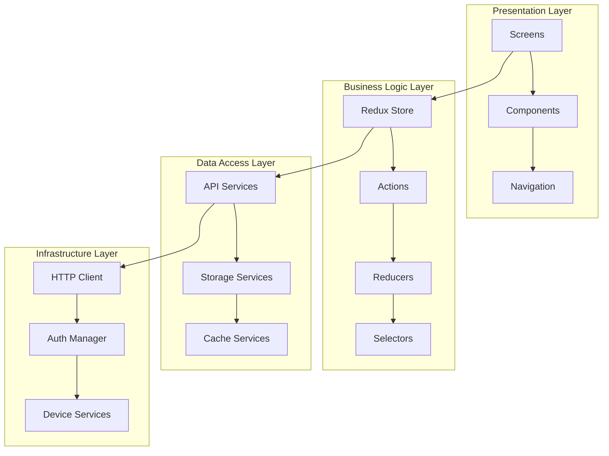
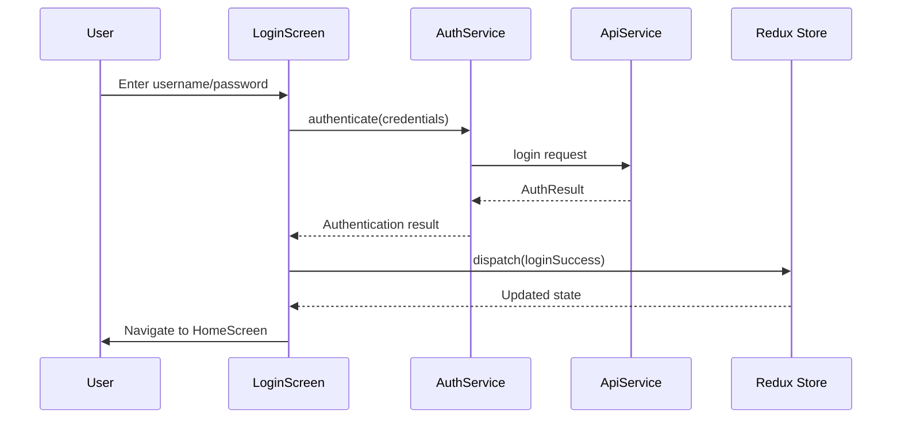
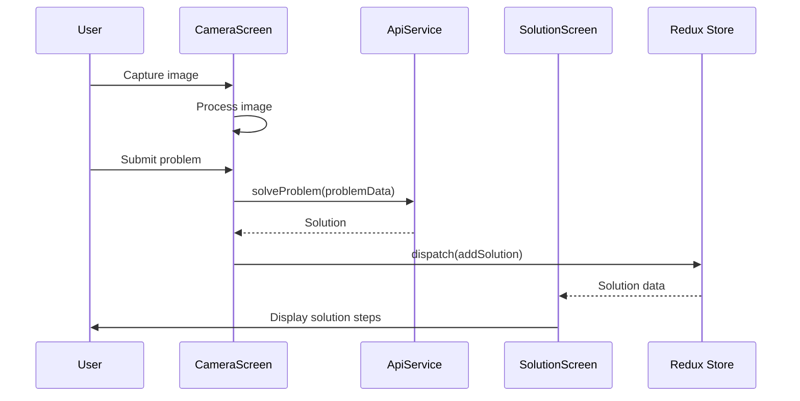

# Frontend Design - React Native Mobile Application

## Overview

The frontend is a React Native mobile application that provides an intuitive interface for high school students to capture mathematical problems and receive step-by-step solutions. The design follows the "Think Big, Start Small" principle, beginning with core functionality and expanding features incrementally.

## Architecture Pattern

The frontend follows a **Layered Architecture** with **MVP (Model-View-Presenter)** pattern combined with **Redux** for state management.

### Core Design Patterns

1. **Observer Pattern** - Redux store for state management
2. **Strategy Pattern** - Multiple authentication providers
3. **Factory Pattern** - Screen component creation
4. **Adapter Pattern** - API service integration
5. **Singleton Pattern** - Global services (AuthService, ApiClient)

## System Architecture



## Detailed Component Design

### 1. Core Models (Start Small)

```typescript
// models/User.ts
export interface User {
  id: string;
  username: string;
  password?: string; // Only for login, not stored
}

// models/Problem.ts
export interface Problem {
  id: string;
  userId: string;
  imageUri: string;
  category: string;
  createdAt: Date;
}

// models/Solution.ts
export interface Solution {
  id: string;
  problemId: string;
  steps: SolutionStep[];
  confidence: number;
  createdAt: Date;
}

export interface SolutionStep {
  stepNumber: number;
  description: string;
  formula?: string;
  explanation: string;
}
```

### 2. State Management (Redux Pattern)

```typescript
// store/index.ts - Singleton Pattern
export class Store {
  private static instance: Store;
  private store: any;

  private constructor() {
    this.store = configureStore({
      reducer: {
        auth: authReducer,
        problems: problemsReducer,
        solutions: solutionsReducer,
        ui: uiReducer,
      },
    });
  }

  public static getInstance(): Store {
    if (!Store.instance) {
      Store.instance = new Store();
    }
    return Store.instance;
  }

  public getStore() {
    return this.store;
  }
}
```

### 3. Authentication Service (Strategy Pattern)

```typescript
// services/AuthService.ts
export interface AuthStrategy {
  login(credentials: LoginCredentials): Promise<AuthResult>;
  logout(): Promise<void>;
}

export class UsernamePasswordAuth implements AuthStrategy {
  async login(credentials: LoginCredentials): Promise<AuthResult> {
    // Implementation for username/password login
  }
  
  async logout(): Promise<void> {
    // Implementation for logout
  }
}

export class AuthService {
  private strategy: AuthStrategy;
  
  constructor(strategy: AuthStrategy) {
    this.strategy = strategy;
  }
  
  setStrategy(strategy: AuthStrategy): void {
    this.strategy = strategy;
  }
  
  async authenticate(credentials: LoginCredentials): Promise<AuthResult> {
    return await this.strategy.login(credentials);
  }
}
```

### 4. API Service (Adapter Pattern)

```typescript
// services/ApiService.ts
export interface ApiAdapter {
  request<T>(config: RequestConfig): Promise<T>;
}

export class HttpApiAdapter implements ApiAdapter {
  private httpClient: AxiosInstance;
  
  constructor(baseURL: string) {
    this.httpClient = axios.create({
      baseURL,
      timeout: 10000,
    });
  }
  
  async request<T>(config: RequestConfig): Promise<T> {
    try {
      const response = await this.httpClient.request(config);
      return response.data;
    } catch (error) {
      throw new ApiError(error);
    }
  }
}

export class ApiService {
  private adapter: ApiAdapter;
  
  constructor(adapter: ApiAdapter) {
    this.adapter = adapter;
  }
  
  async solveProblem(problemData: ProblemRequest): Promise<Solution> {
    return await this.adapter.request<Solution>({
      method: 'POST',
      url: '/api/solve',
      data: problemData,
    });
  }
}
```

## Class Diagram

```mermaid
classDiagram
    class User {
        +string id
        +string username
        +string password
    }
    
    class Problem {
        +string id
        +string userId
        +string imageUri
        +string category
        +Date createdAt
    }
    
    class Solution {
        +string id
        +string problemId
        +SolutionStep[] steps
        +number confidence
        +Date createdAt
    }
    
    class SolutionStep {
        +number stepNumber
        +string description
        +string formula
        +string explanation
    }
    
    class AuthService {
        -AuthStrategy strategy
        +setStrategy(strategy: AuthStrategy)
        +authenticate(credentials: LoginCredentials): Promise~AuthResult~
    }
    
    class AuthStrategy {
        <<interface>>
        +login(credentials: LoginCredentials): Promise~AuthResult~
        +logout(): Promise~void~
    }
    
    class UsernamePasswordAuth {
        +login(credentials: LoginCredentials): Promise~AuthResult~
        +logout(): Promise~void~
    }
    
    class ApiService {
        -ApiAdapter adapter
        +solveProblem(problemData: ProblemRequest): Promise~Solution~
        +getUser(id: string): Promise~User~
    }
    
    class ApiAdapter {
        <<interface>>
        +request~T~(config: RequestConfig): Promise~T~
    }
    
    class HttpApiAdapter {
        -AxiosInstance httpClient
        +request~T~(config: RequestConfig): Promise~T~
    }
    
    class Store {
        -Store instance
        -store: any
        +getInstance(): Store
        +getStore(): any
    }
    
    class LoginScreen {
        -AuthService authService
        +handleLogin(): void
        +render(): JSX.Element
    }
    
    class CameraScreen {
        -ApiService apiService
        +captureImage(): void
        +submitProblem(): void
        +render(): JSX.Element
    }
    
    class SolutionScreen {
        +displaySteps(): void
        +render(): JSX.Element
    }
    
    User ||--o{ Problem
    Problem ||--|| Solution
    Solution ||--o{ SolutionStep
    
    AuthService --> AuthStrategy
    AuthStrategy <|-- UsernamePasswordAuth
    
    ApiService --> ApiAdapter
    ApiAdapter <|-- HttpApiAdapter
    
    LoginScreen --> AuthService
    CameraScreen --> ApiService
    SolutionScreen --> Solution
    
    Store --> User
    Store --> Problem
    Store --> Solution
```

## Sequence Diagrams

### 1. User Authentication Flow



### 2. Problem Solving Flow



## Screen Components Architecture

### 1. Screen Factory (Factory Pattern)

```typescript
// navigation/ScreenFactory.ts
export interface ScreenFactory {
  createScreen(screenType: ScreenType, props?: any): React.ComponentType;
}

export class AuthScreenFactory implements ScreenFactory {
  createScreen(screenType: ScreenType, props?: any): React.ComponentType {
    switch (screenType) {
      case ScreenType.LOGIN:
        return () => <LoginScreen {...props} />;
      case ScreenType.REGISTER:
        return () => <RegisterScreen {...props} />;
      default:
        throw new Error(`Unknown screen type: ${screenType}`);
    }
  }
}

export class MainScreenFactory implements ScreenFactory {
  createScreen(screenType: ScreenType, props?: any): React.ComponentType {
    switch (screenType) {
      case ScreenType.HOME:
        return () => <HomeScreen {...props} />;
      case ScreenType.CAMERA:
        return () => <CameraScreen {...props} />;
      case ScreenType.SOLUTION:
        return () => <SolutionScreen {...props} />;
      default:
        throw new Error(`Unknown screen type: ${screenType}`);
    }
  }
}
```

### 2. Core Screens (MVP Pattern)

```typescript
// screens/LoginScreen.tsx
interface LoginScreenProps {
  navigation: NavigationProp<any>;
}

export const LoginScreen: React.FC<LoginScreenProps> = ({ navigation }) => {
  const [credentials, setCredentials] = useState<LoginCredentials>({
    username: '',
    password: '',
  });
  
  const authService = AuthService.getInstance();
  const dispatch = useAppDispatch();
  
  const handleLogin = async () => {
    try {
      const result = await authService.authenticate(credentials);
      dispatch(loginSuccess(result.user));
      navigation.navigate('Home');
    } catch (error) {
      dispatch(loginFailure(error.message));
    }
  };
  
  return (
    <View style={styles.container}>
      <TextInput
        placeholder="Username"
        value={credentials.username}
        onChangeText={(text) => setCredentials(prev => ({ ...prev, username: text }))}
      />
      <TextInput
        placeholder="Password"
        secureTextEntry
        value={credentials.password}
        onChangeText={(text) => setCredentials(prev => ({ ...prev, password: text }))}
      />
      <Button title="Login" onPress={handleLogin} />
    </View>
  );
};
```

### 3. Camera Screen (Observer Pattern)

```typescript
// screens/CameraScreen.tsx
export const CameraScreen: React.FC = () => {
  const [imageUri, setImageUri] = useState<string | null>(null);
  const [category, setCategory] = useState<string>('algebra');
  
  const apiService = ApiService.getInstance();
  const dispatch = useAppDispatch();
  
  const captureImage = async () => {
    // Camera implementation
    const result = await launchCamera({
      mediaType: 'photo',
      quality: 0.8,
    });
    
    if (result.assets && result.assets[0]) {
      setImageUri(result.assets[0].uri);
    }
  };
  
  const submitProblem = async () => {
    if (!imageUri) return;
    
    try {
      const problemData: ProblemRequest = {
        imageUri,
        category,
      };
      
      const solution = await apiService.solveProblem(problemData);
      dispatch(addSolution(solution));
      
      // Navigate to solution screen
      navigation.navigate('Solution', { solutionId: solution.id });
    } catch (error) {
      // Handle error
    }
  };
  
  return (
    <View style={styles.container}>
      {imageUri ? (
        <Image source={{ uri: imageUri }} style={styles.image} />
      ) : (
        <View style={styles.cameraPlaceholder}>
          <Button title="Capture Image" onPress={captureImage} />
        </View>
      )}
      
      <CategorySelector
        value={category}
        onSelect={setCategory}
      />
      
      <Button
        title="Solve Problem"
        onPress={submitProblem}
        disabled={!imageUri}
      />
    </View>
  );
};
```

## Component Architecture

### 1. Reusable Components

```typescript
// components/CategorySelector.tsx
interface CategorySelectorProps {
  value: string;
  onSelect: (category: string) => void;
}

export const CategorySelector: React.FC<CategorySelectorProps> = ({
  value,
  onSelect,
}) => {
  const categories = [
    { id: 'algebra', name: 'Algebra' },
    { id: 'geometry', name: 'Geometry' },
    { id: 'calculus', name: 'Calculus' },
  ];
  
  return (
    <View style={styles.container}>
      {categories.map((category) => (
        <TouchableOpacity
          key={category.id}
          style={[
            styles.categoryButton,
            value === category.id && styles.selected,
          ]}
          onPress={() => onSelect(category.id)}
        >
          <Text style={styles.categoryText}>{category.name}</Text>
        </TouchableOpacity>
      ))}
    </View>
  );
};
```

### 2. Solution Display Component

```typescript
// components/SolutionSteps.tsx
interface SolutionStepsProps {
  steps: SolutionStep[];
}

export const SolutionSteps: React.FC<SolutionStepsProps> = ({ steps }) => {
  return (
    <ScrollView style={styles.container}>
      {steps.map((step, index) => (
        <View key={step.stepNumber} style={styles.stepContainer}>
          <Text style={styles.stepNumber}>Step {step.stepNumber}</Text>
          <Text style={styles.description}>{step.description}</Text>
          {step.formula && (
            <MathView
              math={step.formula}
              style={styles.formula}
            />
          )}
          <Text style={styles.explanation}>{step.explanation}</Text>
        </View>
      ))}
    </ScrollView>
  );
};
```

## Navigation Architecture

### Navigation Structure

```typescript
// navigation/AppNavigator.tsx
const AuthStack = createNativeStackNavigator();
const MainStack = createNativeStackNavigator();

const AuthNavigator = () => (
  <AuthStack.Navigator>
    <AuthStack.Screen name="Login" component={LoginScreen} />
    <AuthStack.Screen name="Register" component={RegisterScreen} />
  </AuthStack.Navigator>
);

const MainNavigator = () => (
  <MainStack.Navigator>
    <MainStack.Screen name="Home" component={HomeScreen} />
    <MainStack.Screen name="Camera" component={CameraScreen} />
    <MainStack.Screen name="Solution" component={SolutionScreen} />
  </MainStack.Navigator>
);

export const AppNavigator = () => {
  const isAuthenticated = useAppSelector(selectIsAuthenticated);
  
  return (
    <NavigationContainer>
      {isAuthenticated ? <MainNavigator /> : <AuthNavigator />}
    </NavigationContainer>
  );
};
```

## State Management Architecture

### Redux Store Structure

```typescript
// store/slices/authSlice.ts
interface AuthState {
  user: User | null;
  isAuthenticated: boolean;
  isLoading: boolean;
  error: string | null;
}

const initialState: AuthState = {
  user: null,
  isAuthenticated: false,
  isLoading: false,
  error: null,
};

const authSlice = createSlice({
  name: 'auth',
  initialState,
  reducers: {
    loginStart: (state) => {
      state.isLoading = true;
      state.error = null;
    },
    loginSuccess: (state, action: PayloadAction<User>) => {
      state.user = action.payload;
      state.isAuthenticated = true;
      state.isLoading = false;
      state.error = null;
    },
    loginFailure: (state, action: PayloadAction<string>) => {
      state.isLoading = false;
      state.error = action.payload;
      state.isAuthenticated = false;
    },
    logout: (state) => {
      state.user = null;
      state.isAuthenticated = false;
      state.error = null;
    },
  },
});
```

## Error Handling Architecture

### Error Management (Chain of Responsibility Pattern)

```typescript
// utils/ErrorHandler.ts
export abstract class ErrorHandler {
  protected nextHandler?: ErrorHandler;
  
  setNext(handler: ErrorHandler): ErrorHandler {
    this.nextHandler = handler;
    return handler;
  }
  
  abstract handle(error: Error): void;
}

export class NetworkErrorHandler extends ErrorHandler {
  handle(error: Error): void {
    if (error instanceof NetworkError) {
      // Handle network errors
      showToast('Network connection error. Please try again.');
    } else if (this.nextHandler) {
      this.nextHandler.handle(error);
    }
  }
}

export class AuthErrorHandler extends ErrorHandler {
  handle(error: Error): void {
    if (error instanceof AuthError) {
      // Handle authentication errors
      store.dispatch(logout());
      navigateToLogin();
    } else if (this.nextHandler) {
      this.nextHandler.handle(error);
    }
  }
}
```

## Performance Optimization

### Lazy Loading and Code Splitting

```typescript
// screens/LazyScreens.ts
export const LazyLoginScreen = React.lazy(() => import('./LoginScreen'));
export const LazyCameraScreen = React.lazy(() => import('./CameraScreen'));
export const LazySolutionScreen = React.lazy(() => import('./SolutionScreen'));

// components/LazyWrapper.tsx
export const LazyWrapper: React.FC<{ children: React.ReactNode }> = ({
  children,
}) => (
  <Suspense fallback={<LoadingSpinner />}>
    {children}
  </Suspense>
);
```

## Testing Architecture

### Component Testing Structure

```typescript
// __tests__/LoginScreen.test.tsx
describe('LoginScreen', () => {
  let mockAuthService: jest.Mocked<AuthService>;
  
  beforeEach(() => {
    mockAuthService = {
      authenticate: jest.fn(),
    } as any;
  });
  
  it('should call authService.authenticate when login button is pressed', async () => {
    const { getByText, getByPlaceholderText } = render(
      <Provider store={mockStore}>
        <LoginScreen navigation={mockNavigation} />
      </Provider>
    );
    
    fireEvent.changeText(getByPlaceholderText('Username'), 'testuser');
    fireEvent.changeText(getByPlaceholderText('Password'), 'testpass');
    fireEvent.press(getByText('Login'));
    
    expect(mockAuthService.authenticate).toHaveBeenCalledWith({
      username: 'testuser',
      password: 'testpass',
    });
  });
});
```

## Project Structure

```
src/
├── components/           # Reusable UI components
│   ├── CategorySelector/
│   ├── SolutionSteps/
│   └── common/
├── screens/             # Screen components
│   ├── auth/
│   │   ├── LoginScreen.tsx
│   │   └── RegisterScreen.tsx
│   ├── main/
│   │   ├── HomeScreen.tsx
│   │   ├── CameraScreen.tsx
│   │   └── SolutionScreen.tsx
├── navigation/          # Navigation configuration
│   ├── AppNavigator.tsx
│   └── ScreenFactory.ts
├── store/              # Redux store and slices
│   ├── index.ts
│   ├── slices/
│   └── middleware/
├── services/           # Business logic services
│   ├── AuthService.ts
│   ├── ApiService.ts
│   └── StorageService.ts
├── models/             # Type definitions
│   ├── User.ts
│   ├── Problem.ts
│   └── Solution.ts
├── utils/              # Utility functions
│   ├── ErrorHandler.ts
│   └── validators.ts
└── styles/             # Style definitions
    ├── colors.ts
    ├── typography.ts
    └── components/
```

## Future Expansion Points

Following the "Think Big, Start Small" principle, the current design provides extension points for future features:

1. **User Profile**: Extend User model with additional fields
2. **Social Features**: Add components for comments and sharing
3. **Offline Support**: Extend storage services
4. **Multiple Auth Providers**: Add new AuthStrategy implementations
5. **Advanced Camera Features**: Extend CameraScreen with more processing options

This design provides a solid foundation that can grow with the application's needs while maintaining clean architecture and design patterns.