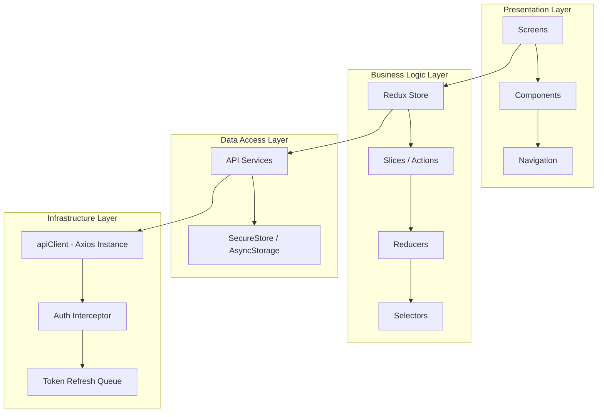
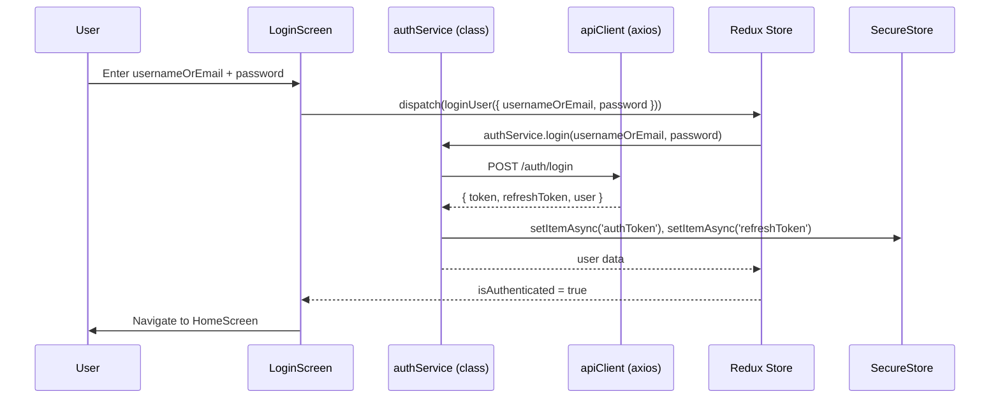
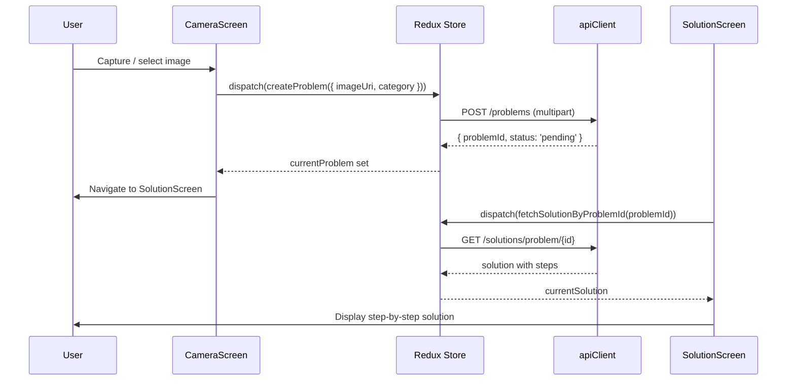

# Frontend Design - React Native Mobile Application

## Overview

The frontend is a React Native mobile application (Expo) that provides an intuitive interface for high school students to capture mathematical problems and receive step-by-step solutions. All source files are **JavaScript (.js)**, not TypeScript.

## Architecture Pattern

The frontend follows a **Layered Architecture** with **Redux Toolkit** for state management and a plain service layer built on **Axios**.

### Core Design Patterns (Actual Implementation)

1. **Observer Pattern** — Redux store with `useSelector` / `useDispatch`
2. **Interceptor Pattern** — Axios request/response interceptors for auth token injection and automatic token refresh
3. **Slice Pattern** — Redux Toolkit `createSlice` for co-located state, reducers, and actions
4. **Service Object Pattern** — Plain ES6 class instances (`AuthService`, `ProblemService`, etc.) exported as singletons; no interface hierarchy

> **Note**: The original design document described Strategy, Factory, Adapter, and Singleton class patterns that were not implemented. The actual code uses the simpler approaches documented here.

## System Architecture



## State Management

### Redux Store (`store/index.js`)

The store is configured with `configureStore` (standard Redux Toolkit export — no Singleton class wrapper). State is persisted to **Expo SecureStore** via `redux-persist`.

```js
// store/index.js
const rootReducer = combineReducers({
  auth:      authReducer,      // Authentication & session
  problem:   problemReducer,   // Problem list & submission state
  solution:  solutionReducer,  // Solution data & steps
  user:      userReducer,      // User profile, stats, preferences
  app:       appReducer,       // App-wide UI & device state
  bookmarks: bookmarkReducer,  // Saved/bookmarked solutions
});

// Persist whitelist: auth, user, app
// Persist blacklist: problem, solution (transient data)
export const store = configureStore({ reducer: persistedReducer, ... });
export const persistor = persistStore(store);
```

**Root selectors** (convenience exports from `store/index.js`):
```js
export const selectAuth      = (state) => state.auth;
export const selectProblem   = (state) => state.problem;
export const selectSolution  = (state) => state.solution;
export const selectUser      = (state) => state.user;
export const selectApp       = (state) => state.app;
export const selectBookmarks = (state) => state.bookmarks;
```

---

### `authSlice` (`store/slices/authSlice.js`)

Manages authentication session.

**State shape**:
```js
{
  user: null,             // Authenticated user object
  token: null,            // JWT access token
  refreshToken: null,     // JWT refresh token
  isAuthenticated: false,
  isLoading: false,
  error: null,
  lastLoginAt: null
}
```

**Key async thunks**: `loginUser`, `registerUser`, `logoutUser`, `refreshToken`, `checkAuthStatus`

**Key actions**: `loginStart`, `loginSuccess`, `loginFailure`, `logout`, `clearError`

---

### `problemSlice` (`store/slices/problemSlice.js`)

Manages problem submission and the user's problem list.

**State shape**:
```js
{
  problems: [],           // Paginated list of problems
  currentProblem: null,   // Problem being viewed
  isLoading: false,
  isSubmitting: false,
  pagination: { page, limit, total, hasMore },
  filters: { category, status, dateRange },
  error: null
}
```

**Key async thunks**: `fetchProblems`, `createProblem`, `getProblemById`, `retryProblem`, `deleteProblem`

---

### `solutionSlice` (`store/slices/solutionSlice.js`)

Manages solution data and step-by-step display.

**State shape**:
```js
{
  solutions: {},          // Keyed by problemId
  currentSolution: null,  // Solution currently displayed
  isLoading: false,
  error: null
}
```

**Key async thunks**: `fetchSolution`, `fetchSolutionByProblemId`

---

### `userSlice` (`store/slices/userSlice.js`)

Manages the user's profile, gamification stats, and preferences.

**State shape**:
```js
{
  profile: null,
  stats: {
    totalProblems, solvedProblems, averageRating,
    totalPoints, streak, rank, achievements: []
  },
  preferences: {
    theme: 'light',
    notifications: { push, email, solutionReady, weeklyReport },
    language: 'en',
    mathNotation: 'latex',
    hintLevel: 'medium'
  },
  isLoading: false,
  isUpdating: false,
  error: null,
  lastProfileUpdate: null
}
```

**Key async thunks**: `fetchUserProfile`, `updateUserProfile`, `changePassword`, `fetchUserStats`, `updateUserPreferences`

**Key actions**: `clearUserData`, `updateLocalPreferences`, `updateLocalStats`, `incrementProblemCount`, `incrementSolvedCount`, `updateStreak`, `addAchievement`

---

### `appSlice` (`store/slices/appSlice.js`)

Manages app-wide device and UI state. Persisted via `redux-persist`.

**State shape**:
```js
{
  isInitialized: false,
  isOnline: true,
  networkType: null,        // '2g'|'3g'|'4g'|'5g'|'wifi'|'cellular'|'unknown'
  theme: 'light',           // 'light'|'dark'|'system'
  orientation: 'portrait',
  isKeyboardVisible: false,
  safeAreaInsets: { top, bottom, left, right },
  currentRoute: null,
  navigationHistory: [],
  globalLoading: false,
  loadingMessage: '',
  globalError: null,
  errorQueue: [],           // Max 20 items
  pushToken: null,
  notificationPermission: null, // 'granted'|'denied'|'undetermined'
  unreadNotifications: 0,
  cacheSize: 0,
  lastCacheCleanup: null,
  features: {
    cameraEnabled: true,
    offlineMode: false,
    betaFeatures: false,
    analytics: true
  },
  performance: {
    appStartTime: null,
    renderTime: null,
    apiResponseTimes: []    // Max 100 entries
  }
}
```

**Key actions**: `setInitialized`, `setNetworkStatus`, `setTheme`, `setGlobalLoading`, `setGlobalError`, `clearGlobalError`, `addToErrorQueue`, `removeFromErrorQueue`, `setPushToken`, `setNotificationPermission`, `toggleFeature`, `updateFeatures`, `addApiResponseTime`, `resetAppState`

---

### `bookmarkSlice` (`store/slices/bookmarkSlice.js`)

Manages saved solutions. Persisted to **Expo SecureStore** directly (not via redux-persist whitelist — the slice manages its own storage).

**State shape**:
```js
{
  items: [],              // Array of bookmark objects
  isLoading: false,
  error: null,
  lastUpdated: null
}
```

**Bookmark object shape**:
```js
{
  id, problemId, title, category, difficulty,
  solutionSteps,          // Number of steps
  confidence,
  bookmarkedAt,
  lastViewedAt,
  notes: ''
}
```

**Key async thunks**: `addBookmark`, `removeBookmark`, `updateBookmarkNotes`, `updateLastViewed`, `loadBookmarksThunk`

**Selectors**: `selectBookmarks`, `selectIsBookmarked(state, solutionId)`, `selectBookmarkById`, `selectBookmarksByCategory`, `selectRecentBookmarks(state, limit)`

---

## Service Layer

### `apiClient` (`services/apiClient.js`)

A configured **Axios instance** — not a class, not an adapter interface. Uses request/response interceptors directly.

```js
const apiClient = axios.create({
  baseURL: '...API_BASE_URL.../api/v1',
  timeout: 10000,
  headers: { 'Content-Type': 'application/json' },
});

// Request interceptor: reads JWT from SecureStore, injects Authorization header
// Response interceptor: handles 401 → queues requests → refreshes token → retries
```

**Error handling**: `handleApiError(error)` delegates to a **Chain-of-Responsibility** defined in `utils/errorHandlers.js` — see the Error Handling section below.

### `AuthService` (`services/authService.js`)

Plain ES6 class exported as a singleton instance. No `AuthStrategy` interface.

```js
class AuthService {
  async login(usernameOrEmail, password) { ... }
  async register(username, email, password) { ... }
  async logout() { ... }
  async refreshToken() { ... }
  async getCurrentUser() { ... }
}

export default new AuthService();
```

---

## Navigation Architecture

Standard React Navigation stack — no `ScreenFactory` class.

```js
// navigation/AppNavigator.js
const AuthNavigator = () => (
  <AuthStack.Navigator>
    <AuthStack.Screen name="Login"    component={LoginScreen} />
    <AuthStack.Screen name="Register" component={RegisterScreen} />
  </AuthStack.Navigator>
);

const MainNavigator = () => (
  <MainTab.Navigator>
    <MainTab.Screen name="Home"     component={HomeScreen} />
    <MainTab.Screen name="Camera"   component={CameraScreen} />
    <MainTab.Screen name="History"  component={HistoryScreen} />
    <MainTab.Screen name="Profile"  component={ProfileScreen} />
  </MainTab.Navigator>
);

export const AppNavigator = () => {
  const { isAuthenticated } = useSelector(selectAuth);
  return (
    <NavigationContainer>
      {isAuthenticated ? <MainNavigator /> : <AuthNavigator />}
    </NavigationContainer>
  );
};
```

---

## Error Handling

Error handling uses a **Chain-of-Responsibility** (`utils/errorHandlers.js`). Each handler checks one condition and either throws a user-facing `Error` or passes to the next handler. `handleApiError` in `apiClient.js` is now a one-liner that delegates to the chain head.

### Handler chain (in order)

| Handler | Condition | Message thrown |
|---|---|---|
| `ServerMessageHandler` | `error.response.data.message` exists | Backend message verbatim |
| `NetworkErrorHandler` | No `error.response`, has `error.request` | Network connectivity error |
| `BadRequestHandler` | HTTP 400 | Bad request / check input |
| `AuthErrorHandler` | HTTP 401 | Authentication failed |
| `ForbiddenErrorHandler` | HTTP 403 | Permission denied |
| `NotFoundErrorHandler` | HTTP 404 | Resource not found |
| `ValidationErrorHandler` | HTTP 422 | Joins `errors` object fields |
| `ServerErrorHandler` | HTTP 5xx | Server error / try again |
| `DefaultErrorHandler` | Anything else | Status code or error message |

### Adding a new error type

```js
// 1. Add a class in utils/errorHandlers.js
class RateLimitHandler extends ErrorHandler {
  handle(error) {
    if (error.response?.status === 429) {
      throw new Error('Too many requests. Please wait a moment.');
    }
    return super.handle(error);
  }
}

// 2. Insert it into buildErrorHandlerChain() — no other changes needed
validation.setNext(rateLimit).setNext(server);
```

---

## Sequence Diagrams

### User Authentication Flow



### Problem Solving Flow



---

## Project Structure (Actual)

```
frontend/src/
├── components/
│   ├── camera/
│   │   ├── CaptureView.js
│   │   └── ImageCropper.js
│   ├── common/
│   │   ├── ErrorDisplay.js
│   │   ├── LoadingOverlay.js
│   │   ├── MathRenderer.js       # KaTeX / MathJax rendering
│   │   └── SkeletonLoader.js
│   └── solution/
│       └── SolutionSteps.js
├── screens/
│   ├── auth/
│   │   ├── LoginScreen.js
│   │   └── RegisterScreen.js
│   └── main/
│       ├── CameraScreen.js
│       ├── HistoryScreen.js
│       ├── HomeScreen.js
│       ├── ProfileScreen.js
│       └── SolutionScreen.js
├── navigation/
│   └── AppNavigator.js           # No ScreenFactory
├── store/
│   ├── index.js                  # configureStore export (no Singleton class)
│   └── slices/
│       ├── appSlice.js
│       ├── authSlice.js
│       ├── bookmarkSlice.js
│       ├── problemSlice.js
│       ├── solutionSlice.js
│       └── userSlice.js
├── services/
│   ├── apiClient.js              # Axios instance + interceptors
│   ├── authService.js            # Plain class (no AuthStrategy interface)
│   ├── problemService.js
│   ├── solutionService.js
│   └── userService.js
├── constants/
│   └── index.js                  # ProblemStatus, categories, etc.
└── utils/
    └── validators.js
```

---

## Future Expansion Points

1. **TypeScript migration** — Deferred to post-MVP; team is proficient in JS
2. **Chain-of-Responsibility error handler** — ✅ Implemented in `utils/errorHandlers.js`
3. **Social features** — Comments, sharing, study groups
4. **Offline support** — Extend storage services for full offline capability
5. **Analytics dashboard** — User progress tracking and weak-area identification
