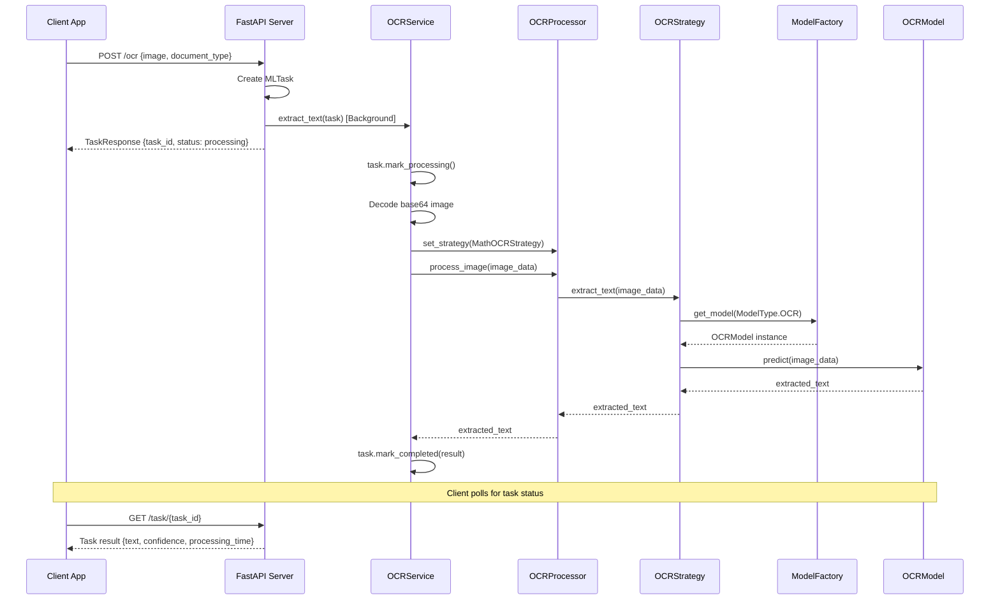

# LLM Service Design - Python ML Service

## Overview

The LLM Service is a Python-based machine learning microservice that handles all AI operations including OCR, fine-tuning, Mixture of Experts (MoE), chat services, and AI agents. It follows clean architecture principles with design patterns for maintainability and extensibility.

### Architecture Philosophy

- **Think Big, Start Small**: Begin with basic OCR functionality, expand to advanced AI features
- **Separation of Concerns**: Clear boundaries between ML operations, data processing, and API handling
- **Design Patterns**: Extensive use of proven patterns for flexibility and maintainability
- **Microservice Architecture**: Independent service communicating via HTTP REST API

## Architecture Overview

```
┌─────────────────────────────────────────────────────────────────┐
│                        LLM Service Architecture                  │
├─────────────────────────────────────────────────────────────────┤
│  API Layer (FastAPI)                                            │
│  ├── OCR Endpoints                                               │
│  ├── Chat Endpoints                                              │
│  ├── Fine-tuning Endpoints                                       │
│  └── Agent Endpoints                                             │
├─────────────────────────────────────────────────────────────────┤
│  Application Layer                                               │
│  ├── OCR Service (Strategy Pattern)                              │
│  ├── Chat Service (Command Pattern)                              │
│  ├── Fine-tuning Service (Template Method)                       │
│  └── Agent Manager (Composite Pattern)                           │
├─────────────────────────────────────────────────────────────────┤
│  Domain Layer                                                    │
│  ├── Models (Entity Pattern)                                     │
│  ├── Repositories (Repository Pattern)                           │
│  └── Services (Domain Services)                                  │
├─────────────────────────────────────────────────────────────────┤
│  Infrastructure Layer                                            │
│  ├── ML Models (Factory Pattern)                                 │
│  ├── Model Storage (Adapter Pattern)                             │
│  ├── Queue Service (Observer Pattern)                            │
│  └── Configuration (Singleton Pattern)                           │
└─────────────────────────────────────────────────────────────────┘
```

## Design Patterns Implementation

### 1. Factory Pattern - ML Model Creation

**Purpose**: Create different ML models based on configuration without tight coupling.

```python
from abc import ABC, abstractmethod
from enum import Enum

class ModelType(Enum):
    OCR = "ocr"
    CHAT = "chat"
    FINE_TUNE = "fine_tune"
    AGENT = "agent"

class MLModel(ABC):
    @abstractmethod
    def predict(self, input_data: any) -> any:
        pass
    
    @abstractmethod
    def load_model(self, model_path: str) -> None:
        pass

class OCRModel(MLModel):
    def __init__(self):
        self.model = None
    
    def load_model(self, model_path: str) -> None:
        # Load PyTorch OCR model
        import torch
        self.model = torch.load(model_path)
    
    def predict(self, image_data: bytes) -> str:
        # OCR prediction logic
        return "extracted_text"

class ChatModel(MLModel):
    def __init__(self):
        self.model = None
    
    def load_model(self, model_path: str) -> None:
        # Load chat model (e.g., transformers)
        from transformers import AutoModel, AutoTokenizer
        self.model = AutoModel.from_pretrained(model_path)
        self.tokenizer = AutoTokenizer.from_pretrained(model_path)
    
    def predict(self, message: str) -> str:
        # Chat prediction logic
        return "response"

class ModelFactory:
    _models = {}
    
    @staticmethod
    def create_model(model_type: ModelType, model_path: str) -> MLModel:
        if model_type == ModelType.OCR:
            model = OCRModel()
        elif model_type == ModelType.CHAT:
            model = ChatModel()
        else:
            raise ValueError(f"Unknown model type: {model_type}")
        
        model.load_model(model_path)
        ModelFactory._models[model_type] = model
        return model
    
    @staticmethod
    def get_model(model_type: ModelType) -> MLModel:
        return ModelFactory._models.get(model_type)
```

### 2. Strategy Pattern - OCR Processing

**Purpose**: Different OCR processing strategies for various document types.

```python
from abc import ABC, abstractmethod

class OCRStrategy(ABC):
    @abstractmethod
    def extract_text(self, image_data: bytes) -> str:
        pass

class MathOCRStrategy(OCRStrategy):
    def extract_text(self, image_data: bytes) -> str:
        # Mathematical formula OCR processing
        model = ModelFactory.get_model(ModelType.OCR)
        return model.predict(image_data)

class TextOCRStrategy(OCRStrategy):
    def extract_text(self, image_data: bytes) -> str:
        # Regular text OCR processing
        model = ModelFactory.get_model(ModelType.OCR)
        return model.predict(image_data)

class OCRProcessor:
    def __init__(self, strategy: OCRStrategy):
        self._strategy = strategy
    
    def set_strategy(self, strategy: OCRStrategy):
        self._strategy = strategy
    
    def process_image(self, image_data: bytes) -> str:
        return self._strategy.extract_text(image_data)
```

### 3. Command Pattern - Chat Operations

**Purpose**: Encapsulate chat requests as objects for queuing, logging, and undo operations.

```python
from abc import ABC, abstractmethod
from datetime import datetime
from typing import Any, Dict

class ChatCommand(ABC):
    @abstractmethod
    def execute(self) -> Dict[str, Any]:
        pass
    
    @abstractmethod
    def get_metadata(self) -> Dict[str, Any]:
        pass

class SendMessageCommand(ChatCommand):
    def __init__(self, user_id: str, message: str, context: Dict[str, Any] = None):
        self.user_id = user_id
        self.message = message
        self.context = context or {}
        self.timestamp = datetime.utcnow()
    
    def execute(self) -> Dict[str, Any]:
        model = ModelFactory.get_model(ModelType.CHAT)
        response = model.predict(self.message)
        
        return {
            "user_id": self.user_id,
            "message": self.message,
            "response": response,
            "timestamp": self.timestamp.isoformat(),
            "context": self.context
        }
    
    def get_metadata(self) -> Dict[str, Any]:
        return {
            "user_id": self.user_id,
            "timestamp": self.timestamp.isoformat(),
            "command_type": "send_message"
        }

class ChatInvoker:
    def __init__(self):
        self._history = []
    
    def execute_command(self, command: ChatCommand) -> Dict[str, Any]:
        result = command.execute()
        self._history.append({
            "command": command,
            "result": result,
            "executed_at": datetime.utcnow()
        })
        return result
    
    def get_history(self, user_id: str = None) -> list:
        if user_id:
            return [h for h in self._history 
                   if h["command"].get_metadata().get("user_id") == user_id]
        return self._history
```

### 4. Template Method Pattern - Fine-tuning Pipeline

**Purpose**: Define the skeleton of fine-tuning algorithm, allowing subclasses to override specific steps.

```python
from abc import ABC, abstractmethod
from typing import Dict, Any

class FineTuningTemplate(ABC):
    def fine_tune(self, model_config: Dict[str, Any]) -> Dict[str, Any]:
        """Template method defining the fine-tuning process"""
        self.validate_config(model_config)
        data = self.prepare_data(model_config)
        model = self.load_base_model(model_config)
        trained_model = self.train_model(model, data, model_config)
        metrics = self.evaluate_model(trained_model, data)
        self.save_model(trained_model, model_config)
        
        return {
            "status": "completed",
            "metrics": metrics,
            "model_path": self.get_model_path(model_config)
        }
    
    def validate_config(self, config: Dict[str, Any]) -> None:
        """Default validation - can be overridden"""
        required_fields = ["model_name", "dataset_path", "output_path"]
        for field in required_fields:
            if field not in config:
                raise ValueError(f"Missing required field: {field}")
    
    @abstractmethod
    def prepare_data(self, config: Dict[str, Any]) -> Any:
        pass
    
    @abstractmethod
    def load_base_model(self, config: Dict[str, Any]) -> Any:
        pass
    
    @abstractmethod
    def train_model(self, model: Any, data: Any, config: Dict[str, Any]) -> Any:
        pass
    
    @abstractmethod
    def evaluate_model(self, model: Any, data: Any) -> Dict[str, Any]:
        pass
    
    @abstractmethod
    def save_model(self, model: Any, config: Dict[str, Any]) -> None:
        pass
    
    @abstractmethod
    def get_model_path(self, config: Dict[str, Any]) -> str:
        pass

class ChatModelFineTuning(FineTuningTemplate):
    def prepare_data(self, config: Dict[str, Any]) -> Any:
        # Load and preprocess chat dataset
        import pandas as pd
        data = pd.read_json(config["dataset_path"])
        return self._preprocess_chat_data(data)
    
    def load_base_model(self, config: Dict[str, Any]) -> Any:
        from transformers import AutoModel
        return AutoModel.from_pretrained(config["base_model"])
    
    def train_model(self, model: Any, data: Any, config: Dict[str, Any]) -> Any:
        # Training logic for chat model
        epochs = config.get("epochs", 3)
        for epoch in range(epochs):
            # Training loop
            pass
        return model
    
    def evaluate_model(self, model: Any, data: Any) -> Dict[str, Any]:
        # Evaluation metrics
        return {"accuracy": 0.85, "loss": 0.23}
    
    def save_model(self, model: Any, config: Dict[str, Any]) -> None:
        import torch
        torch.save(model, self.get_model_path(config))
    
    def get_model_path(self, config: Dict[str, Any]) -> str:
        return f"{config['output_path']}/{config['model_name']}.pt"
    
    def _preprocess_chat_data(self, data) -> Any:
        # Chat-specific preprocessing
        return data
```

### 5. Singleton Pattern - Configuration Manager

**Purpose**: Ensure single instance of configuration management across the application.

```python
import json
from typing import Dict, Any
import threading

class ConfigManager:
    _instance = None
    _lock = threading.Lock()
    
    def __new__(cls):
        if cls._instance is None:
            with cls._lock:
                if cls._instance is None:
                    cls._instance = super().__new__(cls)
        return cls._instance
    
    def __init__(self):
        if not hasattr(self, 'initialized'):
            self._config = {}
            self.initialized = True
    
    def load_config(self, config_path: str = "config.json") -> None:
        with open(config_path, 'r') as f:
            self._config = json.load(f)
    
    def get(self, key: str, default: Any = None) -> Any:
        return self._config.get(key, default)
    
    def set(self, key: str, value: Any) -> None:
        self._config[key] = value
    
    def get_model_config(self, model_type: str) -> Dict[str, Any]:
        return self._config.get("models", {}).get(model_type, {})
```

### 6. Composite Pattern - AI Agent System

**Purpose**: Compose AI agents into tree structures to represent part-whole hierarchies.

```python
from abc import ABC, abstractmethod
from typing import List, Dict, Any

class AgentComponent(ABC):
    @abstractmethod
    def execute(self, task: Dict[str, Any]) -> Dict[str, Any]:
        pass
    
    @abstractmethod
    def get_capabilities(self) -> List[str]:
        pass

class SimpleAgent(AgentComponent):
    def __init__(self, name: str, capabilities: List[str]):
        self.name = name
        self._capabilities = capabilities
    
    def execute(self, task: Dict[str, Any]) -> Dict[str, Any]:
        # Simple agent execution logic
        return {
            "agent": self.name,
            "status": "completed",
            "result": f"Processed task: {task.get('type', 'unknown')}"
        }
    
    def get_capabilities(self) -> List[str]:
        return self._capabilities

class CompositeAgent(AgentComponent):
    def __init__(self, name: str):
        self.name = name
        self._children: List[AgentComponent] = []
    
    def add(self, agent: AgentComponent) -> None:
        self._children.append(agent)
    
    def remove(self, agent: AgentComponent) -> None:
        self._children.remove(agent)
    
    def execute(self, task: Dict[str, Any]) -> Dict[str, Any]:
        results = []
        for child in self._children:
            if self._can_handle_task(child, task):
                result = child.execute(task)
                results.append(result)
        
        return {
            "composite_agent": self.name,
            "status": "completed",
            "child_results": results
        }
    
    def get_capabilities(self) -> List[str]:
        capabilities = []
        for child in self._children:
            capabilities.extend(child.get_capabilities())
        return list(set(capabilities))
    
    def _can_handle_task(self, agent: AgentComponent, task: Dict[str, Any]) -> bool:
        task_type = task.get('type')
        return task_type in agent.get_capabilities()
```

## Domain Models

### Core Entities

```python
from datetime import datetime
from enum import Enum
from typing import Optional, Dict, Any
from dataclasses import dataclass

class TaskStatus(Enum):
    PENDING = "pending"
    PROCESSING = "processing"
    COMPLETED = "completed"
    FAILED = "failed"

class TaskType(Enum):
    OCR = "ocr"
    CHAT = "chat"
    FINE_TUNE = "fine_tune"
    AGENT_TASK = "agent_task"

@dataclass
class MLTask:
    id: str
    type: TaskType
    status: TaskStatus
    input_data: Dict[str, Any]
    output_data: Optional[Dict[str, Any]] = None
    error_message: Optional[str] = None
    created_at: datetime = datetime.utcnow()
    updated_at: datetime = datetime.utcnow()
    user_id: Optional[str] = None
    
    def mark_processing(self) -> None:
        self.status = TaskStatus.PROCESSING
        self.updated_at = datetime.utcnow()
    
    def mark_completed(self, output_data: Dict[str, Any]) -> None:
        self.status = TaskStatus.COMPLETED
        self.output_data = output_data
        self.updated_at = datetime.utcnow()
    
    def mark_failed(self, error_message: str) -> None:
        self.status = TaskStatus.FAILED
        self.error_message = error_message
        self.updated_at = datetime.utcnow()

@dataclass
class ModelInfo:
    name: str
    type: ModelType
    version: str
    path: str
    created_at: datetime = datetime.utcnow()
    is_active: bool = True
    metadata: Optional[Dict[str, Any]] = None
```

## Application Services

### OCR Service

```python
from typing import Dict, Any
import base64

class OCRService:
    def __init__(self):
        self.processor = OCRProcessor(MathOCRStrategy())
        self.config = ConfigManager()
    
    async def extract_text(self, task: MLTask) -> Dict[str, Any]:
        try:
            task.mark_processing()
            
            # Decode base64 image data
            image_data = base64.b64decode(task.input_data["image"])
            
            # Determine strategy based on task input
            if task.input_data.get("document_type") == "math":
                self.processor.set_strategy(MathOCRStrategy())
            else:
                self.processor.set_strategy(TextOCRStrategy())
            
            # Process image
            extracted_text = self.processor.process_image(image_data)
            
            result = {
                "text": extracted_text,
                "confidence": 0.95,  # Mock confidence score
                "processing_time": 1.2
            }
            
            task.mark_completed(result)
            return result
            
        except Exception as e:
            task.mark_failed(str(e))
            raise
```

### Chat Service

```python
class ChatService:
    def __init__(self):
        self.invoker = ChatInvoker()
        self.config = ConfigManager()
    
    async def send_message(self, task: MLTask) -> Dict[str, Any]:
        try:
            task.mark_processing()
            
            command = SendMessageCommand(
                user_id=task.user_id,
                message=task.input_data["message"],
                context=task.input_data.get("context", {})
            )
            
            result = self.invoker.execute_command(command)
            
            task.mark_completed(result)
            return result
            
        except Exception as e:
            task.mark_failed(str(e))
            raise
    
    async def get_chat_history(self, user_id: str) -> List[Dict[str, Any]]:
        return self.invoker.get_history(user_id)
```

## API Layer (FastAPI)

```python
from fastapi import FastAPI, HTTPException, BackgroundTasks
from pydantic import BaseModel
from typing import Dict, Any, Optional
import uuid

app = FastAPI(title="LLM Service API", version="1.0.0")

class OCRRequest(BaseModel):
    image: str  # base64 encoded
    document_type: Optional[str] = "text"
    user_id: Optional[str] = None

class ChatRequest(BaseModel):
    message: str
    user_id: str
    context: Optional[Dict[str, Any]] = None

class TaskResponse(BaseModel):
    task_id: str
    status: str
    message: str

# Initialize services
ocr_service = OCRService()
chat_service = ChatService()

@app.post("/ocr", response_model=TaskResponse)
async def extract_text(request: OCRRequest, background_tasks: BackgroundTasks):
    task_id = str(uuid.uuid4())
    
    task = MLTask(
        id=task_id,
        type=TaskType.OCR,
        status=TaskStatus.PENDING,
        input_data={
            "image": request.image,
            "document_type": request.document_type
        },
        user_id=request.user_id
    )
    
    # Process in background
    background_tasks.add_task(ocr_service.extract_text, task)
    
    return TaskResponse(
        task_id=task_id,
        status="processing",
        message="OCR task submitted successfully"
    )

@app.post("/chat", response_model=TaskResponse)
async def send_message(request: ChatRequest, background_tasks: BackgroundTasks):
    task_id = str(uuid.uuid4())
    
    task = MLTask(
        id=task_id,
        type=TaskType.CHAT,
        status=TaskStatus.PENDING,
        input_data={
            "message": request.message,
            "context": request.context
        },
        user_id=request.user_id
    )
    
    # Process in background
    background_tasks.add_task(chat_service.send_message, task)
    
    return TaskResponse(
        task_id=task_id,
        status="processing",
        message="Chat message submitted successfully"
    )

@app.get("/task/{task_id}")
async def get_task_status(task_id: str):
    # Implementation to retrieve task status
    # This would typically query a database or cache
    pass

@app.get("/health")
async def health_check():
    return {"status": "healthy", "service": "llm-service"}
```

## Class Diagram

```mermaid
classDiagram
    class MLModel {
        <<abstract>>
        +predict(input_data: any) any
        +load_model(model_path: str) void
    }
    
    class OCRModel {
        -model: torch.Model
        +load_model(model_path: str) void
        +predict(image_data: bytes) str
    }
    
    class ChatModel {
        -model: transformers.Model
        -tokenizer: transformers.Tokenizer
        +load_model(model_path: str) void
        +predict(message: str) str
    }
    
    class ModelFactory {
        -models: dict
        +create_model(type: ModelType, path: str) MLModel
        +get_model(type: ModelType) MLModel
    }
    
    class OCRStrategy {
        <<abstract>>
        +extract_text(image_data: bytes) str
    }
    
    class MathOCRStrategy {
        +extract_text(image_data: bytes) str
    }
    
    class TextOCRStrategy {
        +extract_text(image_data: bytes) str
    }
    
    class OCRProcessor {
        -strategy: OCRStrategy
        +set_strategy(strategy: OCRStrategy) void
        +process_image(image_data: bytes) str
    }
    
    class ChatCommand {
        <<abstract>>
        +execute() Dict
        +get_metadata() Dict
    }
    
    class SendMessageCommand {
        -user_id: str
        -message: str
        -context: Dict
        +execute() Dict
        +get_metadata() Dict
    }
    
    class ChatInvoker {
        -history: list
        +execute_command(command: ChatCommand) Dict
        +get_history(user_id: str) list
    }
    
    class FineTuningTemplate {
        <<abstract>>
        +fine_tune(config: Dict) Dict
        +validate_config(config: Dict) void
        #prepare_data(config: Dict) any
        #load_base_model(config: Dict) any
        #train_model(model: any, data: any, config: Dict) any
        #evaluate_model(model: any, data: any) Dict
        #save_model(model: any, config: Dict) void
        #get_model_path(config: Dict) str
    }
    
    class ChatModelFineTuning {
        +prepare_data(config: Dict) any
        +load_base_model(config: Dict) any
        +train_model(model: any, data: any, config: Dict) any
        +evaluate_model(model: any, data: any) Dict
        +save_model(model: any, config: Dict) void
        +get_model_path(config: Dict) str
    }
    
    class ConfigManager {
        -instance: ConfigManager
        -config: Dict
        +load_config(path: str) void
        +get(key: str, default: any) any
        +set(key: str, value: any) void
        +get_model_config(type: str) Dict
    }
    
    class AgentComponent {
        <<abstract>>
        +execute(task: Dict) Dict
        +get_capabilities() List
    }
    
    class SimpleAgent {
        -name: str
        -capabilities: List
        +execute(task: Dict) Dict
        +get_capabilities() List
    }
    
    class CompositeAgent {
        -name: str
        -children: List~AgentComponent~
        +add(agent: AgentComponent) void
        +remove(agent: AgentComponent) void
        +execute(task: Dict) Dict
        +get_capabilities() List
    }
    
    class MLTask {
        +id: str
        +type: TaskType
        +status: TaskStatus
        +input_data: Dict
        +output_data: Dict
        +mark_processing() void
        +mark_completed(output: Dict) void
        +mark_failed(error: str) void
    }
    
    class OCRService {
        -processor: OCRProcessor
        +extract_text(task: MLTask) Dict
    }
    
    class ChatService {
        -invoker: ChatInvoker
        +send_message(task: MLTask) Dict
        +get_chat_history(user_id: str) List
    }
    
    MLModel <|-- OCRModel
    MLModel <|-- ChatModel
    ModelFactory --> MLModel : creates
    
    OCRStrategy <|-- MathOCRStrategy
    OCRStrategy <|-- TextOCRStrategy
    OCRProcessor --> OCRStrategy : uses
    
    ChatCommand <|-- SendMessageCommand
    ChatInvoker --> ChatCommand : executes
    
    FineTuningTemplate <|-- ChatModelFineTuning
    
    AgentComponent <|-- SimpleAgent
    AgentComponent <|-- CompositeAgent
    CompositeAgent --> AgentComponent : contains
    
    OCRService --> OCRProcessor : uses
    OCRService --> MLTask : processes
    ChatService --> ChatInvoker : uses
    ChatService --> MLTask : processes
```



## Sequence Diagram - OCR Processing Flow



## Technology Stack

### Core Technologies
- **Python 3.11+**: Main programming language
- **FastAPI**: Asynchronous web framework for APIs
- **PyTorch**: Deep learning framework for ML models
- **Transformers**: Hugging Face library for pre-trained models
- **Pydantic**: Data validation and settings management

### ML/AI Libraries
- **torch**: PyTorch for neural networks
- **torchvision**: Computer vision models and transforms
- **transformers**: Pre-trained transformer models
- **datasets**: Hugging Face datasets library
- **accelerate**: Training acceleration library

### Infrastructure
- **Redis**: Task queue and caching
- **Celery**: Distributed task queue (future enhancement)
- **Docker**: Containerization
- **uvicorn**: ASGI server for FastAPI

## Deployment Architecture

```yaml
# docker-compose.yml
version: '3.8'

services:
  llm-service:
    build:
      context: ./llm-service
      dockerfile: Dockerfile
    ports:
      - "8002:8000"
    environment:
      - REDIS_URL=redis://redis:6379
      - MODEL_PATH=/app/models
    volumes:
      - ./models:/app/models
    depends_on:
      - redis
    networks:
      - ml-network

  redis:
    image: redis:7-alpine
    ports:
      - "6379:6379"
    networks:
      - ml-network

networks:
  ml-network:
    driver: bridge
```

## Configuration Example

```json
{
  "models": {
    "ocr": {
      "model_path": "/app/models/ocr_model.pt",
      "confidence_threshold": 0.8,
      "max_image_size": "10MB"
    },
    "chat": {
      "model_name": "microsoft/DialoGPT-medium",
      "max_length": 1000,
      "temperature": 0.7
    },
    "fine_tune": {
      "base_model": "bert-base-uncased",
      "batch_size": 16,
      "learning_rate": 2e-5,
      "epochs": 3
    }
  },
  "api": {
    "max_concurrent_tasks": 10,
    "task_timeout": 300
  },
  "logging": {
    "level": "INFO",
    "format": "json"
  }
}
```

## Future Enhancements (Think Big)

### Phase 1 - Basic Implementation ✅
- OCR service with basic text extraction
- Simple chat functionality
- Basic fine-tuning capabilities
- Health monitoring

### Phase 2 - Advanced Features
- **Mixture of Experts (MoE)**: Multiple specialized models
- **Advanced Agents**: Multi-step reasoning agents
- **Model Versioning**: A/B testing capabilities
- **Advanced Caching**: Intelligent result caching

### Phase 3 - Enterprise Features
- **Model Marketplace**: Deploy custom models
- **Advanced Analytics**: Usage metrics and insights
- **Multi-tenancy**: Isolated environments per user
- **Real-time Learning**: Continuous model improvement

### Phase 4 - AI Platform
- **AutoML**: Automated model training and selection
- **Federated Learning**: Distributed training capabilities
- **Edge Deployment**: Model deployment to edge devices
- **Advanced Orchestration**: Complex workflow management

## Quality Assurance

### Testing Strategy
```python
# tests/test_ocr_service.py
import pytest
from unittest.mock import Mock, patch
from llm_service.services.ocr_service import OCRService
from llm_service.models.ml_task import MLTask, TaskType, TaskStatus

@pytest.fixture
def ocr_service():
    return OCRService()

@pytest.fixture
def sample_task():
    return MLTask(
        id="test-123",
        type=TaskType.OCR,
        status=TaskStatus.PENDING,
        input_data={"image": "base64encodedimage", "document_type": "math"}
    )

class TestOCRService:
    @patch('llm_service.services.ocr_service.ModelFactory.get_model')
    async def test_extract_text_success(self, mock_get_model, ocr_service, sample_task):
        # Arrange
        mock_model = Mock()
        mock_model.predict.return_value = "extracted text"
        mock_get_model.return_value = mock_model
        
        # Act
        result = await ocr_service.extract_text(sample_task)
        
        # Assert
        assert result["text"] == "extracted text"
        assert sample_task.status == TaskStatus.COMPLETED
        mock_model.predict.assert_called_once()
```

This design provides a solid foundation for the Python ML service with clean architecture, proven design patterns, and the flexibility to scale from basic OCR functionality to a comprehensive AI platform following the "Think Big, Start Small" principle.