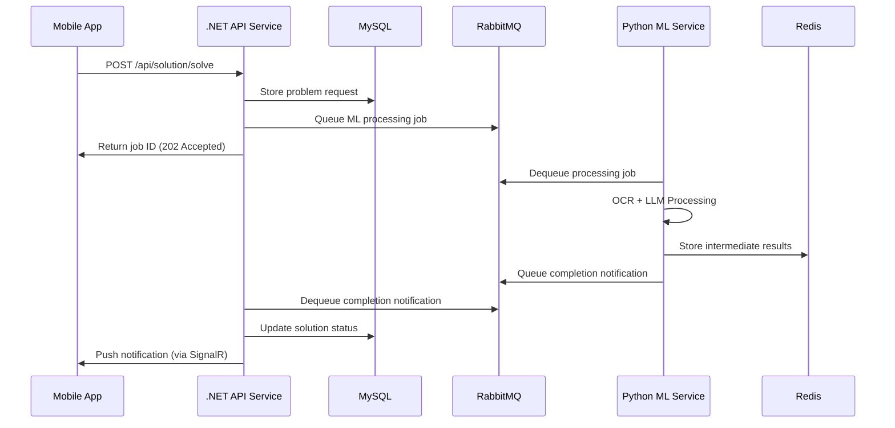

# Technical Workflow - Homework Solver System

## Architecture Overview

The Homework Solver system consists of two separate microservices:

1. **API Service** (.NET Core 8.0): Handles HTTP requests, authentication, and database operations
2. **ML Service** (Python + PyTorch): Handles all ML operations including OCR, fine-tuning, and AI agents

## Service Communication Flow

### Request Processing Flow



## .NET Core API Service Workflow

### Authentication Flow
```csharp
// AuthController.cs workflow
1. Client submits credentials
2. Validate against database
3. Generate JWT token
4. Return token + user profile
```

### Problem Solving Workflow
```csharp
// SolutionController.cs workflow
1. Receive problem submission
2. Validate user permissions
3. Store problem in database
4. Create ML processing job
5. Queue job to RabbitMQ
6. Return job ID to client
7. Listen for ML completion
8. Update database with results
9. Notify client via SignalR
```

### Data Models
```csharp
// Core entities
public class Problem
{
    public Guid Id { get; set; }
    public string UserId { get; set; }
    public string ImageUrl { get; set; }
    public string ExtractedText { get; set; }
    public ProblemStatus Status { get; set; }
    public DateTime CreatedAt { get; set; }
}

public class Solution
{
    public Guid Id { get; set; }
    public Guid ProblemId { get; set; }
    public string StepByStepSolution { get; set; }
    public string FinalAnswer { get; set; }
    public float Confidence { get; set; }
    public DateTime GeneratedAt { get; set; }
}
```

## Python ML Service Workflow

### OCR Processing Pipeline
```python
# OCR Service workflow
1. Receive image from API service
2. Preprocess image (noise reduction, contrast)
3. Run multiple OCR engines:
   - EasyOCR for general text
   - Tesseract for printed text
   - Mathpix for mathematical expressions
4. Combine and validate results
5. Return structured text
```

### LLM Processing Pipeline
```python
# LLM Service workflow
1. Receive extracted text
2. Classify problem type (algebra, calculus, etc.)
3. Route to appropriate expert model via MoE
4. Generate step-by-step solution
5. Validate mathematical accuracy
6. Return formatted solution
```

### Model Architecture
```python
# MoE (Mixture of Experts) routing
class MoERouter:
    def route_request(self, problem_text):
        # Classify problem type
        problem_type = self.classifier.predict(problem_text)
        
        # Route to appropriate expert
        expert_models = {
            'algebra': AlgebraExpert(),
            'calculus': CalculusExpert(),
            'geometry': GeometryExpert(),
            'statistics': StatisticsExpert()
        }
        
        return expert_models[problem_type]
```

## Service Integration Patterns

### Synchronous Communication (HTTP)
```csharp
// .NET API calling Python ML service
public async Task<OcrResult> ExtractTextAsync(byte[] imageData)
{
    var content = new ByteArrayContent(imageData);
    content.Headers.ContentType = new MediaTypeHeaderValue("image/jpeg");
    
    var response = await _httpClient.PostAsync("/api/ocr/extract", content);
    return await response.Content.ReadFromJsonAsync<OcrResult>();
}
```

### Asynchronous Communication (RabbitMQ)
```csharp
// Publishing job to queue
public async Task QueueSolutionJobAsync(SolutionJob job)
{
    var message = JsonSerializer.Serialize(job);
    var body = Encoding.UTF8.GetBytes(message);
    
    _channel.BasicPublish(
        exchange: "homework-solver",
        routingKey: "solution.generate",
        body: body
    );
}
```

```python
# Python ML service consuming jobs
def process_solution_job(ch, method, properties, body):
    job = json.loads(body)
    
    # Process OCR
    extracted_text = ocr_service.extract_text(job['image_url'])
    
    # Generate solution
    solution = llm_service.solve_problem(extracted_text)
    
    # Publish result
    publish_solution_result(job['id'], solution)
    
    ch.basic_ack(delivery_tag=method.delivery_tag)
```

## Error Handling & Resilience

### .NET API Service
```csharp
// Global exception handling
public class ErrorHandlingMiddleware
{
    public async Task InvokeAsync(HttpContext context)
    {
        try
        {
            await _next(context);
        }
        catch (MLServiceException ex)
        {
            // ML service unavailable
            await HandleMLServiceError(context, ex);
        }
        catch (ValidationException ex)
        {
            // Input validation error
            await HandleValidationError(context, ex);
        }
    }
}

// Circuit breaker for ML service calls
services.AddHttpClient<MLServiceClient>()
    .AddPolicyHandler(GetRetryPolicy())
    .AddPolicyHandler(GetCircuitBreakerPolicy());
```

### Python ML Service
```python
# Error handling with retries
@retry(
    stop=stop_after_attempt(3),
    wait=wait_exponential(multiplier=1, min=4, max=10)
)
def process_ocr(image_path):
    try:
        return ocr_engine.extract_text(image_path)
    except OCRException as e:
        logger.error(f"OCR processing failed: {e}")
        raise
```

## Performance Optimization

### Caching Strategy
```csharp
// Redis caching in .NET API
[HttpGet("{id}")]
[ResponseCache(Duration = 300)]
public async Task<IActionResult> GetSolution(Guid id)
{
    var cacheKey = $"solution:{id}";
    var cached = await _cache.GetStringAsync(cacheKey);
    
    if (cached != null)
        return Ok(JsonSerializer.Deserialize<Solution>(cached));
    
    var solution = await _solutionService.GetByIdAsync(id);
    await _cache.SetStringAsync(cacheKey, JsonSerializer.Serialize(solution));
    
    return Ok(solution);
}
```

### ML Model Optimization
```python
# Model loading and caching
class ModelManager:
    def __init__(self):
        self._models = {}
        self._device = torch.device("cuda" if torch.cuda.is_available() else "cpu")
    
    def load_model(self, model_type):
        if model_type not in self._models:
            model = AutoModelForCausalLM.from_pretrained(f"models/{model_type}")
            model.to(self._device)
            self._models[model_type] = model
        
        return self._models[model_type]
```

## Monitoring & Observability

### Health Checks
```csharp
// .NET API health checks
services.AddHealthChecks()
    .AddDbContext<AppDbContext>()
    .AddMySql(_connectionString)
    .AddRedis(_connectionString)
    .AddRabbitMQ(rabbitConnectionString: _rabbitMqConnection)
    .AddCheck<MLServiceHealthCheck>("ml-service");
```

### Logging
```python
# Structured logging in Python
import structlog

logger = structlog.get_logger()

def solve_problem(problem_text):
    logger.info("Starting problem solving", problem_id=problem_id)
    
    try:
        solution = generate_solution(problem_text)
        logger.info("Problem solved successfully", 
                   problem_id=problem_id, 
                   confidence=solution.confidence)
        return solution
    except Exception as e:
        logger.error("Problem solving failed", 
                    problem_id=problem_id, 
                    error=str(e))
        raise
```

## Security Considerations

### API Security
```csharp
// JWT authentication
services.AddAuthentication(JwtBearerDefaults.AuthenticationScheme)
    .AddJwtBearer(options =>
    {
        options.TokenValidationParameters = new TokenValidationParameters
        {
            ValidateIssuer = true,
            ValidateAudience = true,
            ValidateLifetime = true,
            ValidateIssuerSigningKey = true,
            ValidIssuer = configuration["Jwt:Issuer"],
            ValidAudience = configuration["Jwt:Audience"],
            IssuerSigningKey = new SymmetricSecurityKey(
                Encoding.UTF8.GetBytes(configuration["Jwt:SecretKey"]))
        };
    });
```

### Input Validation
```python
# Input sanitization in Python ML service
from pydantic import BaseModel, validator

class SolutionRequest(BaseModel):
    problem_text: str
    user_id: str
    
    @validator('problem_text')
    def validate_problem_text(cls, v):
        if len(v) > 10000:
            raise ValueError('Problem text too long')
        return v.strip()
```

## Deployment Workflow

### Docker Build Process
```bash
# Build .NET API service
docker build -f Dockerfile.api -t homework-solver-api:latest .

# Build Python ML service
docker build -f Dockerfile.ml -t homework-solver-ml:latest .
```

### Kubernetes Deployment
```yaml
# Deploy both services
kubectl apply -f k8s/api-deployment.yaml
kubectl apply -f k8s/ml-deployment.yaml
kubectl apply -f k8s/services.yaml
kubectl apply -f k8s/ingress.yaml
```

## Testing Strategy

### Unit Tests
```csharp
// .NET API unit tests
[Test]
public async Task SolveProblem_ValidInput_ReturnsJobId()
{
    // Arrange
    var mockMLService = new Mock<IMLServiceClient>();
    var controller = new SolutionController(mockMLService.Object);
    
    // Act
    var result = await controller.SolveProblem(validRequest);
    
    // Assert
    Assert.IsInstanceOf<AcceptedResult>(result);
}
```

```python
# Python ML service tests
def test_ocr_extraction():
    # Arrange
    image_path = "test_images/algebra_problem.jpg"
    
    # Act
    result = ocr_service.extract_text(image_path)
    
    # Assert
    assert result.confidence > 0.8
    assert "x + 2 = 5" in result.text
```

### Integration Tests
```csharp
// End-to-end workflow test
[Test]
public async Task CompleteWorkflow_ValidProblem_GeneratesSolution()
{
    // Submit problem
    var jobId = await apiClient.PostAsync("/api/solution/solve", problemData);
    
    // Wait for processing
    await Task.Delay(5000);
    
    // Verify solution
    var solution = await apiClient.GetAsync($"/api/solution/{jobId}");
    Assert.IsNotNull(solution.StepByStepSolution);
}
```