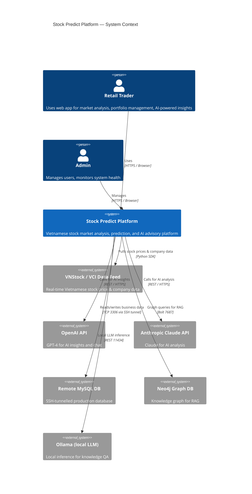
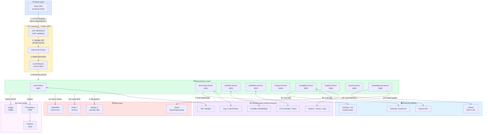
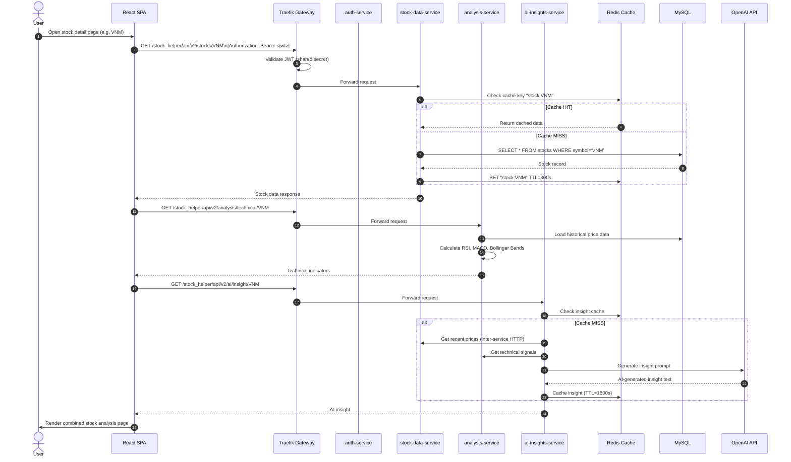

# 01 — System Overview Pipeline

## 1.1 C4 Context Diagram — Who uses the system

---

## 1.2 C4 Container Diagram — Internal architecture

```mermaid
C4Container
  title Stock Predict Platform — Containers

  Person(user, "User / Trader")

  Container(frontend, "React SPA", "React 19 / CRA", "Single-page app; all API calls via Fetch through Traefik gateway")

  Container(traefik, "Traefik API Gateway", "Traefik v2", "Path-prefix routing, TLS termination, load balancing, auth middleware")

  Container(auth_svc, "auth-service :8007", "FastAPI", "JWT issuing, user registration, password management")
  Container(stock_svc, "stock-data-service :8001", "FastAPI", "Company data, stock prices, VN30 priceboard, market info")
  Container(portfolio_svc, "portfolio-service :8003", "FastAPI", "Portfolios, holdings, transactions, watchlists, alerts")
  Container(pred_svc, "prediction-service :8002", "FastAPI + ML", "ML model management, predictions, backtesting, simulation")
  Container(analysis_svc, "analysis-service :8004", "FastAPI + TA-Lib", "Technical & fundamental analysis, screener")
  Container(ai_svc, "ai-insights-service :8005", "FastAPI + LLM", "AI-generated market insights via OpenAI / Claude")
  Container(chat_svc, "chatbot-service :8006", "FastAPI + LLM", "Conversational AI for stock queries")
  Container(journal_svc, "journal-service :8008", "FastAPI", "Trading journal, plans, risk metrics")
  Container(qa_svc, "knowledge-qa-service :8009", "FastAPI + GraphRAG", "Knowledge base Q&A via Neo4j + Ollama")

  ContainerDb(mysql, "MySQL 8", "Relational DB", "Primary system of record for all services")
  ContainerDb(redis, "Redis 7", "Cache", "Session cache, API response cache, rate limiting")
  ContainerDb(rabbitmq, "RabbitMQ 3", "Message Broker", "Async event bus with topic exchange")
  ContainerDb(neo4j_db, "Neo4j", "Graph DB", "Knowledge graph for RAG queries")

  Container(prometheus, "Prometheus", "Metrics", "Scrapes /metrics from all services")
  Container(grafana, "Grafana :3100", "Dashboards", "Visualises Prometheus metrics")
  Container(jaeger, "Jaeger :16686", "Tracing", "Distributed trace collection via OTLP")

  Rel(user, frontend, "Uses", "HTTPS :3004")
  Rel(frontend, traefik, "API calls", "HTTP :8004")

  Rel(traefik, auth_svc, "/auth/*")
  Rel(traefik, stock_svc, "/companies|stocks|market|industries|priceboards/*")
  Rel(traefik, portfolio_svc, "/portfolio/*")
  Rel(traefik, pred_svc, "/predictions|predict|models|solutions/*")
  Rel(traefik, analysis_svc, "/analysis/*")
  Rel(traefik, ai_svc, "/ai/*")
  Rel(traefik, chat_svc, "/chat/*")
  Rel(traefik, journal_svc, "/journal/*")
  Rel(traefik, qa_svc, "/knowledge-qa/*")

  Rel(auth_svc, mysql, "R/W users, tokens")
  Rel(stock_svc, mysql, "R/W stocks, companies")
  Rel(portfolio_svc, mysql, "R/W portfolios")
  Rel(pred_svc, mysql, "R/W models, predictions")
  Rel(analysis_svc, mysql, "R analysis data")
  Rel(journal_svc, mysql, "R/W journal entries")
  Rel(qa_svc, neo4j_db, "Graph queries")

  Rel(ai_svc, redis, "Cache insights")
  Rel(chat_svc, redis, "Cache chat sessions")
  Rel(portfolio_svc, rabbitmq, "Publishes portfolio events")
  Rel(pred_svc, rabbitmq, "Publishes prediction events")
  Rel(stock_svc, rabbitmq, "Publishes stock sync events")

  Rel(prometheus, auth_svc, "Scrape /metrics")
  Rel(prometheus, stock_svc, "Scrape /metrics")
  Rel(grafana, prometheus, "Query")
  Rel(jaeger, auth_svc, "Receive OTLP traces")
```

---

## 1.3 End-to-End Request Pipeline

---

## 1.4 Typical User Journey — Stock Analysis Request

