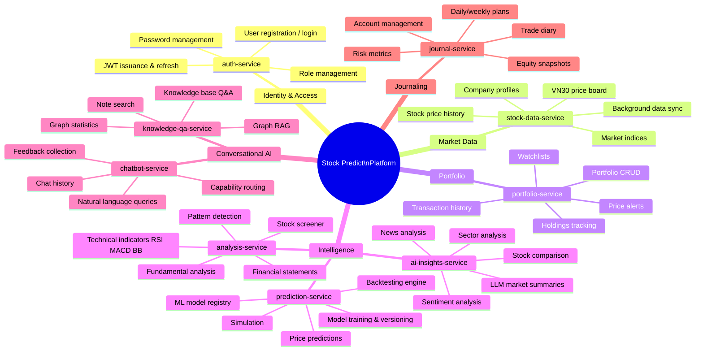
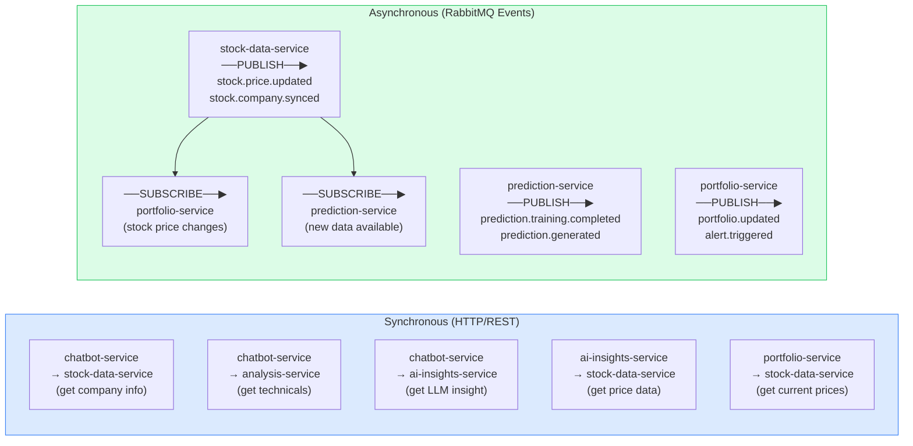
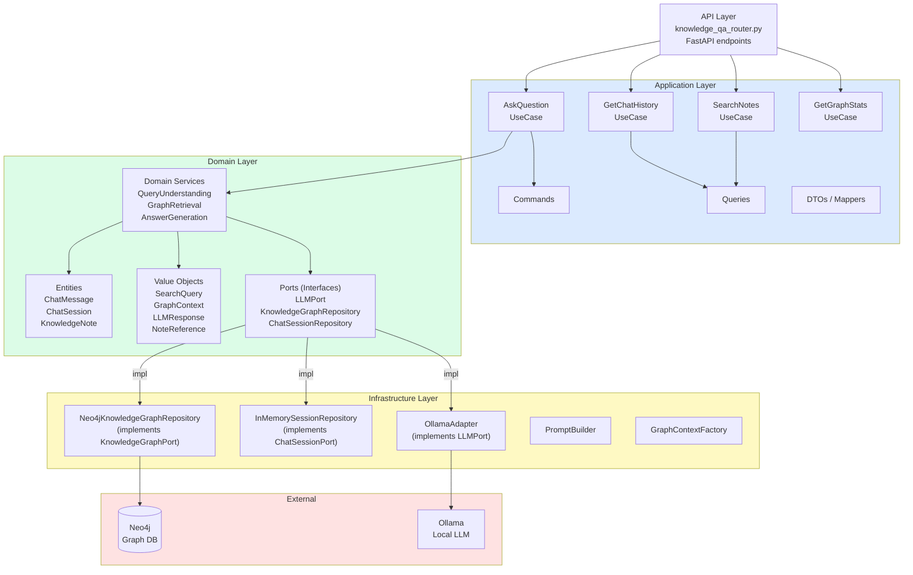

# 02 — Microservices Architecture

## 2.1 Service Dependency Map

```mermaid
graph TD
    subgraph INFRA["Infrastructure"]
        MYSQL[("MySQL 8")]
        REDIS[("Redis")]
        MQ[("RabbitMQ")]
        NEO4J[("Neo4j")]
    end

    subgraph EXTERNAL["External APIs"]
        VNSTOCK["VNStock/VCI"]
        OPENAI["OpenAI"]
        CLAUDE["Anthropic"]
        OLLAMA["Ollama"]
    end

    AUTH["🔐 auth-service\n:8007\nJWT · Users · Roles"]
    STOCK["📈 stock-data-service\n:8001\nPrices · Companies · Market"]
    PORT["💼 portfolio-service\n:8003\nPortfolios · Holdings · Alerts"]
    PRED["🤖 prediction-service\n:8002\nML Models · Predictions · Backtest"]
    ANAL["📊 analysis-service\n:8004\nTA · FA · Screener"]
    AI["💡 ai-insights-service\n:8005\nLLM Insights · Sentiment"]
    CHAT["💬 chatbot-service\n:8006\nConversational AI"]
    JOUR["📔 journal-service\n:8008\nTrade Journal · Risk"]
    QA["🧠 knowledge-qa-service\n:8009\nGraph RAG · Q&A"]

    %% DB connections
    AUTH --> MYSQL
    STOCK --> MYSQL
    PORT --> MYSQL
    PRED --> MYSQL
    ANAL --> MYSQL
    JOUR --> MYSQL
    QA --> NEO4J

    %% Cache connections
    AI --> REDIS
    CHAT --> REDIS
    STOCK --> REDIS
    PORT --> REDIS

    %% Event bus
    STOCK -->|"stock.price.updated\nstock.company.synced"| MQ
    PRED -->|"prediction.training.*\nprediction.generated"| MQ
    PORT -->|"portfolio.updated\nalert.triggered"| MQ
    ANAL -->|"analysis.completed"| MQ

    %% Inter-service HTTP calls
    CHAT -->|"GET /companies\nGET /stocks"| STOCK
    CHAT -->|"GET /analysis"| ANAL
    CHAT -->|"GET /predict"| PRED
    CHAT -->|"GET /ai/insight"| AI
    AI -->|"GET /stocks (price data)"| STOCK
    AI -->|"GET /analysis (signals)"| ANAL
    PORT -->|"GET /stocks (prices)"| STOCK

    %% External
    STOCK --> VNSTOCK
    AI --> OPENAI
    AI --> CLAUDE
    QA --> OLLAMA

    %% MQ consumers
    MQ -->|"stock.price.updated"| PORT
    MQ -->|"stock.data.available"| PRED

    style AUTH fill:#fef9c3,stroke:#ca8a04
    style STOCK fill:#dbeafe,stroke:#3b82f6
    style PORT fill:#dcfce7,stroke:#16a34a
    style PRED fill:#f3e8ff,stroke:#9333ea
    style ANAL fill:#e0f2fe,stroke:#0284c7
    style AI fill:#fff7ed,stroke:#ea580c
    style CHAT fill:#fce7f3,stroke:#db2777
    style JOUR fill:#f0fdf4,stroke:#15803d
    style QA fill:#fdf4ff,stroke:#c026d3
```

---

## 2.2 Service Internal Architecture (Standard Pattern)

Every service follows the same layered structure:

```mermaid
graph TD
    subgraph SERVICE["Microservice (e.g. stock-data-service)"]
        subgraph HTTP["HTTP Layer"]
            ROUTES["api/routes.py\nFastAPI Router\nPydantic schemas\n(request / response)"]
            HEALTH["/health/live\n/health/ready\n/metrics"]
        end

        subgraph BIZ["Business Logic Layer"]
            SVC["services/\nDomain Services\nbusiness rules\norchestration"]
        end

        subgraph REPO["Data Access Layer"]
            REPOS["repositories/\nBaseRepository\nCRUD + queries\nasync SQLAlchemy"]
        end

        subgraph MODEL["Domain Model Layer"]
            DOM["models/domain.py\nSQLAlchemy ORM entities"]
            SCHEMA["models/schemas.py\nPydantic DTOs"]
        end

        subgraph INFRA["Infrastructure"]
            CONF["config.py\npydantic-settings\nenv vars"]
            MAIN["main.py\nFastAPI app\nlifespan hooks\nmiddleware"]
        end
    end

    ROUTES --> SVC
    SVC --> REPOS
    REPOS --> DOM
    ROUTES --> SCHEMA
    MAIN --> ROUTES
    MAIN --> HEALTH
    CONF --> MAIN

    DB[("MySQL")]
    CACHE[("Redis")]
    MQ[("RabbitMQ")]

    REPOS --> DB
    SVC --> CACHE
    SVC --> MQ

    COMMON["stock-common\nlibrary"]
    MAIN --> COMMON
    REPOS --> COMMON

    style HTTP fill:#dbeafe
    style BIZ fill:#dcfce7
    style REPO fill:#fef9c3
    style MODEL fill:#f3e8ff
    style INFRA fill:#fee2e2
```

---

## 2.3 Service Responsibility Matrix



---

## 2.4 Inter-Service Communication Patterns



---

## 2.5 Knowledge-QA Service — Special Architecture

This service uses full DDD layering, unlike the simpler CRUD services:


