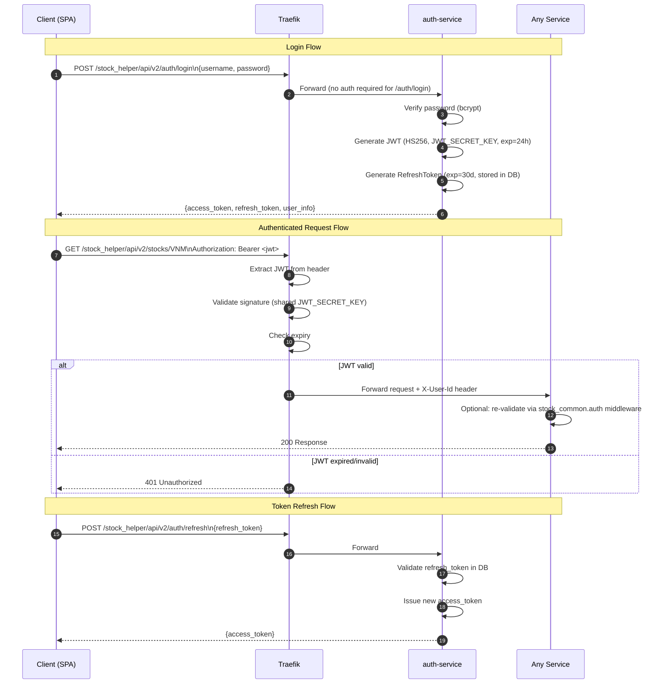

# 03 — API Gateway & Routing

## 3.1 Traefik Routing Architecture

```mermaid
flowchart TD
    subgraph INTERNET["Internet / Client"]
        BROWSER["Browser :3004\nReact SPA"]
        CURL["curl / API Client"]
    end

    subgraph TRAEFIK["Traefik v2 — API Gateway :8004"]
        ENTRYPOINT["Entrypoint: web\nport 80 (internal)\nport 8004 (external)"]
        ENTRYPOINT_HTTPS["Entrypoint: websecure\nport 443 (internal)\nport 8444 (external)"]
        DASHBOARD["Traefik Dashboard\nport 8084"]

        subgraph MIDDLEWARE["Middleware Chain"]
            CORS["CORS Middleware\nAllowOrigins: *\nAllowMethods: GET,POST,PUT,DELETE,OPTIONS\nAllowHeaders: Authorization, Content-Type"]
            STRIP["StripPrefix Middleware\n(per-service path stripping)"]
            RATELIMIT["Rate Limiter\n(future)"]
        end

        subgraph ROUTERS["Routers (PathPrefix Rules)"]
            R_AUTH["auth-router\nPathPrefix: /stock_helper/api/v2/auth"]
            R_COMPANIES["companies-router\nPathPrefix: /stock_helper/api/v2/companies"]
            R_STOCKS["stocks-router\nPathPrefix: /stock_helper/api/v2/stocks"]
            R_MARKET["market-router\nPathPrefix: /stock_helper/api/v2/market"]
            R_INDUSTRIES["industries-router\nPathPrefix: /stock_helper/api/v2/industries"]
            R_PRICEBOARDS["priceboards-router\nPathPrefix: /stock_helper/api/v2/priceboards"]
            R_PORTFOLIO["portfolio-router\nPathPrefix: /stock_helper/api/v2/portfolio"]
            R_PREDICT["predict-router\nPathPrefix: /stock_helper/api/v2/predict"]
            R_PREDICTIONS["predictions-router\nPathPrefix: /stock_helper/api/v2/predictions"]
            R_MODELS["models-router\nPathPrefix: /stock_helper/api/v2/models"]
            R_SOLUTIONS["solutions-router\nPathPrefix: /stock_helper/api/v2/solutions"]
            R_ANALYSIS["analysis-router\nPathPrefix: /stock_helper/api/v2/analysis"]
            R_AI["ai-router\nPathPrefix: /stock_helper/api/v2/ai"]
            R_CHAT["chat-router\nPathPrefix: /stock_helper/api/v2/chat"]
            R_JOURNAL["journal-router\nPathPrefix: /stock_helper/api/v2/journal"]
            R_KQA["knowledge-qa-router\nPathPrefix: /stock_helper/api/v2/knowledge-qa"]
        end
    end

    subgraph SERVICES["Backend Services"]
        AUTH_SVC["auth-service\nauth-service:8007"]
        STOCK_SVC["stock-data-service\nstock-data-service:8001"]
        PORT_SVC["portfolio-service\nportfolio-service:8003"]
        PRED_SVC["prediction-service\nprediction-service:8002"]
        ANAL_SVC["analysis-service\nanalysis-service:8004"]
        AI_SVC["ai-insights-service\nai-insights-service:8005"]
        CHAT_SVC["chatbot-service\nchatbot-service:8006"]
        JOUR_SVC["journal-service\njournal-service:8008"]
        QA_SVC["knowledge-qa-service\nknowledge-qa-service:8009"]
    end

    BROWSER --> ENTRYPOINT
    CURL --> ENTRYPOINT
    ENTRYPOINT --> CORS
    CORS --> STRIP
    STRIP --> ROUTERS

    R_AUTH --> AUTH_SVC
    R_COMPANIES & R_STOCKS & R_MARKET & R_INDUSTRIES & R_PRICEBOARDS --> STOCK_SVC
    R_PORTFOLIO --> PORT_SVC
    R_PREDICT & R_PREDICTIONS & R_MODELS & R_SOLUTIONS --> PRED_SVC
    R_ANALYSIS --> ANAL_SVC
    R_AI --> AI_SVC
    R_CHAT --> CHAT_SVC
    R_JOURNAL --> JOUR_SVC
    R_KQA --> QA_SVC

    style TRAEFIK fill:#fef9c3,stroke:#ca8a04
    style MIDDLEWARE fill:#fee2e2,stroke:#ef4444
    style ROUTERS fill:#dbeafe,stroke:#3b82f6
    style SERVICES fill:#dcfce7,stroke:#22c55e
```



---

## 3.2 Complete Routing Table

```mermaid
block-beta
  columns 4
  block:H["Path Prefix"]:1
  block:S["Target Service"]:1
  block:P["Internal Port"]:1
  block:M["Key Endpoints"]:1

  A["/stock_helper/api/v2/auth"]:1
  B["auth-service"]:1
  C[":8007"]:1
  D["POST /login\nPOST /register\nPOST /refresh\nPOST /reset-password"]:1

  E["/stock_helper/api/v2/companies"]:1
  F["stock-data-service"]:1
  G[":8001"]:1
  H2["GET /\nGET /{symbol}\nGET /{symbol}/financial\nGET /{symbol}/news"]:1

  I["/stock_helper/api/v2/stocks"]:1
  J["stock-data-service"]:1
  K[":8001"]:1
  L["GET /{symbol}\nGET /{symbol}/history\nGET /search"]:1

  M2["/stock_helper/api/v2/market"]:1
  N["stock-data-service"]:1
  O[":8001"]:1
  P2["GET /overview\nGET /movers\nGET /indices"]:1

  Q["/stock_helper/api/v2/portfolio"]:1
  R["portfolio-service"]:1
  S2[":8003"]:1
  T["CRUD portfolios\nGET /holdings\nPOST /transactions\nGET /alerts"]:1

  U["/stock_helper/api/v2/predict"]:1
  V["prediction-service"]:1
  W[":8002"]:1
  X["POST /\nGET /{id}/result"]:1

  Y["/stock_helper/api/v2/models"]:1
  Z["prediction-service"]:1
  AA[":8002"]:1
  BB["CRUD ML models\nPOST /train\nGET /status"]:1

  CC["/stock_helper/api/v2/analysis"]:1
  DD["analysis-service"]:1
  EE[":8004"]:1
  FF["GET /technical/{sym}\nGET /fundamental/{sym}\nGET /screener"]:1

  GG["/stock_helper/api/v2/ai"]:1
  HH["ai-insights-service"]:1
  II[":8005"]:1
  JJ["GET /insight/{sym}\nGET /market-overview\nPOST /ask\nGET /trending"]:1

  KK["/stock_helper/api/v2/chat"]:1
  LL["chatbot-service"]:1
  MM[":8006"]:1
  NN["POST /\nGET /history\nGET /suggestions"]:1

  OO["/stock_helper/api/v2/journal"]:1
  PP["journal-service"]:1
  QQ[":8008"]:1
  RR["CRUD accounts\nCRUD trades\nGET /metrics\nGET /equity-curve"]:1

  SS["/stock_helper/api/v2/knowledge-qa"]:1
  TT["knowledge-qa-service"]:1
  UU[":8009"]:1
  VV["POST /chat\nGET /search\nGET /stats"]:1
```

---

## 3.3 Request Lifecycle with Auth



---

## 3.4 URL Anatomy

```
Full URL: http://localhost:8004/stock_helper/api/v2/companies/VNM/financial

 ┌─────────────────────┐   ┌────────────────────────────────────────────────────────┐
 │  Traefik gateway     │   │   Path                                                  │
 │  localhost:8004      │   │   /stock_helper/api/v2 / companies / VNM / financial   │
 └─────────────────────┘   └──────────┬─────────────┬──────┬───────────────────────┘
                                       │             │      │
                                  API_PREFIX    service  resource
                             (global constant)  segment  path

 Traefik matches: PathPrefix(/stock_helper/api/v2/companies)
 Forwards to:     stock-data-service:8001
 Service sees:    /stock_helper/api/v2/companies/VNM/financial
                  (full path preserved, no stripping by default)
```
