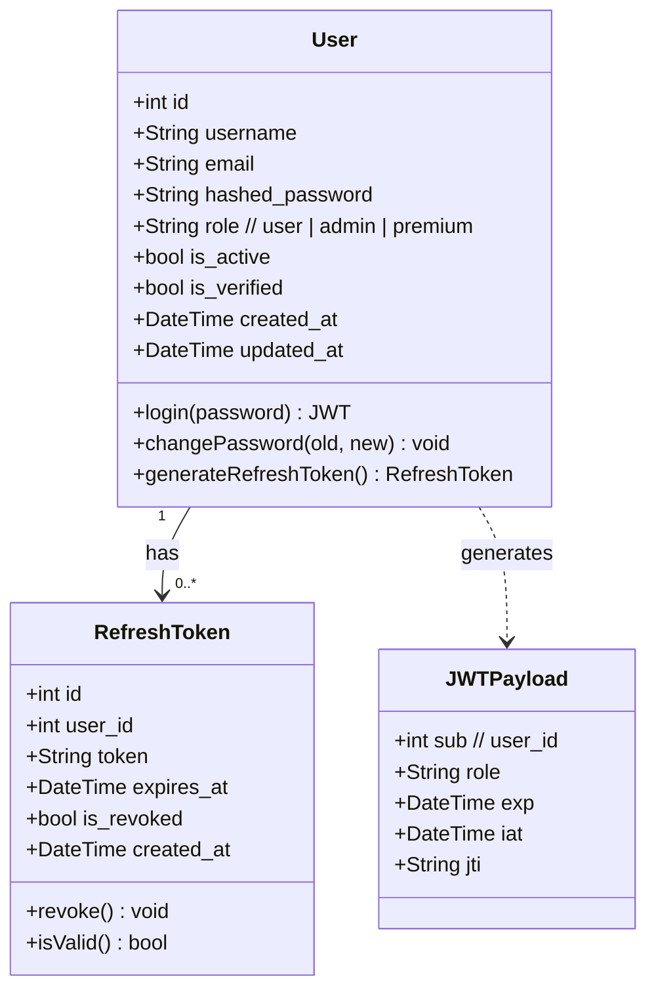
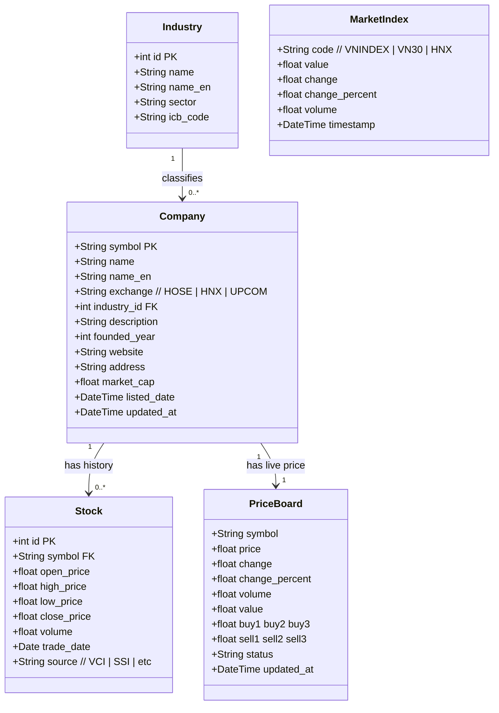
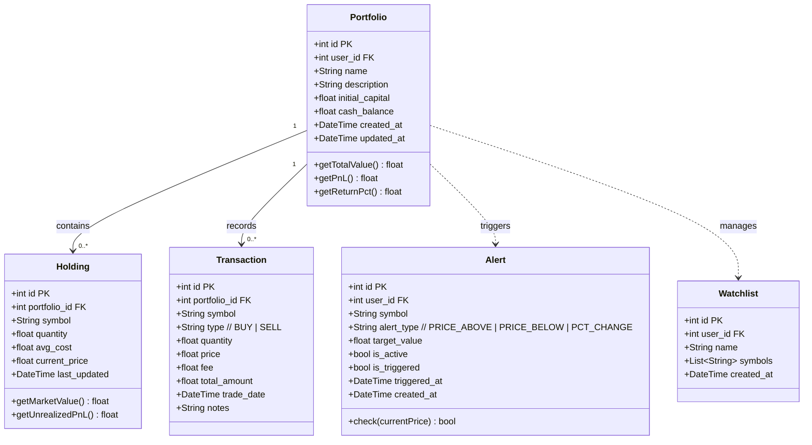
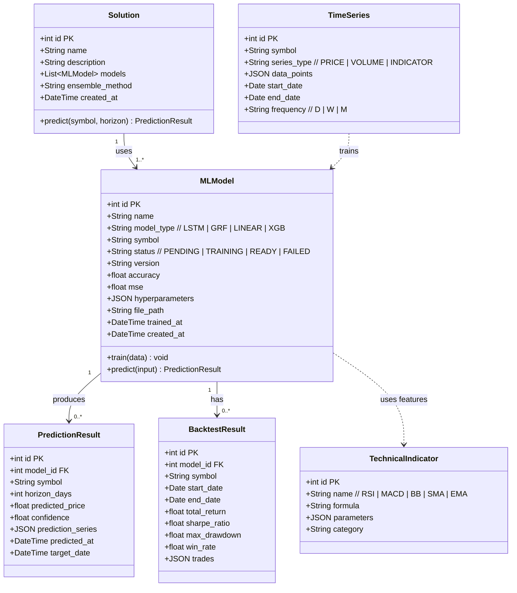
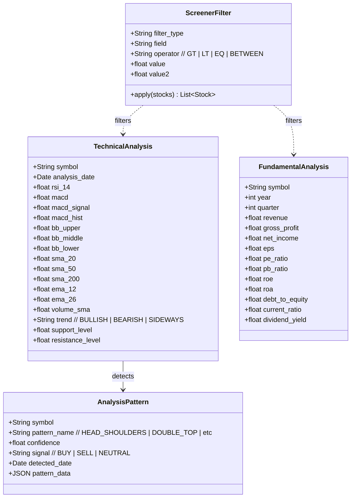
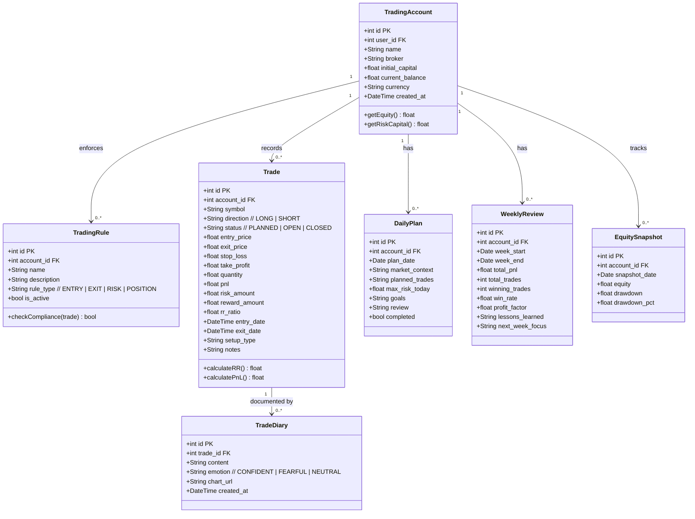
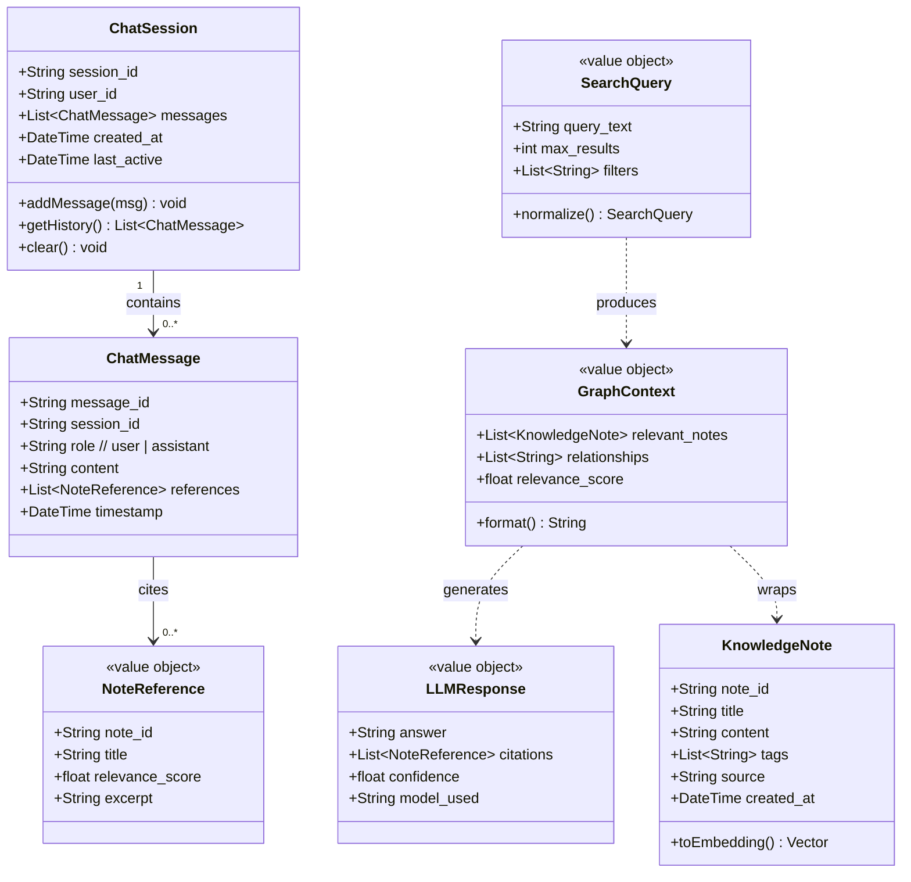
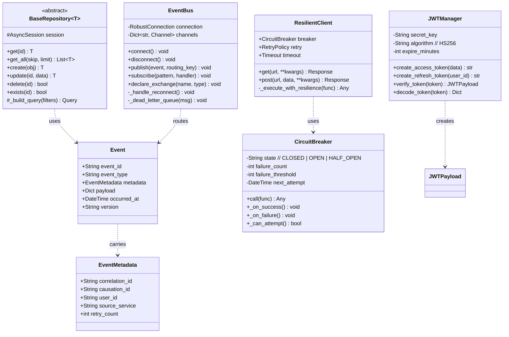

# 04 — Domain Models & Class Diagrams

## 4.1 Auth Service — Domain Model

---

## 4.2 Stock Data Service — Domain Model

---

## 4.3 Portfolio Service — Domain Model

---

## 4.4 Prediction Service — Domain Model

---

## 4.5 Analysis Service — Domain Model

---

## 4.6 Journal Service — Domain Model

---

## 4.7 Knowledge QA Service — Domain Entities

---

## 4.8 Shared Stock-Common — Core Classes

