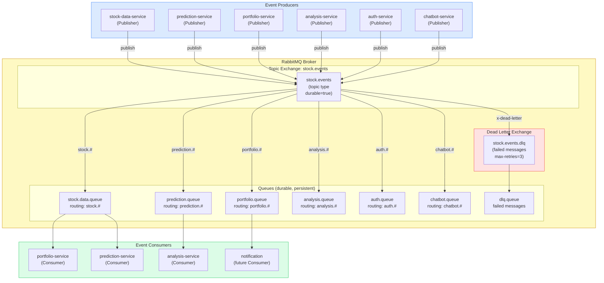
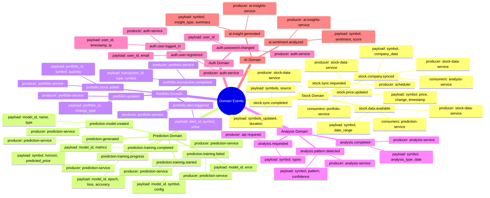
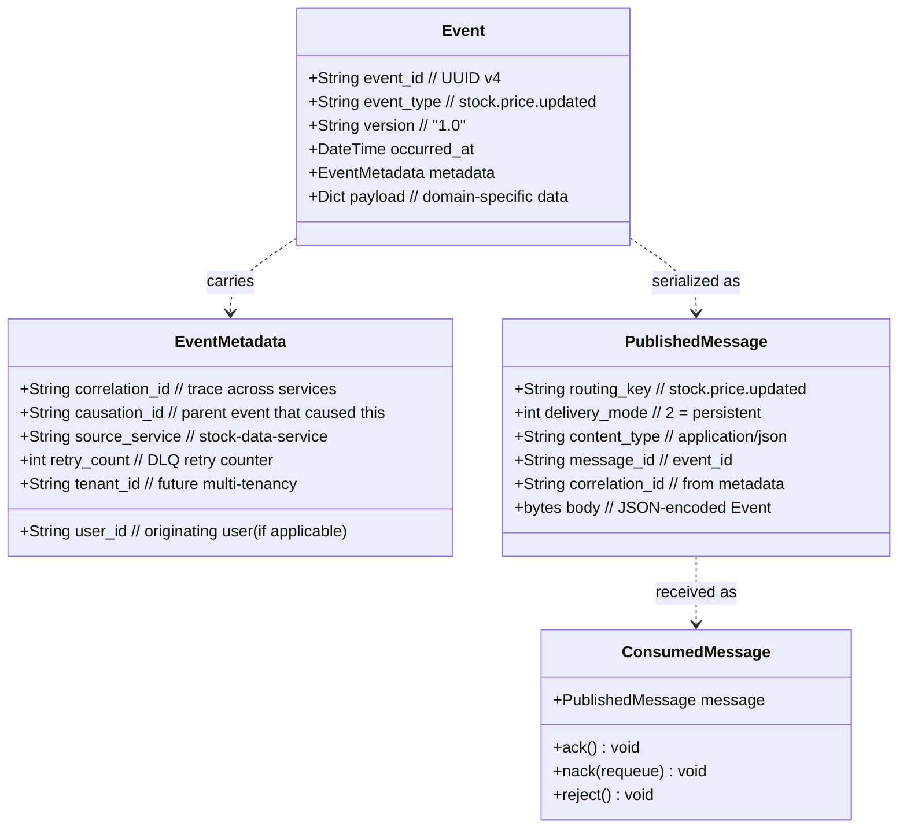
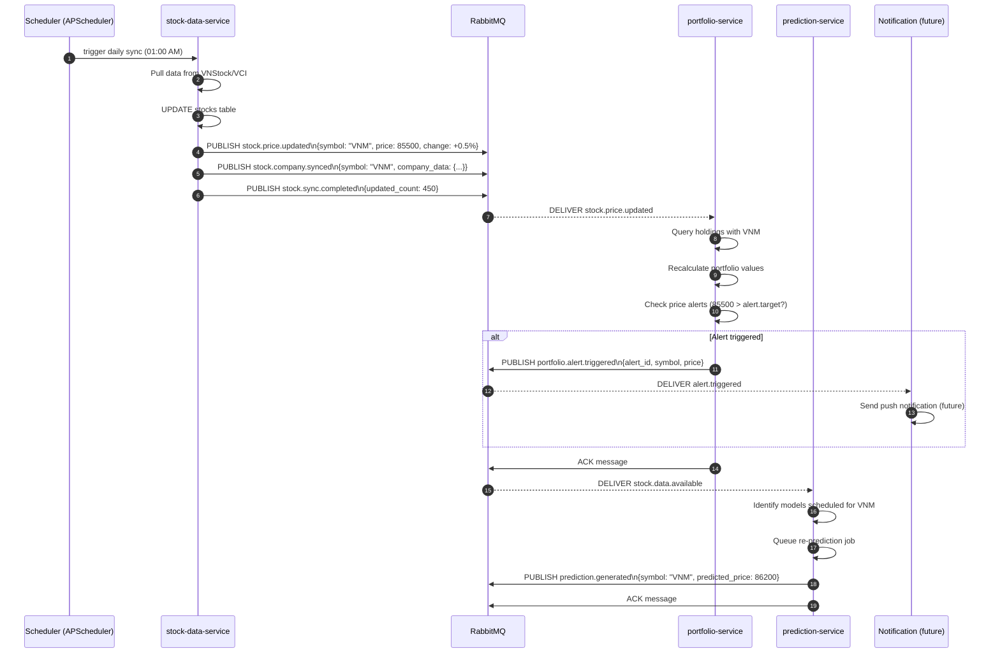
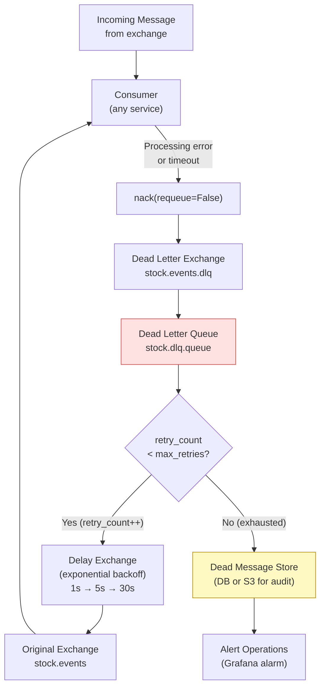
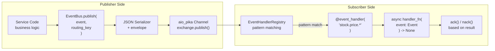

# 05 — Event-Driven Architecture

## 5.1 RabbitMQ Topology Overview

---

## 5.2 Complete Event Catalog

---

## 5.3 Event Structure & Envelope

---

## 5.4 Event Flow — Stock Price Update Cascade

---

## 5.5 Dead Letter Queue Flow

---

## 5.6 EventBus Implementation Pattern

