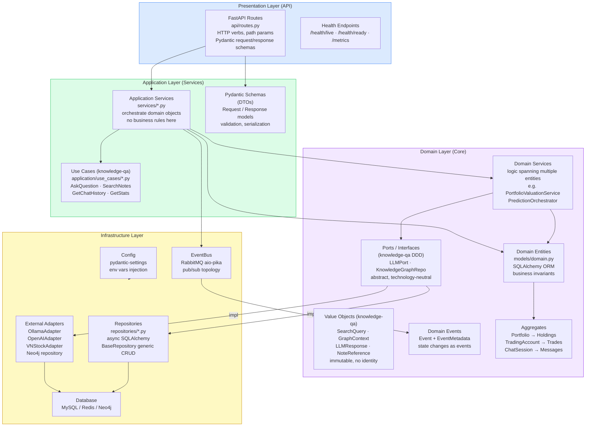
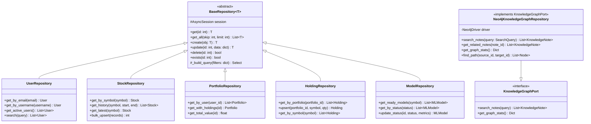
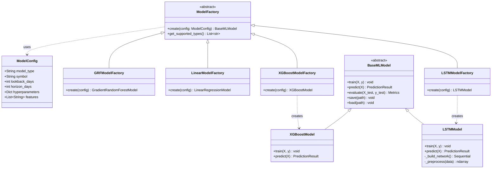
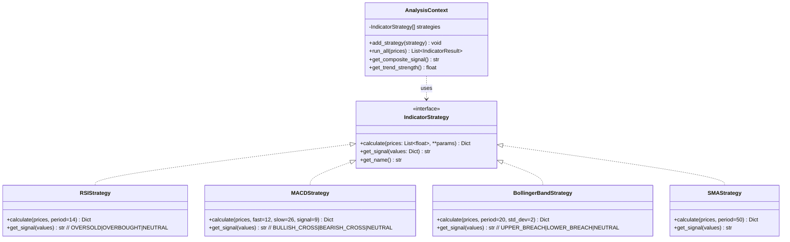
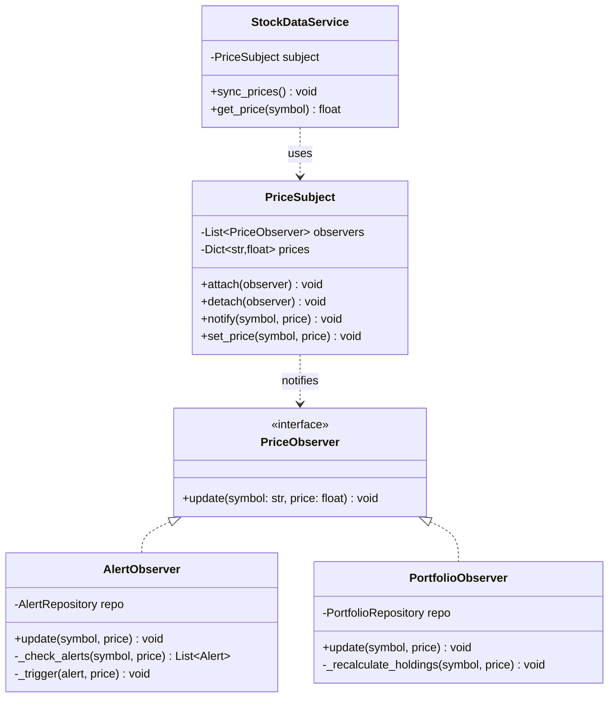
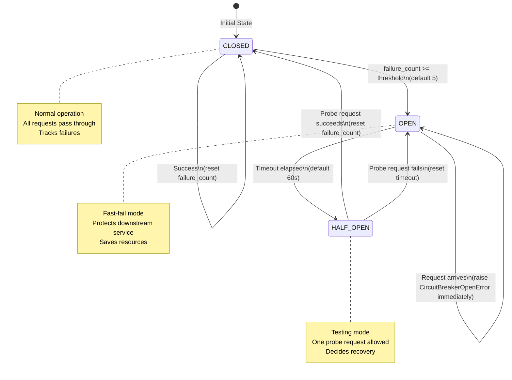
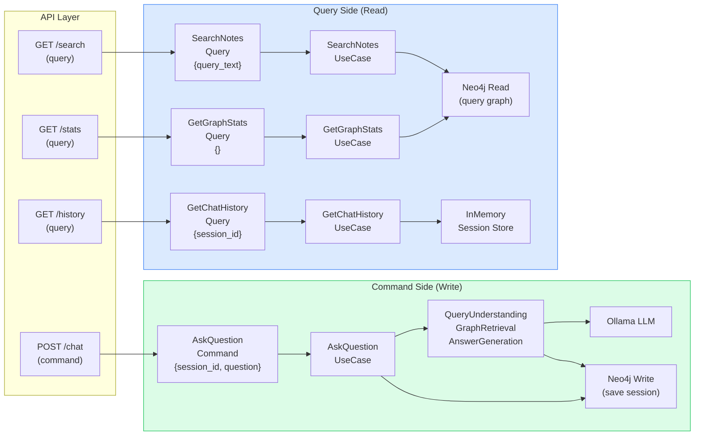

# 06 — DDD & Design Patterns

## 6.1 Domain-Driven Design Layers Applied



---

## 6.2 Repository Pattern



---

## 6.3 Factory Pattern (Prediction Service)



---

## 6.4 Strategy Pattern (Analysis Service)



---

## 6.5 Observer Pattern (Alert System)



---

## 6.6 Circuit Breaker Pattern



---

## 6.7 CQRS Pattern (knowledge-qa-service)



---

## 6.8 Aggregate Pattern (Portfolio Service)

```mermaid
flowchart TD
    subgraph AGGREGATE["Portfolio Aggregate Root"]
        PORT["Portfolio\n(Aggregate Root)\nid, user_id, name\ncash_balance"]
        
        subgraph CHILDREN["Child Entities (same transaction boundary)"]
            HOLD["Holdings\n(Entity Collection)\nsymbol, quantity, avg_cost"]
            TXN["Transactions\n(Entity Collection)\ntype, qty, price, date"]
        end
        
        subgraph INVARIANTS["Business Invariants (enforced by Aggregate)"]
            INV1["cash_balance >= 0\n(cannot overdraw)"]
            INV2["BUY → reduce cash\nadd/update holding"]
            INV3["SELL → increase cash\nreduce/remove holding"]
            INV4["quantity >= 0\n(no negative positions)"]
        end
    end

    subgraph EXTERNAL["External References (by ID only)"]
        ALERT["Alert\n(different aggregate)\nuser_id, symbol, target"]
        WATCHLIST["Watchlist\n(different aggregate)\nuser_id, symbols[]"]
    end

    PORT --> HOLD
    PORT --> TXN
    PORT ..> INV1 & INV2 & INV3 & INV4
    PORT -.->|"user_id ref"| ALERT
    PORT -.->|"user_id ref"| WATCHLIST
```
