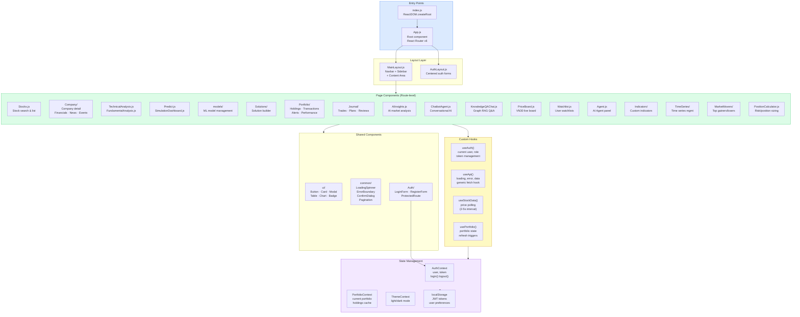
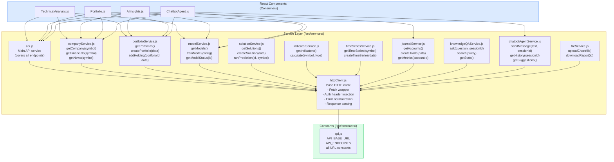
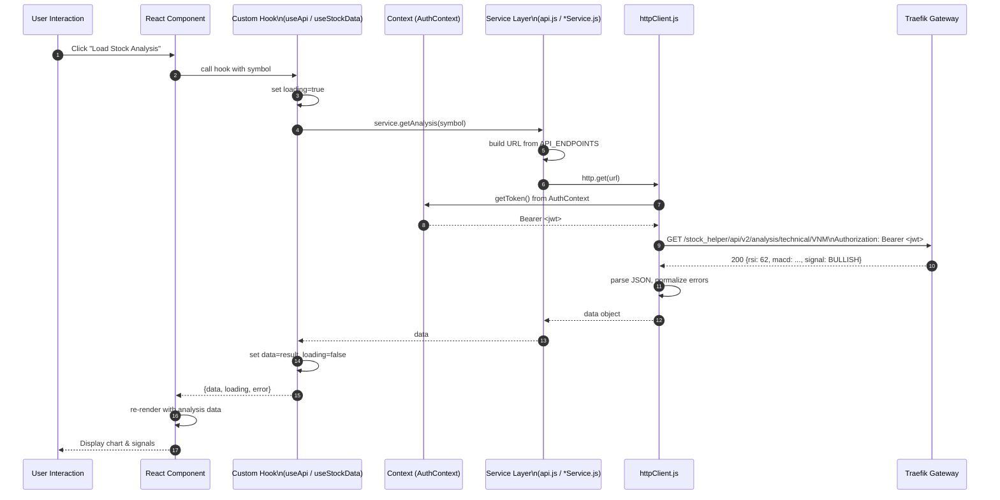
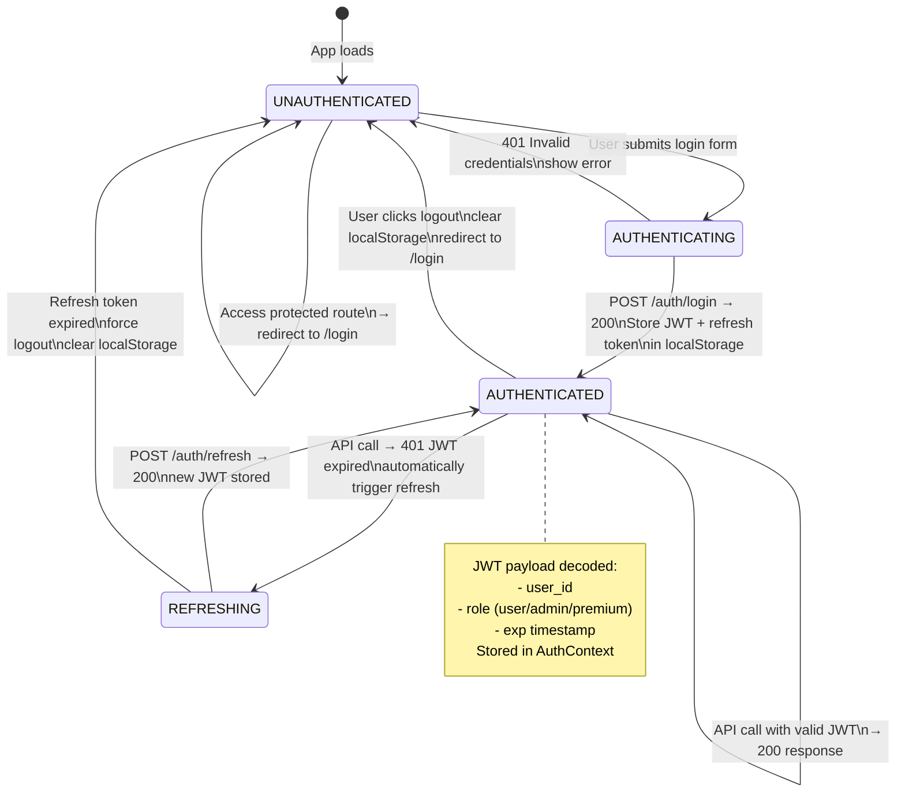
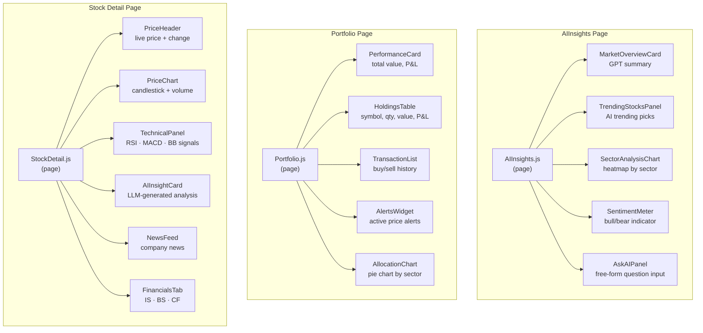

# 07 — Frontend Architecture

## 7.1 React Application Structure

---

## 7.2 Service Layer Architecture

---

## 7.3 Route Map

```mermaid
flowchart TD
    ROOT["/stock-app (homepage)"]

    ROOT --> AUTH_R["/stock-app/auth/*"]
    AUTH_R --> LOGIN["/login"]
    AUTH_R --> REGISTER["/register"]

    ROOT --> MARKET_R["/market/*"]
    MARKET_R --> PRICEBOARD["/priceboard\nVN30 live board"]
    MARKET_R --> MOVERS["/movers\nTop gainers/losers"]
    MARKET_R --> INDICES["/indices\nMarket indices"]

    ROOT --> STOCKS_R["/stocks/*"]
    STOCKS_R --> STOCK_LIST["/stocks\nSearch & browse"]
    STOCKS_R --> STOCK_DETAIL["/stocks/:symbol\nCompany detail"]
    STOCKS_R --> TECHNICAL["/stocks/:symbol/technical"]
    STOCKS_R --> FUNDAMENTAL["/stocks/:symbol/fundamental"]

    ROOT --> PORTFOLIO_R["/portfolio/*"]
    PORTFOLIO_R --> PORT_LIST["/portfolio\nMy portfolios"]
    PORTFOLIO_R --> PORT_DETAIL["/portfolio/:id"]
    PORTFOLIO_R --> WATCHLIST["/watchlist"]
    PORTFOLIO_R --> ALERTS["/alerts"]
    PORTFOLIO_R --> CALC["/position-calculator"]

    ROOT --> AI_R["/ai/*"]
    AI_R --> AI_INSIGHTS["/ai/insights\nMarket AI overview"]
    AI_R --> CHATBOT["/ai/chat\nConversational AI"]
    AI_R --> KQA["/ai/knowledge-qa\nGraph RAG Q&A"]
    AI_R --> AGENT["/ai/agent\nAI Agent panel"]

    ROOT --> PRED_R["/predictions/*"]
    PRED_R --> PREDICT["/predict\nRun prediction"]
    PRED_R --> MODELS["/models\nModel management"]
    PRED_R --> SOLUTIONS["/solutions\nSolution builder"]
    PRED_R --> SIMULATION["/simulation\nBacktest / simulation"]
    PRED_R --> INDICATORS["/indicators\nCustom indicators"]
    PRED_R --> TIMESERIES["/time-series\nTime series data"]

    ROOT --> JOURNAL_R["/journal/*"]
    JOURNAL_R --> JOUR_HOME["/journal\nDashboard"]
    JOURNAL_R --> TRADES["/journal/trades"]
    JOURNAL_R --> PLANS["/journal/plans"]
    JOURNAL_R --> REVIEWS["/journal/reviews"]
    JOURNAL_R --> EQUITY["/journal/equity-curve"]

    style ROOT fill:#3b82f6,color:#fff
    style AUTH_R fill:#fee2e2,stroke:#ef4444
    style MARKET_R fill:#dcfce7,stroke:#22c55e
    style STOCKS_R fill:#dbeafe,stroke:#3b82f6
    style PORTFOLIO_R fill:#fef9c3,stroke:#ca8a04
    style AI_R fill:#f3e8ff,stroke:#9333ea
    style PRED_R fill:#fff7ed,stroke:#ea580c
    style JOURNAL_R fill:#f0fdf4,stroke:#15803d
```

---

## 7.4 Data Flow — Component ↔ API

---

## 7.5 Authentication State Flow

---

## 7.6 Component Hierarchy (Key Pages)

