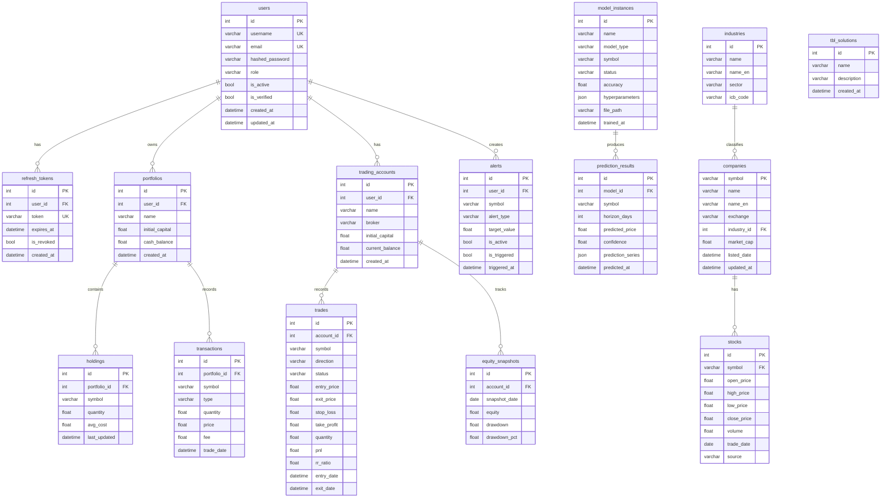
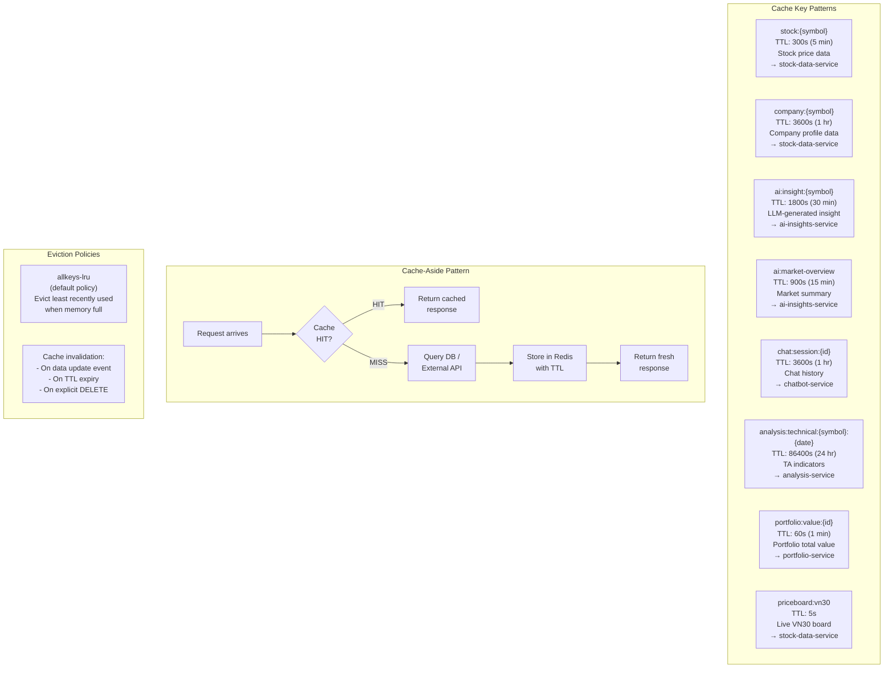
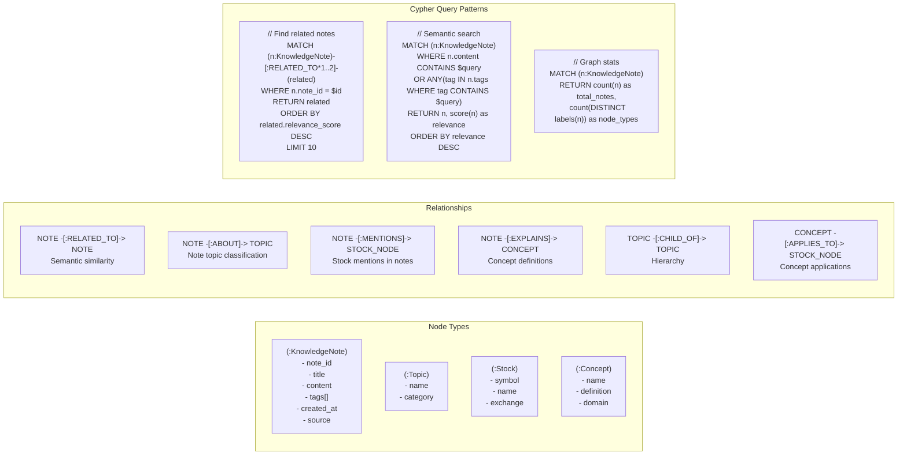
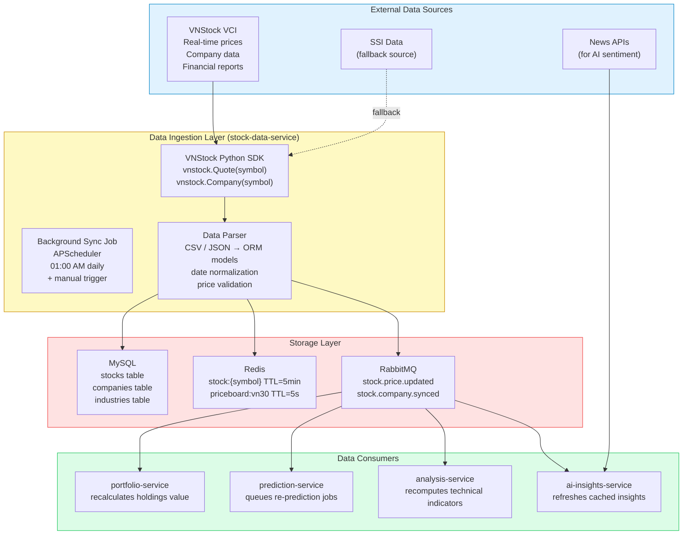
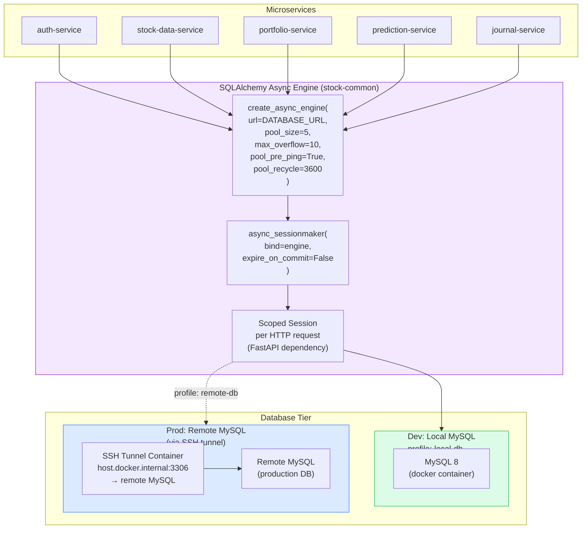

# 08 — Data Architecture

## 8.1 MySQL Schema Overview (All Services)

---

## 8.2 Redis Caching Strategy

---

## 8.3 Neo4j Knowledge Graph Schema

---

## 8.4 Data Flow — Market Data Pipeline

---

## 8.5 Database Connection Architecture

