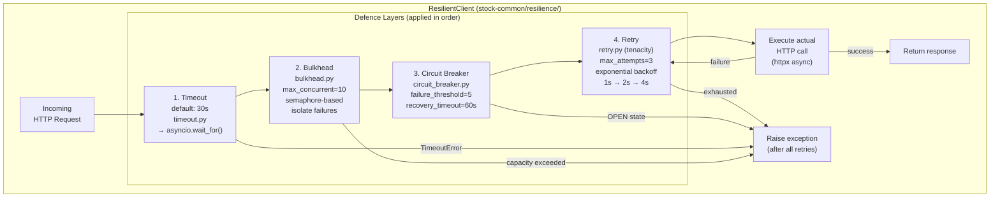
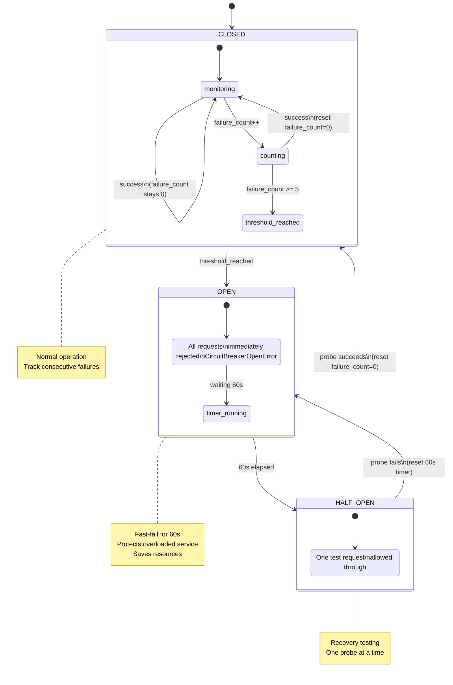
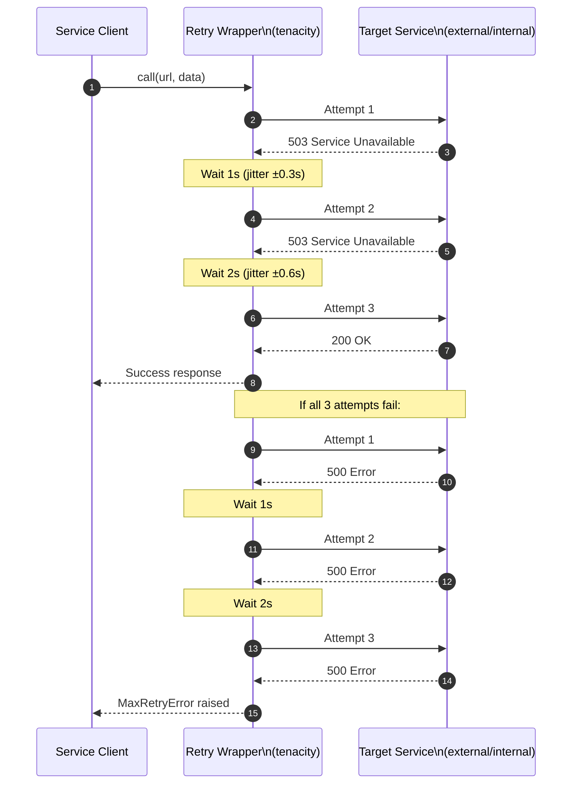
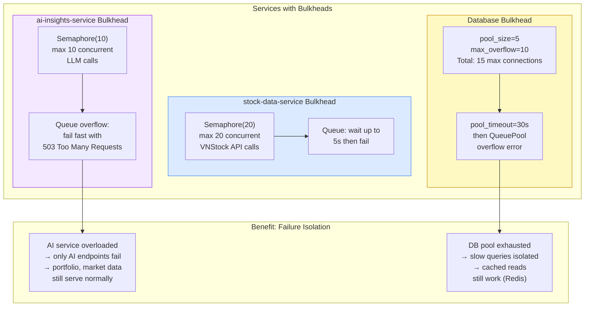
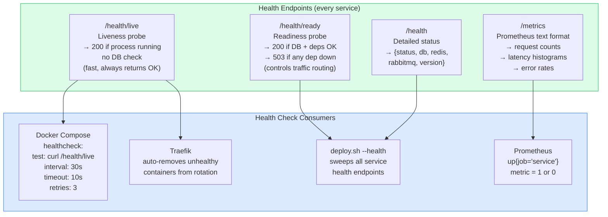
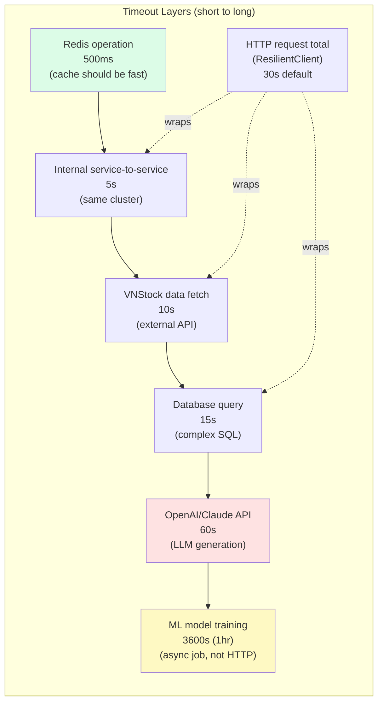

# 09 — Resilience Patterns

## 9.1 Resilience Stack (stock-common)

---

## 9.2 Circuit Breaker — State Machine Detail

---

## 9.3 Retry Policy with Exponential Backoff

---

## 9.4 Bulkhead Pattern — Resource Isolation

---

## 9.5 Health Check Architecture

---

## 9.6 Timeout Hierarchy

