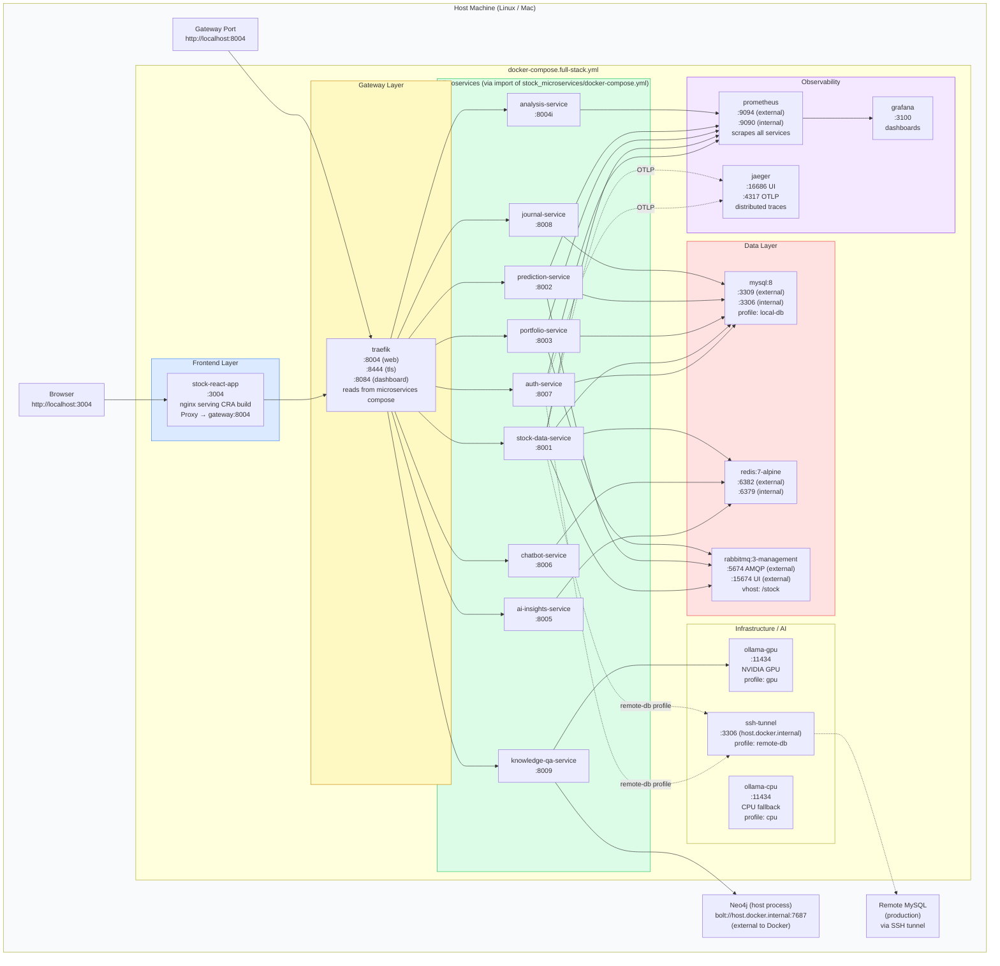
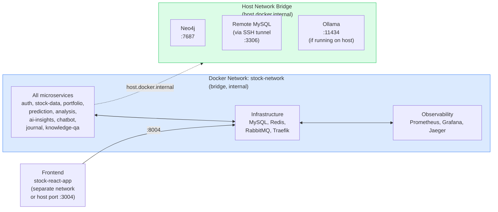
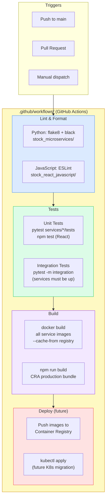
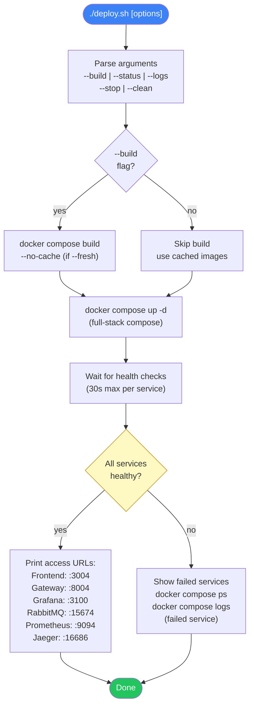
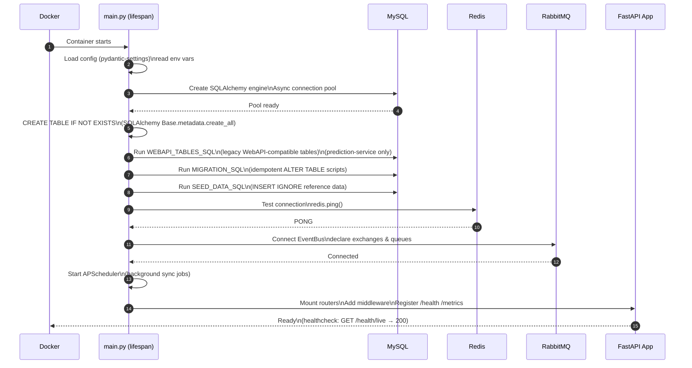

# 10 — Deployment & Infrastructure

## 10.1 Full-Stack Deployment Topology



---

## 10.2 Port Allocation Map

```mermaid
block-beta
    columns 5
    block:H1["Service"]:1
    block:H2["Dev Port\n(microsvcs only)"]:1
    block:H3["Full-Stack Port\n(all-in-one)"]:1
    block:H4["Internal Port"]:1
    block:H5["Protocol"]:1

    A["Traefik (HTTP)"]:1 B["8004"]:1 C["8004"]:1 D["80"]:1 E["HTTP"]:1
    F["Traefik (HTTPS)"]:1 G["8444"]:1 H["8444"]:1 I["443"]:1 J["HTTPS"]:1
    K["Traefik Dashboard"]:1 L["8084"]:1 M["8084"]:1 N["8080"]:1 O["HTTP"]:1
    P["auth-service"]:1 Q["8007"]:1 R["8007"]:1 S["8007"]:1 T["HTTP"]:1
    U["stock-data-service"]:1 V["8001"]:1 W["8001"]:1 X["8001"]:1 Y["HTTP"]:1
    Z["portfolio-service"]:1 AA["8003"]:1 BB["8003"]:1 CC["8003"]:1 DD["HTTP"]:1
    EE["prediction-service"]:1 FF["8002"]:1 GG["8002"]:1 HH["8002"]:1 II["HTTP"]:1
    JJ["analysis-service"]:1 KK["8004i"]:1 LL["8004i"]:1 MM["8004i"]:1 NN["HTTP"]:1
    OO["ai-insights-service"]:1 PP["8005"]:1 QQ["8005"]:1 RR["8005"]:1 SS2["HTTP"]:1
    TT["chatbot-service"]:1 UU["8006"]:1 VV["8006"]:1 WW["8006"]:1 XX["HTTP"]:1
    YY["journal-service"]:1 ZZ["8008"]:1 AAA["8008"]:1 BBB["8008"]:1 CCC["HTTP"]:1
    DDD["knowledge-qa"]:1 EEE["8009"]:1 FFF["8009"]:1 GGG["8009"]:1 HHH["HTTP"]:1
    III["Frontend (React)"]:1 JJJ["3000 (dev)"]:1 KKK["3004"]:1 LLL["80"]:1 MMM["HTTP"]:1
    NNN["MySQL"]:1 OOO["-"]:1 PPP["3309"]:1 QQQ["3306"]:1 RRR["TCP"]:1
    SSS["Redis"]:1 TTT["-"]:1 UUU["6382"]:1 VVV["6379"]:1 WWW["TCP"]:1
    XXX["RabbitMQ AMQP"]:1 YYY["5672"]:1 ZZZ["5674"]:1 AAAA["5672"]:1 BBBB["AMQP"]:1
    CCCC["RabbitMQ UI"]:1 DDDD["15672"]:1 EEEE["15674"]:1 FFFF["15672"]:1 GGGG["HTTP"]:1
    HHHH["Prometheus"]:1 IIII["9090"]:1 JJJJ["9094"]:1 KKKK["9090"]:1 LLLL["HTTP"]:1
    MMMM["Grafana"]:1 NNNN["3100"]:1 OOOO["3100"]:1 PPPP["3000"]:1 QQQQ["HTTP"]:1
    RRRR["Jaeger UI"]:1 SSSS["16686"]:1 TTTT["16686"]:1 UUUU["16686"]:1 VVVV["HTTP"]:1
    WWWW["Ollama"]:1 XXXX["11434"]:1 YYYY["11434"]:1 ZZZZ["11434"]:1 AAAAA["HTTP"]:1
```

---

## 10.3 Docker Compose Networks



---

## 10.4 CI/CD Pipeline



---

## 10.5 Deploy Script Flow



---

## 10.6 Service Startup Sequence (lifespan)


