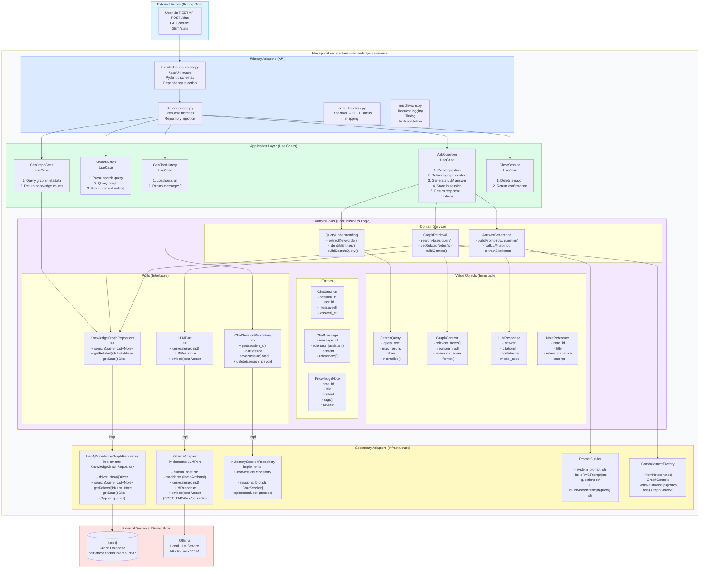
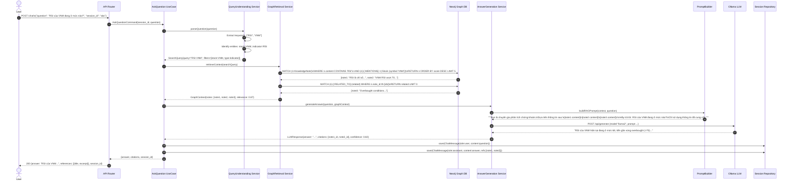
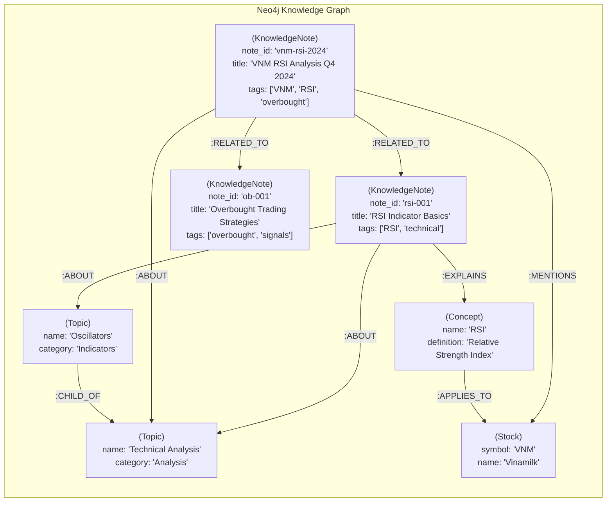
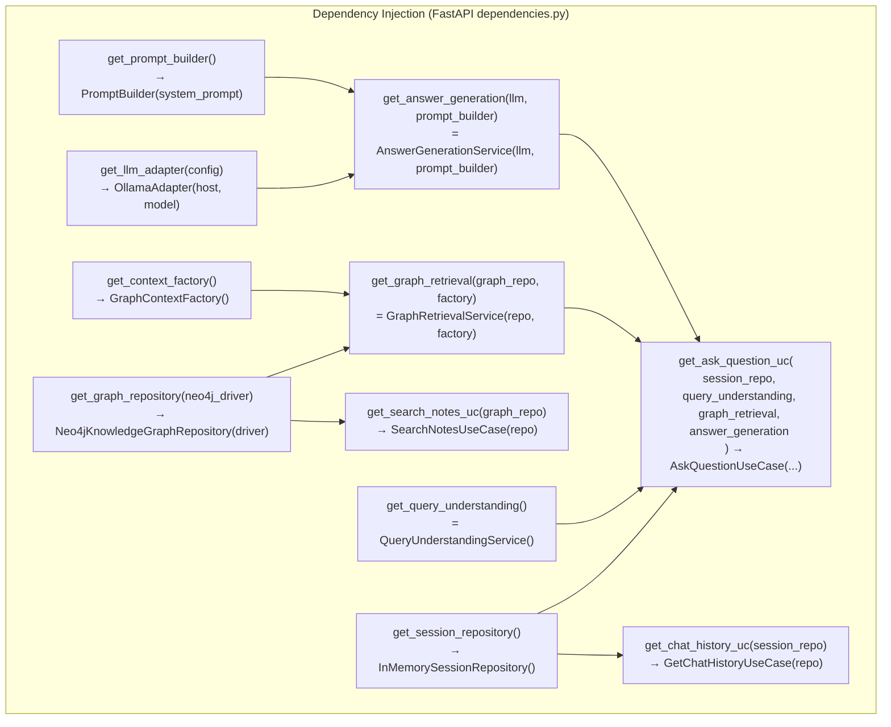

# 11 — Knowledge-QA Service — Deep Dive (DDD + Graph RAG)

## 11.1 Architecture Overview

This service is the most architecturally sophisticated in the platform. It implements full DDD layering with Hexagonal Architecture (Ports & Adapters) and uses Graph RAG (Retrieval-Augmented Generation) for knowledge-grounded Q&A.

---

## 11.2 Graph RAG Pipeline

---

## 11.3 Neo4j Knowledge Graph Structure

---

## 11.4 Dependency Injection Map

