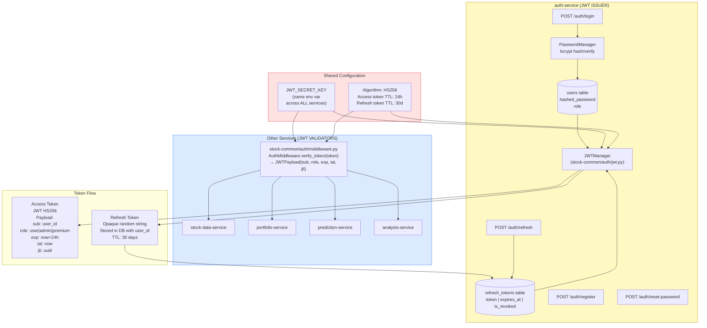
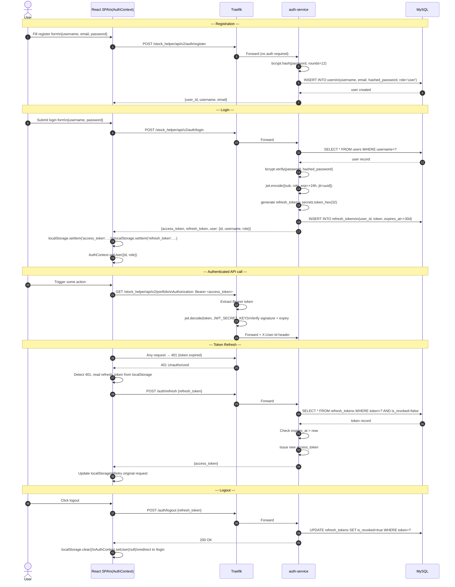
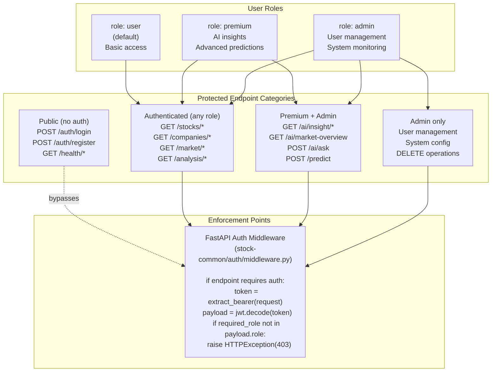
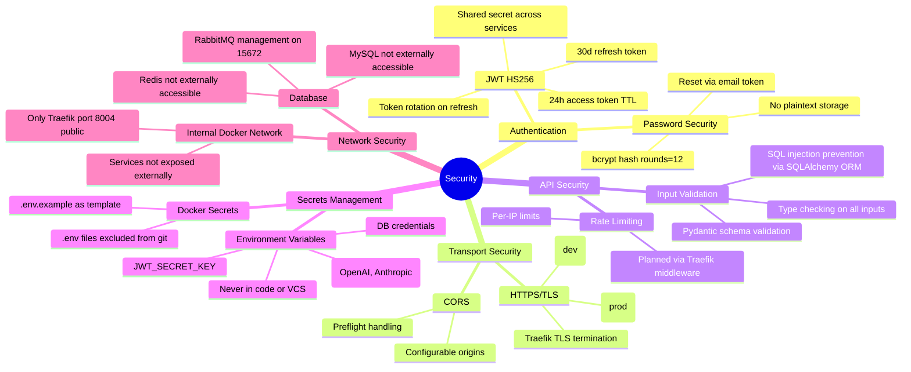

# 12 — Auth & Security Flow

## 12.1 JWT Architecture — Multi-Service Validation

---

## 12.2 Login & Token Lifecycle

---

## 12.3 Role-Based Access Control

---

## 12.4 Security Architecture Overview

